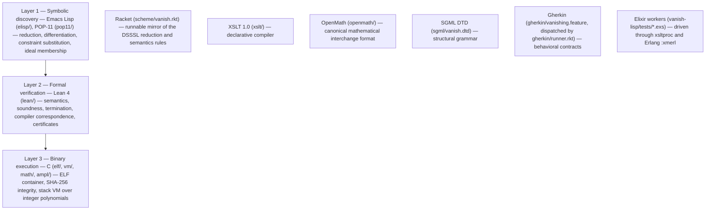
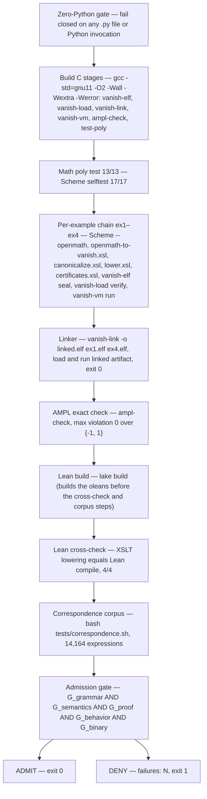
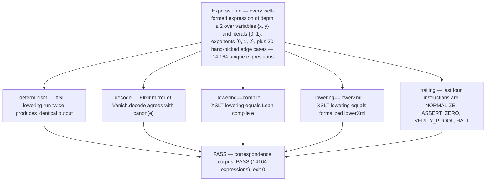
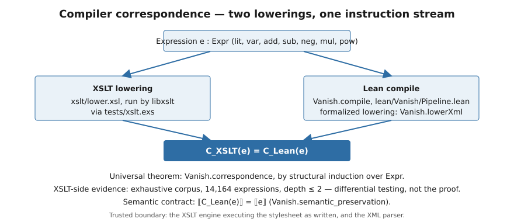
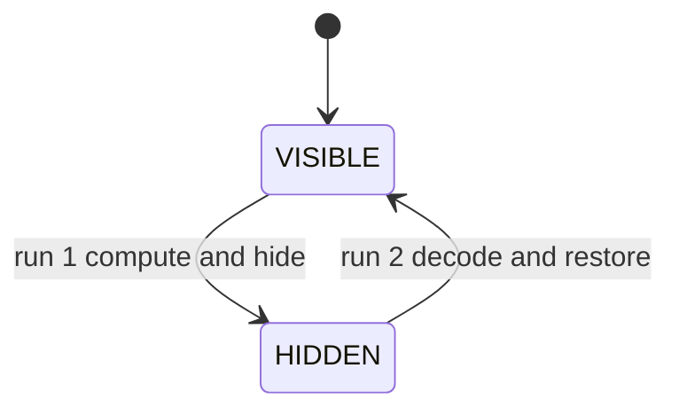
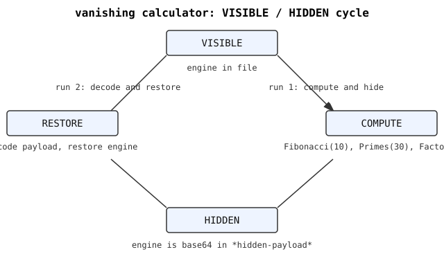
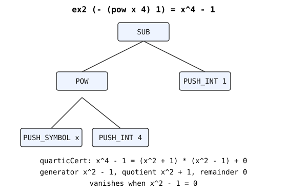
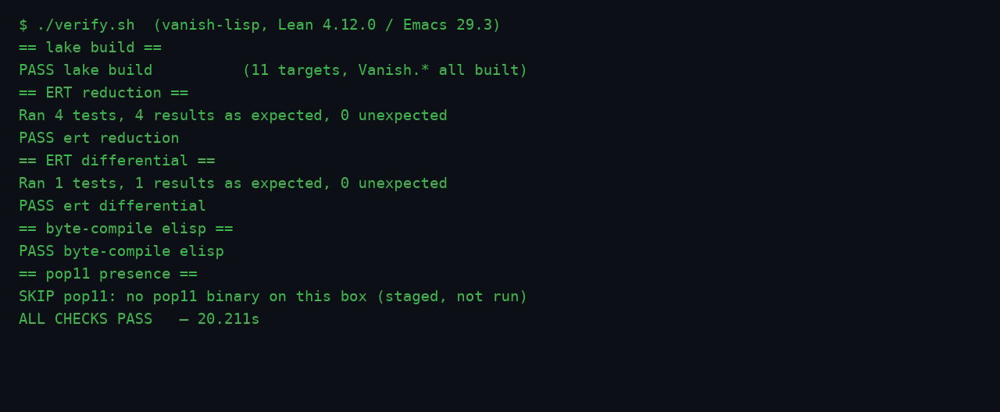
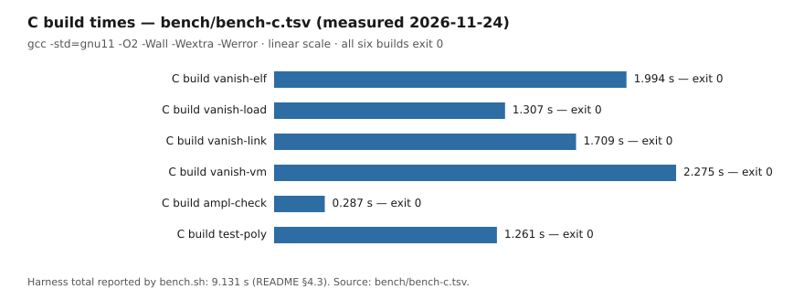

<!--
VANISH-LISP — Copyright (c) 2026 VANISH-LISP Contributors
This program is free software: you can redistribute it and/or modify
it under the terms of the GNU Affero General Public License as published
by the Free Software Foundation, either version 3 of the License, or
(at your option) any later version.

See the LICENSE file for the full text.
-->
# vanishing-calculator

[](https://github.com/AHMADALIPARR/vanishing-calculator/actions/workflows/ci.yml)
[](https://github.com/AHMADALIPARR/vanishing-calculator)
[](https://github.com/AHMADALIPARR/vanishing-calculator)
[](https://github.com/AHMADALIPARR/vanishing-calculator)
[](https://github.com/AHMADALIPARR/vanishing-calculator/blob/main/LICENSE)

Repository: `AHMADALIPARR/vanishing-calculator` (private). Contents: the VANISH-LISP
proof-carrying symbolic vanishing calculus (`vanish-lisp/`) and the self-modifying
vanishing calculator kernels (`vanishing_calculator.lisp` and
`vanish-lisp/vanishing-calculator/`). Zero Python files in the tree. Pipeline
workers are Elixir (`vanish-lisp/tests/*.exs`), driven through `xsltproc` and
Erlang `:xmerl`. License: GNU Affero General Public License v3
(`vanish-lisp/LICENSE`).

Live demo:
https://muse.ai/s/vanishing-calculator-we6xnxxxexx4mxcxw/4bNyU8PHCmTZR6UeND4khGOcmZtOTeSzm50wbu9V2Rc
— the standalone `vanishing_calculator.lisp` running in the page. Run once: prints Fibonacci(10),
Primes(30), Factorial(5), then hides its own engine behind a base64 payload and flips to STATE:
HIDDEN. Run again: the payload decodes, the engine is restored byte-identical (SHA-256
`d8ed5d66a30f4a1f13037272188deeac900bef019d96bde65d4fb6056f4b60fb`).

## Contents

- [1. System Architecture & Execution Pipeline](#1-system-architecture--execution-pipeline)
- [2. Complete Repository File Inventory & Module
  Audit](#2-complete-repository-file-inventory--module-audit)
- [3. Wire Protocols, Schemas & Binary Layouts](#3-wire-protocols-schemas--binary-layouts)
- [4. Authentic Benchmark Suite & Empirical
  Telemetry](#4-authentic-benchmark-suite--empirical-telemetry)
- [5. Build, Verification & Deterministic
  Reproduction](#5-build-verification--deterministic-reproduction)
- [6. Version Control & Commit Lineage](#6-version-control--commit-lineage)
- [7. Known Discrepancies](#7-known-discrepancies)

---

# 1. System Architecture & Execution Pipeline

## 1.1 System definition

VANISH-LISP is a proof-carrying, constraint-driven, document-oriented Lisp dialect for symbolic
vanishing calculus over the integers.

A vanishing assertion is the claim `e = 0` for a polynomial expression `e`; the system decides it by
symbolic reduction, proves it in Lean 4, and seals the compiled program plus a witness certificate
into a relocatable ELF64 object that a stack VM executes and verifies.

Three layers, per `vanish-lisp/ir/contract.md`:

| Layer | Implementation | Role |
|---|---|---|
| Symbolic discovery | Emacs Lisp (`elisp/`), POP-11 (`pop11/`) | Reduction, differentiation, constraint substitution, ideal membership |
| Formal verification | Lean 4 (`lean/`) | Semantics, soundness, termination, compiler correspondence, certificates |
| Binary execution | C (`elf/`, `vm/`, `math/`, `ampl/`) | ELF container, SHA-256 integrity, stack VM over integer polynomials |

The runnable mirror of the DSSSL reduction/semantics rules is Racket
(`scheme/vanish.rkt`); the declarative compiler is XSLT 1.0 (`xslt/`); the
canonical mathematical interchange format is OpenMath (`openmath/`); the
structural grammar is SGML DTD (`sgml/vanish.dtd`); behavioral contracts are
Gherkin (`gherkin/vanishing.feature`, dispatched by `gherkin/runner.rkt`).

## 1.2 End-to-end data flow

```
                         S-expression  (vanish (- x x))
                              |
                              |  scheme/vanish.rkt --openmath
                              v
                    OpenMath  <OMOBJ>  (vanish1 vanishes, arith1 minus)
                              |
                              |  elixir tests/xslt.exs openmath/openmath-to-vanish.xsl
                              v
                    vanish XML  <vanish><expr><sub>...</sub></expr></vanish>
                              |
                              |  elixir tests/xslt.exs xslt/canonicalize.xsl
                              v
                    canonical vanish XML  (whitespace stripped, int/symbol normalized)
                              |
                              |  elixir tests/xslt.exs xslt/lower.xsl
                              v
                    lowered program XML  <program><instruction opcode="..."/>...
                              |
                              |  elixir tests/xslt.exs xslt/certificates.xsl
                              |  (stringparams: ast-uri, ast-hash, program-hash,
                              |   generators, quotients, remainder)
                              v
                    certificate XML  <certificate><target><program><lean>
                                     <witness><hashes>
                              |
                              |  vanish-elf -o ex.elf prog.xml canon.xml cert.xml
                              v
                    ELF64 ET_REL object  .vanish.text / .ast / .proof /
                                         .sym / .hash / .note.vanish
                              |
                              |  vanish-load ex.elf [--dump]
                              v
                    verified image  (ABI version checked, 4 SHA-256 digests recomputed)
                              |
                              |  vanish-vm ex.elf
                              v
                    VM verdict  exit 0 (HALT) / exit 1 (ASSERT_ZERO FAIL: residual ...)
```



## 1.3 Control plane: the admission gate

`tests/run_pipeline.sh` runs the full chain on the four pipeline examples
(`tests/examples/ex1.sexp`–`ex4.sexp`) and applies the admission gate:

```
Admit(M) = G_grammar AND G_semantics AND G_proof AND G_behavior AND G_binary
```

```
  G_grammar ---->|
  G_semantics -->|   all five = 1
  G_proof ------>|   AND FAILURES = 0
  G_behavior --->|        |
  G_binary ----->|        v
                      ADMIT (exit 0)
                 otherwise: DENY (failures: N) (exit 1)
```

| Gate | Check | Implementation |
|---|---|---|
| `G_grammar` | vanish XML validates against the SGML DTD structure | `elixir tests/check_dtd.exs sgml/vanish.dtd ex1.xml ex2.xml ex3.xml ex4.xml` |
| `G_semantics` | OpenMath round-trip preserves the expression | `vanish-to-openmath.xsl` then `openmath-to-vanish.xsl`, `cmp`, `elixir tests/check_om.exs` |
| `G_proof` | `lake build` passes and the Lean certificate check passes | `lake build`, `lake env lean tests/certificates/CertificateTests.lean` |
| `G_behavior` | all Gherkin scenarios pass | `racket gherkin/runner.rkt --root $ROOT --work $WORK gherkin/vanishing.feature` |
| `G_binary` | ELF loader round-trip reconstructs the identical AST and section hashes match | `vanish-load ex.elf --dump`, `elixir tests/check_dump.exs dump canon.xml` |


*Admission gate — `Admit(M) = G_grammar ∧ G_semantics ∧ G_proof ∧
G_behavior ∧ G_binary`. Each `G` is a real check in
`tests/run_pipeline.sh`; a failed `G` prints `DENY` and exits non-zero.*

## 1.4 Pipeline stages (run_pipeline.sh order)

1. Zero-Python gate (fail closed on any `.py` file or Python invocation).
2. Build C stages with `gcc -std=gnu11 -O2 -Wall -Wextra -Werror`:
   `vanish-elf`, `vanish-load`, `vanish-link`, `vanish-vm`, `ampl-check`,
   `test-poly`.
3. Math poly test (13/13), Scheme selftest (17/17).
4. Per-example chain (ex1–ex4): Scheme `--openmath`, `openmath-to-vanish.xsl`,
   Scheme `--xml` direct comparison (`cmp -s`), `canonicalize.xsl`,
   `lower.xsl`, `certificates.xsl` (certificate copied to
   `certificates/exN.cert.xml`), `vanish-elf` seal, `vanish-load` verify,
   `vanish-vm` run with expected exit code per example.
5. Linker: `vanish-link -o linked.elf ex1.elf ex4.elf`; load and run linked
   artifact (exit 0).
6. AMPL exact check (`ampl-check`): max violation 0 over `{-1, 1}`.
7. Lean cross-check: `lake env lean tests/lean-cross-check.lean` output
   compared byte-for-byte against `program_to_text.exs` output for ex1–ex4.
8. Correspondence corpus: `bash tests/correspondence.sh` (14,164 expressions).
9. Admission gate (Section 1.3). Verdict `ADMIT` / `DENY`.

| Stage | Command | Result |
|---|---|---|
| 1. Zero-Python gate | fail closed on any `.py` file or Python invocation | `DENY`, exit 1 on any hit |
| 2. Build C stages | `gcc -std=gnu11 -O2 -Wall -Wextra -Werror` builds `vanish-elf`, `vanish-load`, `vanish-link`, `vanish-vm`, `ampl-check`, `test-poly` | all six binaries built, exit 0 |
| 3. Math poly test, Scheme selftest | math poly test, `vanish.rkt --selftest` | 13/13, 17/17 |
| 4. Per-example chain | Scheme `--openmath`, `openmath-to-vanish.xsl`, Scheme `--xml` comparison, `canonicalize.xsl`, `lower.xsl`, `certificates.xsl`, `vanish-elf` seal, `vanish-load` verify, `vanish-vm` run | ex1–ex4 sealed, loaded, run with expected exit codes |
| 5. Linker | `vanish-link -o linked.elf ex1.elf ex4.elf`, load and run linked artifact | exit 0 |
| 6. AMPL exact check | `ampl-check` | max violation 0 over `{-1, 1}` |
| 7. Lean build | `lake build` | oleans built before the Lean steps |
| 8. Lean cross-check | `lake env lean tests/lean-cross-check.lean` vs `program_to_text.exs` output | byte-identical, 4/4 |
| 9. Correspondence corpus | `bash tests/correspondence.sh` | PASS, 14,164 expressions |
| 10. Admission gate | `Admit(M) = G_grammar ∧ G_semantics ∧ G_proof ∧ G_behavior ∧ G_binary` | `ADMIT` exit 0, or `DENY` exit 1 |




*Pipeline stages as run by `tests/run_pipeline.sh`. The zero-Python gate
runs first (§1.4 step 1) and is not shown as a numbered stage in this
figure. Any stage failure increments `FAILURES` and blocks `ADMIT`.*

Expected VM outcomes per example: ex1 (`x - x`) and ex4 (`x * 0`) pass
`ASSERT_ZERO` (exit 0). ex2 (`x^4 - 1`) fails `ASSERT_ZERO` with residual
`x^4 - 1` (vanishing is conditional on `x^2 - 1 = 0`, via the ideal
certificate). ex3 (`x - y`) fails `ASSERT_ZERO` with residual `x - y`.

## 1.5 The correspondence corpus

`tests/correspondence.exs` differentially tests the XSLT lowering against the Lean compiler and the
formalized lowering.

Corpus: every well-formed expression of depth ≤ 2 over variables `{x, y}` and literals `{0, 1}` with
exponents `{0, 1, 2}` (14,148 expressions: depth 0 = 4, depth 1 = 64, depth 2 = 14,080) plus 30
hand-picked edge cases = 14,164 unique expressions, asserted at runtime (`@expected_total 14_164`).

Per expression, five checks:

| Check | Meaning |
|---|---|
| `determinism` | XSLT lowering run twice produces identical output |
| `decode` | Elixir mirror of `Vanish.decode` agrees with `canon(e)` |
| `lowering==compile` | XSLT lowering equals Lean `compile e` |
| `lowering==lowerXml` | XSLT lowering equals formalized `lowerXml` |
| `trailing` | last four instructions are `NORMALIZE`, `ASSERT_ZERO`, `VERIFY_PROOF`, `HALT` |





*Compiler correspondence — two lowerings, one instruction stream. This
copy corrects one label in
`vanish-lisp/docs/figures/correspondence.svg`, which names the removed
driver `tests/xslt.py` (§7.5); the current driver is `tests/xslt.exs`.*

Mechanism: Racket `scheme/batch-xml.rkt` (one process, S-expressions on
stdin, one vanish XML document per line on stdout); `xsltproc` with
`xslt/canonicalize.xsl` then `xslt/lower.xsl` twice per expression; Lean
batched runs in chunks of 500 (`@chunk_size 500`) via `lake env lean` on
generated batch files importing `Vanish.Pipeline` and `Vanish.Correspondence`.

## 1.6 The self-modifying vanishing calculator

The standalone calculator (`vanishing_calculator.lisp`, SBCL; also
`vanish-lisp/vanishing-calculator/` kernels in PowerShell, Racket, C, POP-11)
is a self-modifying program with a two-state cycle:

```
STATE: VISIBLE
  run 1: print Fibonacci(10), Primes(30), Factorial(5)
         base64-encode the engine section between the
         CALCULATION ENGINE START/END markers into *hidden-payload*
         flip header to STATE: HIDDEN, rewrite own file, exit 0
STATE: HIDDEN
  run 2: decode *hidden-payload*, restore the engine section,
         flip header back to STATE: VISIBLE,
         print "Engine restored. Run again to calculate.", exit 0
```



| Run | State before | What happens | State after | Exit code |
|---|---|---|---|---|
| 1 | VISIBLE | Print Fibonacci(10), Primes(30), Factorial(5); base64-encode the engine section between the CALCULATION ENGINE START/END markers into `*hidden-payload*`; flip the header to STATE: HIDDEN; rewrite own file | HIDDEN | 0 |
| 2 | HIDDEN | Decode `*hidden-payload*`; restore the engine section; flip the header back to STATE: VISIBLE; print "Engine restored. Run again to calculate." | VISIBLE | 0 |



*The VISIBLE / HIDDEN cycle as a static figure: run 1 computes and hides the engine, run 2 decodes and restores it.*

Test vectors: Fibonacci(10) = `[0, 1, 1, 2, 3, 5, 8, 13, 21, 34]`; Primes(30) = `[2, 3, 5, 7, 11,
13, 17, 19, 23, 29]`; Factorial(5) = `120`. The calculator is self-modifying: run it only on scratch
copies, never on originals.

The pristine standalone file SHA-256 is
`d8ed5d66a30f4a1f13037272188deeac900bef019d96bde65d4fb6056f4b60fb`; the in-repo copy is
byte-identical.

The C core (`vanishing_calculator.c`) is an arena Lisp interpreter with a self-modifying `vanish!`
primitive that zeroes a closure body cell in place; first call prints `34 21 13 8 5 3 2 1 1 0`,
second call prints nothing. The POP-11 kernel is staged, not run (no pop11 runtime on the
measurement host).

## 1.7 Hard invariants

1. Zero Python in the tree. No `.py` file, no Python invocation in any
   runnable file (`*.sh`, `*.yml`, `*.exs`, `*.rkt`, `Makefile`). Enforced by
   the fail-closed gate in `run_pipeline.sh`, `verify.sh`, `bench/ci.sh`,
   and the CI `zero-py` job (Section 5.5).
2. `Admit(M)` requires all five gates and zero stage failures.
3. Every certificate names Lean module `Vanish.Certificate`, theorem
   `cert_soundness`.
4. `.vanish.text` size is a multiple of 9 bytes (one 9-byte instruction per
   entry). `vanish_image_load` enforces this.
5. `.note.vanish` ABI version must equal `VANISH_ABI_VERSION` 1; the loader
   rejects any other version.
6. The four hashed sections are exactly `.vanish.text`, `.vanish.ast`,
   `.vanish.proof`, `.vanish.sym`, in that order. `.vanish.hash` and
   `.note.vanish` are not hashed.
7. The writer cross-checks the certificate's `.vanish.ast` hash against the
   SHA-256 of the AST file bytes, and the certificate's `.vanish.text` hash
   against the SHA-256 of the lowered program XML bytes as read (not the
   encoded `.vanish.text` bytes); disagreement refuses to seal.
8. The VM stack is bounded: `STACK_MAX` 1024 polynomial entries;
   overflow/underflow/empty-stack exit 1.
9. Polynomial coefficients are `int64`; overflow is out of range for the
   layer and is not silently wrapped (`math/poly.h`).
10. The Lean development contains no `sorry`/`sorryAx` and no `axiom`
    declarations (13 `#print axioms` checks, all in
    `vanish-lisp/tests/axioms.lean`).
11. Calculator files are run only on scratch copies. The pristine
    `vanishing_calculator.lisp` SHA-256 is
    `d8ed5d66a30f4a1f13037272188deeac900bef019d96bde65d4fb6056f4b60fb`.

## 1.8 Failure and exit-code contracts

| Program | Exit 0 | Exit 1 | Exit 2 |
|---|---|---|---|
| `verify.sh` | `ALL CHECKS PASS` | any check fails (`FAILURES PRESENT`) | — |
| `run_pipeline.sh` | `ADMIT` | `DENY (failures: N)`; zero-Python gate failure | — |
| `correspondence.exs` | corpus PASS / `--one` all five checks PASS | any check fails; corpus FAIL | wrong arity |
| `check_dtd.exs` | all files validate | any file fails validation | wrong arity |
| `check_om.exs` | round-trip identical or `vanishes()` wrapping | neither matches | wrong arity |
| `check_dump.exs` | loader round-trip reconstructs identical AST | AST differs / markers missing | wrong arity |
| `xslt.exs` | transform written to stdout | xsltproc fails | wrong arity / bad parameter |
| `program_to_text.exs` | instruction text printed | (raise on non-`<program>` root or missing `opcode`; exit code UNDETERMINED) | wrong arity |
| `vanish-elf` | `wrote <out>: <n> instructions, <n> symbols` + 4 digests | unreadable input, parse error, certificate digest disagreement, write failure | usage |
| `vanish-load` | `LOAD OK` (+ `OK note:`, `OK hashes:`, `OK instructions:`, `OK symbols:`, `OK ast:`, `OK proof:`) | load/verification failure | usage |
| `vanish-link` | `linked <a> + <b> -> <out>: <n> instructions, <n> symbols` | load failure, module not ending in HALT, bad symbol index, write failure | usage |
| `vanish-vm` | HALT reached | load failure, bad symbol index, out of memory, POW non-constant/negative exponent, `ASSERT_ZERO` failure, `VERIFY_PROOF` failure, unknown opcode, ran off end without HALT, stack overflow/underflow/empty stack | usage |
| `test-poly` | `POLY TEST PASS` (13/13) | `POLY TEST FAIL: <n> failures` | — |
| `ampl-check` | `AMPL check PASS` (max violation 0) | manifold check failure or non-zero max violation | — |
| `gherkin/runner.rkt` | `<N> scenario(s), 0 failed` | any scenario fails | missing `--root`/`--work`/feature |
| `vanish.rkt --selftest` | 17/17 pass | any check fails | usage |
| `ob-lean4-test.el` | `(kill-emacs 0)` after marker lines | (test failure path not stated in file) | — |

Discrepancy: the `vanish-vm.c` header comment states exit 0 requires
`ASSERT_ZERO` and `VERIFY_PROOF` to pass, but the code returns 0 on any HALT
with no flag tracking them (Section 7.4).

---

# 2. Complete Repository File Inventory & Module Audit

Audit source: file-by-file read of the full tree (123 files, 0 unreadable).
Line counts are `wc -l` values. Certificate XML files are single-line files
with no trailing newline, so `wc -l` reports 0; byte sizes are given.
PNG files are binary; `wc -l` does not apply.

## 2.1 Inventory table

| Path | Language / runtime | Lines (wc -l) |
|---|---|---:|
| `vanish-lisp/lean/Vanish.lean` | Lean 4 | 47 |
| `vanish-lisp/lean/Vanish/Certificate.lean` | Lean 4 | 41 |
| `vanish-lisp/lean/Vanish/Correspondence.lean` | Lean 4 | 515 |
| `vanish-lisp/lean/Vanish/Ideals.lean` | Lean 4 | 48 |
| `vanish-lisp/lean/Vanish/Pipeline.lean` | Lean 4 | 193 |
| `vanish-lisp/lean/Vanish/Semantics.lean` | Lean 4 | 42 |
| `vanish-lisp/lean/Vanish/Soundness.lean` | Lean 4 | 70 |
| `vanish-lisp/lean/Vanish/Syntax.lean` | Lean 4 | 49 |
| `vanish-lisp/lean/Vanish/Termination.lean` | Lean 4 | 38 |
| `vanish-lisp/tests/axioms.lean` | Lean 4 | 37 |
| `vanish-lisp/tests/certificates/CertificateTests.lean` | Lean 4 | 37 |
| `vanish-lisp/tests/lean-cross-check.lean` | Lean 4 | 43 |
| `vanish-lisp/lakefile.toml` | TOML (Lake) | 15 |
| `vanish-lisp/lean-toolchain` | Lean toolchain specifier | 1 |
| `vanish-lisp/scheme/vanish.rkt` | Racket | 276 |
| `vanish-lisp/scheme/batch-xml.rkt` | Racket | 32 |
| `vanish-lisp/elisp/grammar.el` | Emacs Lisp | 83 |
| `vanish-lisp/elisp/macros.el` | Emacs Lisp | 64 |
| `vanish-lisp/elisp/reader.el` | Emacs Lisp | 115 |
| `vanish-lisp/elisp/repl.el` | Emacs Lisp | 58 |
| `vanish-lisp/elisp/vanish.el` | Emacs Lisp | 188 |
| `vanish-lisp/pop11/groebner.p` | POP-11 | 90 |
| `vanish-lisp/pop11/normalize.p` | POP-11 | 142 |
| `vanish-lisp/pop11/polynomial.p` | POP-11 | 89 |
| `vanish-lisp/pop11/rewrite.p` | POP-11 | 116 |
| `vanish-lisp/pop11/stack.p` | POP-11 | 79 |
| `vanish-lisp/pop11/vanish.p` | POP-11 | 38 |
| `vanish-lisp/tests/differential/test-differential.el` | Emacs Lisp (ERT) | 22 |
| `vanish-lisp/tests/reduction/test-reduction.el` | Emacs Lisp (ERT) | 40 |
| `vanish-lisp/vanishing-calculator/ob-lean4.el` | Emacs Lisp | 935 |
| `vanish-lisp/vanishing-calculator/ob-lean4-test.el` | Emacs Lisp | 83 |
| `vanish-lisp/vanishing-calculator/vanishing_calculator.rkt` | Racket | 155 |
| `vanish-lisp/elf/abi/ABI.md` | Markdown (spec) | 69 |
| `vanish-lisp/elf/abi/elfio.c` | C | 329 |
| `vanish-lisp/elf/abi/elfio.h` | C header | 49 |
| `vanish-lisp/elf/abi/opcodes.h` | C header | 79 |
| `vanish-lisp/elf/abi/sha256.c` | C | 142 |
| `vanish-lisp/elf/abi/sha256.h` | C header | 37 |
| `vanish-lisp/elf/abi/verify.c` | C | 210 |
| `vanish-lisp/elf/abi/verify.h` | C header | 52 |
| `vanish-lisp/elf/linker/vanish-link.c` | C | 249 |
| `vanish-lisp/elf/loader/vanish-load.c` | C | 65 |
| `vanish-lisp/elf/writer/vanish-elf.c` | C | 420 |
| `vanish-lisp/vm/vanish-vm.c` | C | 252 |
| `vanish-lisp/math/poly.c` | C | 408 |
| `vanish-lisp/math/poly.h` | C header | 80 |
| `vanish-lisp/math/test_poly.c` | C | 140 |
| `vanish-lisp/ampl/check.c` | C | 70 |
| `vanish-lisp/ampl/vanish.mod` | AMPL | 14 |
| `vanish-lisp/xslt/canonicalize.xsl` | XSLT 1.0 | 39 |
| `vanish-lisp/xslt/certificates.xsl` | XSLT 1.0 | 66 |
| `vanish-lisp/xslt/lower.xsl` | XSLT 1.0 | 72 |
| `vanish-lisp/openmath/content-mathml-to-openmath.xsl` | XSLT 1.0 | 86 |
| `vanish-lisp/openmath/omdoc/vanish.omdoc` | OMDoc XML | 131 |
| `vanish-lisp/openmath/openmath-to-vanish.xsl` | XSLT 1.0 | 108 |
| `vanish-lisp/openmath/quartic-mathml.xml` | Content MathML | 24 |
| `vanish-lisp/openmath/quartic.om` | OpenMath XML | 24 |
| `vanish-lisp/openmath/sub-self.om` | OpenMath XML | 19 |
| `vanish-lisp/openmath/vanish-to-openmath.xsl` | XSLT 1.0 | 70 |
| `vanish-lisp/openmath/vanish1.ocd` | OpenMath CD | 45 |
| `vanish-lisp/sgml/grammar.sgml` | SGML | 27 |
| `vanish-lisp/sgml/vanish.dtd` | SGML/XML DTD | 17 |
| `vanish-lisp/dsssl/reduction.dsl` | DSSSL / Scheme | 61 |
| `vanish-lisp/dsssl/semantics.dsl` | DSSSL / Scheme | 53 |
| `vanish-lisp/certificates/ex1.cert.xml` | XML certificate | 0 (826 bytes) |
| `vanish-lisp/certificates/ex2.cert.xml` | XML certificate | 0 (992 bytes) |
| `vanish-lisp/certificates/ex3.cert.xml` | XML certificate | 0 (830 bytes) |
| `vanish-lisp/certificates/ex4.cert.xml` | XML certificate | 0 (825 bytes) |
| `vanish-lisp/ir/contract.md` | Markdown (contract) | 70 |
| `vanish-lisp/ir/grammar.ebnf` | EBNF | 64 |
| `vanish-lisp/tests/check_dtd.exs` | Elixir script | 135 |
| `vanish-lisp/tests/check_dump.exs` | Elixir script | 56 |
| `vanish-lisp/tests/check_om.exs` | Elixir script | 84 |
| `vanish-lisp/tests/correspondence.exs` | Elixir script | 500 |
| `vanish-lisp/tests/program_to_text.exs` | Elixir script | 67 |
| `vanish-lisp/tests/xslt.exs` | Elixir script | 52 |
| `vanish-lisp/tests/correspondence.sh` | Bash | 25 |
| `vanish-lisp/tests/run_pipeline.sh` | Bash | 213 |
| `vanish-lisp/tests/examples/ex1.sexp` | S-expression | 9 |
| `vanish-lisp/tests/examples/ex2.sexp` | S-expression | 9 |
| `vanish-lisp/tests/examples/ex3.sexp` | S-expression | 9 |
| `vanish-lisp/tests/examples/ex4.sexp` | S-expression | 9 |
| `vanish-lisp/tests/algebra/ideal-cases.p` | POP-11 | 18 |
| `vanish-lisp/gherkin/runner.rkt` | Racket | 551 |
| `vanish-lisp/gherkin/vanishing.feature` | Gherkin | 51 |
| `vanish-lisp/verify.sh` | POSIX shell | 77 |
| `vanish-lisp/Makefile` | GNU Make | 30 |
| `README.md` | Markdown | 3,373 |
| `LICENSE` | License text (AGPLv3) | 661 |
| `.gitignore` | gitignore | 15 |
| `.github/workflows/ci.yml` | GitHub Actions YAML | 93 |
| `bench/bench-c.tsv` | TSV (benchmark output) | 8 |
| `bench/bench.sh` | Bash | 46 |
| `bench/ci.sh` | Bash | 55 |
| `visuals/bench-build-times.svg` | SVG | 34 |
| `visuals/correspondence.svg` | SVG | 38 |
| `visuals/expr-tree-ex2.svg` | SVG | 36 |
| `visuals/photo-pipeline.png` | PNG image | binary (141,916 bytes) |
| `visuals/photo-verify.png` | PNG image | binary (81,617 bytes) |
| `visuals/vanish-cycle.svg` | SVG | 44 |
| `vanishing_calculator.lisp` | Common Lisp (SBCL) | 187 |
| `vanish-lisp/.gitignore` | gitignore | 12 |
| `vanish-lisp/LICENSE` | License text (AGPLv3) | 661 |
| `vanish-lisp/LICENSE_HEADER.txt` | Plain text | 8 |
| `vanish-lisp/MANIFEST.sha256` | SHA-256 manifest | 44 |
| `vanish-lisp/MANIFEST.zip.sha256` | SHA-256 manifest | 29 |
| `vanish-lisp/PIPELINE.md` | Markdown | 322 |
| `vanish-lisp/README.md` | Markdown | 639 |
| `vanish-lisp/STATUS.md` | Markdown (status log) | 397 |
| `vanish-lisp/TEST_LOG.txt` | Plain text (test log) | 74 |
| `vanish-lisp/docs/figures/admission.svg` | SVG | 37 |
| `vanish-lisp/docs/figures/benchmarks.svg` | SVG | 53 |
| `vanish-lisp/docs/figures/benchmarks.tsv` | TSV (benchmark data) | 15 |
| `vanish-lisp/docs/figures/correspondence.svg` | SVG | 38 |
| `vanish-lisp/docs/figures/pipeline.svg` | SVG | 55 |
| `vanish-lisp/vanishing-calculator/.gitignore` | gitignore | 10 |
| `vanish-lisp/vanishing-calculator/README.md` | Markdown | 53 |
| `vanish-lisp/vanishing-calculator/STATUS.md` | Markdown (status log) | 103 |
| `vanish-lisp/vanishing-calculator/TEST_LOG.txt` | Plain text (test log) | 160 |
| `vanish-lisp/vanishing-calculator/vanishing_calculator.c` | C (C11/gnu11) | 252 |
| `vanish-lisp/vanishing-calculator/vanishing_calculator.lisp` | Common Lisp (SBCL) | 187 |
| `vanish-lisp/vanishing-calculator/vanishing_calculator.p` | POP-11 | 264 |
| `vanish-lisp/vanishing-calculator/vanishing_calculator.ps1` | PowerShell | 159 |

Totals: 123 files. Text lines: Lean 1,176; Scheme/Elisp/POP-11/Racket
2,605; C/ELF/VM/math/AMPL 2,665; XSLT/OpenMath/SGML/DSSSL/IR/certificates
976; tests/Gherkin/pipeline 1,895; root/bench/CI/docs/calculator 8,162.
Grand total 17,479 text lines plus 2 PNG images.

## 2.2 Per-file breakdown

### 2.2.1 Lean proofs

| File | Lines | Role |
|---|---|---|
| `vanish-lisp/lean/Vanish.lean` | 47 | Top-level library root re-exporting all Vanish modules with example vanishing proofs. |
| `vanish-lisp/lean/Vanish/Certificate.lean` | 41 | Proof-carrying vanishing certificates and their soundness. |
| `vanish-lisp/lean/Vanish/Correspondence.lean` | 515 | Universal compiler correspondence between the formalized XSLT lowering / XML tree and the Lean compiler, plus stack… |
| `vanish-lisp/lean/Vanish/Ideals.lean` | 48 | Polynomial ideal membership and vanishing theorems. |
| `vanish-lisp/lean/Vanish/Pipeline.lean` | 193 | The compiled pipeline in Lean — instruction set, compiler, stack-machine execution, preservation and vanishing… |
| `vanish-lisp/lean/Vanish/Semantics.lean` | 42 | Denotational semantics of VANISH-LISP expressions over ℤ. |
| `vanish-lisp/lean/Vanish/Soundness.lean` | 70 | Soundness of POP-11 symbolic reduction rules. |
| `vanish-lisp/lean/Vanish/Syntax.lean` | 49 | AST, tri-state verdict, and macro calculus for VANISH-LISP. |
| `vanish-lisp/lean/Vanish/Termination.lean` | 38 | Well-founded termination measure for symbolic reduction. |
| `vanish-lisp/tests/axioms.lean` | 37 | Lists the axioms the Phase 1 correspondence theorems depend on, requiring only the standard Lean axioms. |
| `vanish-lisp/tests/certificates/CertificateTests.lean` | 37 | Verified vanishing certificate example for `x^4 - 1`. |
| `vanish-lisp/tests/lean-cross-check.lean` | 43 | Prints the Lean compiler's output for the four pipeline examples for diffing against the XSLT lowering. |
| `vanish-lisp/lakefile.toml` | 15 | Lake package definition for the Vanish Lean library. |
| `vanish-lisp/lean-toolchain` | 1 | Pins the Lean 4 toolchain version for the project. |

### `vanish-lisp/lean/Vanish.lean`

- **Language:** Lean 4.
  **Lines:** 47.
- **Symbols:** `VanishExamples.vanish_sub` (theorem: `vanishes[x - x]`);
  `VanishExamples.vanish_constraint` (theorem: `vanishes[x - y]` given `x = y`);
  `VanishExamples.polynomial_vanish` (theorem: `vanishes[x ^ 4 - 1]` given `x ^ 2 - 1 = 0`).
- **Dependencies:** `Vanish.Syntax`, `Vanish.Semantics`, `Vanish.Soundness`, `Vanish.Termination`,
  `Vanish.Ideals`, `Vanish.Certificate`, `Vanish.Pipeline`, `Vanish.Correspondence`; Lean core.
- **Responsibility:** Top-level library root re-exporting all Vanish modules with example vanishing
  proofs.

### `vanish-lisp/lean/Vanish/Certificate.lean`

- **Language:** Lean 4.
  **Lines:** 41.
- **Symbols:** `Vanish.VanishingCert` (structure: `target`, `generators`, `quotients`, `remainder`);
  `Vanish.ValidCert` (def: quotients/generators lengths equal, remainder `Expr.lit 0`, `eval ρ
  target = sumProd ρ quotients generators` for all `ρ`); `Vanish.cert_soundness` (theorem: valid
  certificate target vanishes whenever all generators vanish).
- **Dependencies:** `Vanish.Ideals`.
- **Responsibility:** Proof-carrying vanishing certificates and their soundness.

### `vanish-lisp/lean/Vanish/Correspondence.lean`

- **Language:** Lean 4.
  **Lines:** 515.
- **Symbols:** `Vanish.XmlTree` (inductive: `int`, `sym`, `add`, `sub`, `mul`, `pow`);
  `Vanish.encode : Expr → XmlTree`; `Vanish.decode : XmlTree → Option Expr`; `Vanish.WellFormed`;
  `Vanish.lowerXml` (formalized XSLT template semantics); `Vanish.lowerProgram` (`lowerXml` plus
  trailing `normalize, assertZero, verifyProof, halt`); `Vanish.canon`; theorems `decode_encode`,
  `compile_canon`, `eval_canon`, `encode_decode`, `lowerXml_encode`, `lowerProgram_encode`,
  `correspondence`, `correspondence_wf`, `compile_deterministic`, `lowerXml_deterministic`;
  `Vanish.size`, `size_pos`; `Vanish.boundedRun`, `boundedRun_none_of_length`, `boundedRun_append`,
  `boundedRun_agree`; `Vanish.stack_safe`, `Vanish.stack_bound`, `Vanish.semantic_preservation`.
- **Dependencies:** `Vanish.Pipeline`; Lean core.
- **Responsibility:** Universal compiler correspondence between the formalized XSLT lowering / XML
  tree and the Lean compiler, plus stack safety and bounded execution.

### `vanish-lisp/lean/Vanish/Ideals.lean`

- **Language:** Lean 4.
  **Lines:** 48.
- **Symbols:** `Vanish.sumProd` (def: linear combination `∑ q_i * g_i`); `Vanish.sumProd_vanishes`
  (theorem); `Vanish.InIdeal` (def: ideal membership witnessed by explicit cofactors);
  `Vanish.vanish_of_ideal_member` (theorem).
- **Dependencies:** `Vanish.Semantics`.
- **Responsibility:** Polynomial ideal membership and vanishing theorems.

### `vanish-lisp/lean/Vanish/Pipeline.lean`

- **Language:** Lean 4.
  **Lines:** 193.
- **Symbols:** `Vanish.Instr` (inductive: `pushSym`, `pushInt`, `dup`, `add`, `sub`, `mul`, `pow`,
  `normalize`, `assertZero`, `verifyProof`, `halt`); `Vanish.instrToText`; `Vanish.compile`;
  `Vanish.step`; `Vanish.run`; theorems `run_append`, `int_toNat_ofNat`, `int_zero_sub`,
  `compile_correct`, `run_tail`, `program_vanishes`, `vanish_of_cert_program`; `Vanish.CDVanishes`;
  `cd_vanishes_iff_semantic`.
- **Dependencies:** `Vanish.Semantics`, `Vanish.Certificate`.
- **Responsibility:** The compiled pipeline in Lean — instruction set, compiler, stack-machine
  execution, preservation and vanishing theorems.

### `vanish-lisp/lean/Vanish/Semantics.lean`

- **Language:** Lean 4.
  **Lines:** 42.
- **Symbols:** `Vanish.Env` (abbrev: `String → Int`); `Vanish.eval`; `Vanish.satisfiesConstraint`;
  `Vanish.satisfies`; `Vanish.SemanticallyVanishes` (def: `Γ ⊨ e = 0`).
- **Dependencies:** `Vanish.Syntax`.
- **Responsibility:** Denotational semantics of VANISH-LISP expressions over ℤ.

### `vanish-lisp/lean/Vanish/Soundness.lean`

- **Language:** Lean 4.
  **Lines:** 70.
- **Symbols:** `Vanish.Step` (inductive: `subSelf`, `subZeroRight`, `negZero`, `mulZeroLeft`,
  `mulZeroRight`, `mulOneLeft`, `mulOneRight`, `addZeroLeft`, `addZeroRight`, `powZero`, `powOne`);
  `Vanish.StepStar` (`refl`, `step`); theorems `soundness_step`, `soundness_star`.
- **Dependencies:** `Vanish.Semantics`.
- **Responsibility:** Soundness of POP-11 symbolic reduction rules.

### `vanish-lisp/lean/Vanish/Syntax.lean`

- **Language:** Lean 4.
  **Lines:** 49.
- **Symbols:** `Vanish.Expr` (inductive: `lit`, `var`, `add`, `sub`, `neg`, `mul`, `pow` with
  exponent `Nat`); `Vanish.Constraint` (`eq`, `neq`); `Vanish.Verdict` (`vanishes`, `nonZero`,
  `undetermined`); `vanishes[term]` macro notation; `vanish_solve` tactic macro (`simp_all | omega |
  decide | rfl`).
- **Dependencies:** none.
- **Responsibility:** AST, tri-state verdict, and macro calculus for VANISH-LISP.

### `vanish-lisp/lean/Vanish/Termination.lean`

- **Language:** Lean 4.
  **Lines:** 38.
- **Symbols:** `Vanish.measure : Expr → Nat`; `Vanish.measure_pos`; `Vanish.termination_step` (every
  reduction step strictly decreases `measure`).
- **Dependencies:** `Vanish.Soundness`.
- **Responsibility:** Well-founded termination measure for symbolic reduction.

### `vanish-lisp/tests/axioms.lean`

- **Language:** Lean 4.
  **Lines:** 37.
- **Symbols:** no `def`/`theorem`/`axiom` declarations; 13 `#print axioms` commands for
  `correspondence`, `correspondence_wf`, `decode_encode`, `encode_decode`, `lowerXml_encode`,
  `lowerProgram_encode`, `compile_deterministic`, `lowerXml_deterministic`, `boundedRun_agree`,
  `stack_safe`, `stack_bound`, `semantic_preservation`, `compile_correct`.
- **Dependencies:** `Vanish.Correspondence`.
- **Responsibility:** Lists the axioms the Phase 1 correspondence theorems depend on, requiring only
  the standard Lean axioms. Line 6 mentions `Classical.choice` and `Quot.sound` (with `propext`)
  only inside a doc comment stating that only the standard Lean axioms are allowed.

### `vanish-lisp/tests/certificates/CertificateTests.lean`

- **Language:** Lean 4.
  **Lines:** 37.
- **Symbols:** `VanishTests.quarticCert : VanishingCert` (witness for `x^4 - 1 = (x^2 + 1) * (x^2 -
  1)`, target `x^4 - 1`, generator `x^2 - 1`, quotient `x^2 + 1`, remainder `0`);
  `VanishTests.quarticCert_valid`.
- **Dependencies:** `Vanish.Certificate`.
- **Responsibility:** Verified vanishing certificate example for `x^4 - 1`.

### `vanish-lisp/tests/lean-cross-check.lean`

- **Language:** Lean 4.
  **Lines:** 43.
- **Symbols:** `VanishTests.showProgram (e : Expr) : IO Unit` (prints the full compiled program, one
  instruction per line via `instrToText`); `#eval` entry points for ex1 `(vanish (- x x))`, ex2 `(-
  (pow x 4) 1)`, ex3 `(- x y)`, ex4 `(* x 0)`.
- **Dependencies:** `Vanish.Pipeline`.
- **Responsibility:** Prints the Lean compiler's output for the four pipeline examples for diffing
  against the XSLT lowering.

### `vanish-lisp/lakefile.toml`

- **Language:** TOML (Lake build configuration).
  **Lines:** 15.
- **Symbols:** package `vanish-lisp`, version `0.1.0`, `defaultTargets: ["Vanish"]`, `[[lean_lib]]`
  name `Vanish`, `srcDir: lean`. No dependencies listed, no leanOptions.
- **Dependencies:** none.
- **Responsibility:** Lake package definition for the Vanish Lean library.

### `vanish-lisp/lean-toolchain`

- **Language:** Lean toolchain specifier (plain text).
  **Lines:** 1.
- **Symbols:** toolchain string `leanprover/lean4:v4.12.0`.
- **Dependencies:** Lean 4 toolchain `leanprover/lean4:v4.12.0`.
- **Responsibility:** Pins the Lean 4 toolchain version for the project.

### 2.2.2 Scheme / Elisp / POP-11 / Racket kernels

| File | Lines | Role |
|---|---|---|
| `vanish-lisp/scheme/vanish.rkt` | 276 | Runnable Racket mirror of the DSSSL reduction/semantics rules that normalizes S-expressions and emits vanish XML and… |
| `vanish-lisp/scheme/batch-xml.rkt` | 32 | Batch S-expression-to-vanish-XML emitter for the correspondence corpus check. |
| `vanish-lisp/elisp/grammar.el` | 83 | Restricted mathematical grammar and AST predicates for VANISH-LISP. |
| `vanish-lisp/elisp/macros.el` | 64 | Core VANISH-LISP primitive macros. |
| `vanish-lisp/elisp/reader.el` | 115 | Translates VANISH-LISP S-expressions into POP-11 tagged lists and Lean 4 syntax. |
| `vanish-lisp/elisp/repl.el` | 58 | Interactive Emacs REPL and buffer evaluation commands for VANISH-LISP expressions. |
| `vanish-lisp/elisp/vanish.el` | 188 | Core Emacs Lisp symbolic vanishing normalizer, differentiation, constraint substitution, and Lean theorem emission. |
| `vanish-lisp/pop11/groebner.p` | 90 | S-polynomials, Buchberger reduction, vanishing certificates. |
| `vanish-lisp/pop11/normalize.p` | 142 | Canonical multivariate polynomial normalizer over sparse grevlex-sorted terms. |
| `vanish-lisp/pop11/polynomial.p` | 89 | Multivariate polynomial division and reduction. |
| `vanish-lisp/pop11/rewrite.p` | 116 | Pattern-matching term rewrite rules for VANISH-LISP. |
| `vanish-lisp/pop11/stack.p` | 79 | Open value stack operations for the VANISH-LISP POP-11 engine. |
| `vanish-lisp/pop11/vanish.p` | 38 | Top-level POP-11 symbolic reduction engine for VANISH-LISP. |
| `vanish-lisp/tests/differential/test-differential.el` | 22 | ERT tests for symbolic differentiation. |
| `vanish-lisp/tests/reduction/test-reduction.el` | 40 | ERT tests for VANISH-LISP reduction, n-ary product normalization, constraints, and serialization. |
| `vanish-lisp/vanishing-calculator/ob-lean4.el` | 935 | Org-babel support for Lean 4, compiling src blocks with `lean --json` (sessions replayed,… |
| `vanish-lisp/vanishing-calculator/ob-lean4-test.el` | 83 | End-to-end batch test for `ob-lean4.el`, printing one marker line per check for the verifier to read. |
| `vanish-lisp/vanishing-calculator/vanishing_calculator.rkt` | 155 | Self-modifying vanishing calculator that hides its calculation engine as a base64 payload on one run and restores it on… |

### `vanish-lisp/scheme/vanish.rkt`

- **Language:** Racket (`#lang racket`), CLI program and library.
  **Lines:** 276.
- **Symbols:** `vanish-sub`, `vanish-mul`, `vanish-add`, `vanish-pow`, `vanish-neg`,
  `vanish-normalize`, `denote`, `vanishes?`, `sexp->xml`, `sexp->openmath` (exported via `provide`);
  internal `fold-constants`, `normalize-add`, `normalize-mul`, `canonical-op`, `xml-escape`,
  `expr->xml-inner`, `expr->openmath`, `read-sexp-file`, `selftest` (17 named checks, returns 0 on
  pass, 1 on failure). CLI (`module+ main`): `--xml in.sexp out.xml`, `--openmath in.sexp out.om`,
  `--normalize in.sexp`, `--selftest`; usage error exits 2.
- **Dependencies:** none (only `#lang racket` standard library; no `require`).
- **Responsibility:** Runnable Racket mirror of the DSSSL reduction/semantics rules that normalizes
  S-expressions and emits vanish XML and OpenMath.

### `vanish-lisp/scheme/batch-xml.rkt`

- **Language:** Racket (`#lang racket`), CLI batch program.
  **Lines:** 32.
- **Symbols:** no exports; `module+ main` reads one S-expression per line from stdin and writes one
  vanish XML document per line to stdout, skipping blank lines, exiting nonzero on an unparseable
  line or rejected expression.
- **Dependencies:** `vanish.rkt` (`sexp->xml`, same directory).
- **Responsibility:** Batch S-expression-to-vanish-XML emitter for the correspondence corpus check.

### `vanish-lisp/elisp/grammar.el`

- **Language:** Emacs Lisp (`lexical-binding: t`).
  **Lines:** 83.
- **Symbols:** `vl-ring-operators` (defconst: `(+ - * pow)`); `vl-core-primitives` (defconst:
  `(vanish reduce normalize under derivative vanish-ideal residue witness seal)`); `vl-symbol-p`,
  `vl-constraint-p`, `vl-expr-p`, `vl-validate-expr`; provides feature `grammar`.
- **Dependencies:** `cl-lib` (Emacs built-in).
- **Responsibility:** Restricted mathematical grammar and AST predicates for VANISH-LISP.

### `vanish-lisp/elisp/macros.el`

- **Language:** Emacs Lisp (`lexical-binding: t`).
  **Lines:** 64.
- **Symbols:** macros `vanish`, `reduce`, `normalize`, `under`, `derivative`, `vanish-ideal`,
  `residue`, `witness`, `seal`; provides feature `macros`.
- **Dependencies:** `vanish` (`vl-eval-form`, `vl-normalize`, `vl-derivative`,
  `vl-apply-constraints`, `vl-vanish-p`, `vl-emit-lean-theorem`), `reader` (`vl-sexp-to-pop11`).
- **Responsibility:** Core VANISH-LISP primitive macros.

### `vanish-lisp/elisp/reader.el`

- **Language:** Emacs Lisp (`lexical-binding: t`).
  **Lines:** 115.
- **Symbols:** `vl-sexp-to-pop11`, `vl-fold-binop-pop11`, `vl-constraint-to-pop11`,
  `vl-sexp-to-lean`, `vl-collect-vars`; provides feature `reader`.
- **Dependencies:** `cl-lib`, `grammar` (`vl-symbol-p`).
- **Responsibility:** Translates VANISH-LISP S-expressions into POP-11 tagged lists and Lean 4
  syntax.

### `vanish-lisp/elisp/repl.el`

- **Language:** Emacs Lisp (`lexical-binding: t`).
  **Lines:** 58.
- **Symbols:** `vanish-repl-buffer-name` (defvar: `"*VANISH-LISP*"`), `vanish-format-verdict`,
  `vanish-eval-expression` (interactive, autoloaded), `vanish-repl` (interactive, autoloaded);
  provides feature `repl`.
- **Dependencies:** `vanish` (`vl-eval-form`, `vl-vanish-p`), `macros`.
- **Responsibility:** Interactive Emacs REPL and buffer evaluation commands for VANISH-LISP
  expressions.

### `vanish-lisp/elisp/vanish.el`

- **Language:** Emacs Lisp (`lexical-binding: t`).
  **Lines:** 188.
- **Symbols:** `vanish-lisp` (defgroup); `vl-pop11-executable` (defcustom, default `"pop11"`);
  `vl-lean-executable` (defcustom, default `"lake"`); `vl-normalize-product`, `vl-normalize`,
  `vl-substitute`, `vl-apply-constraints`, `vl-derivative`, `vl-vanish-p` (tri-state verdict 1 / 0 /
  `bot`), `vl-eval-form`, `vl-emit-lean-theorem`; provides feature `vanish`.
- **Dependencies:** `cl-lib`, `grammar` (`vl-symbol-p`), `reader` (`vl-collect-vars`,
  `vl-sexp-to-lean`); the `vl-pop11-executable` / `vl-lean-executable` variables name external
  `pop11` / `lake` executables but no subprocess call appears in this file.
- **Responsibility:** Core Emacs Lisp symbolic vanishing normalizer, differentiation, constraint
  substitution, and Lean theorem emission.

### `vanish-lisp/pop11/groebner.p`

- **Language:** POP-11.
  **Lines:** 90.
- **Symbols:** `vl_mono_lcm`, `vl_mono_max_var`, `vl_spoly`, `vl_buchberger`,
  `vl_vanishing_certificate` (returns `[cert quotients remainder verdict]`).
- **Dependencies:** `vl_poly_lt`, `vl_mono_div`, `vl_poly_divmod` (`polynomial.p`); `vl_poly_sub`,
  `vl_poly_mul` (`normalize.p`); no `load`/`require` in this file.
- **Responsibility:** S-polynomials, Buchberger reduction, vanishing certificates.

### `vanish-lisp/pop11/normalize.p`

- **Language:** POP-11.
  **Lines:** 142.
- **Symbols:** `vl_mono_mul`, `vl_mono_add_var`, `vl_poly_add`, `vl_poly_insert_term`,
  `vl_poly_neg`, `vl_poly_sub`, `vl_poly_mul`, `vl_poly_pow`, `vl_to_poly`, `vl_normalize_canon`.
- **Dependencies:** none (self-contained; POP-11 built-ins such as `mishap`).
- **Responsibility:** Canonical multivariate polynomial normalizer over sparse grevlex-sorted terms.

### `vanish-lisp/pop11/polynomial.p`

- **Language:** POP-11.
  **Lines:** 89.
- **Symbols:** `vl_mono_divides`, `vl_mono_div`, `vl_poly_lt`, `vl_poly_divmod` (returns `[quotients
  remainder]` with `f = sum(q_i * g_i) + r`).
- **Dependencies:** `vl_poly_add`, `vl_poly_sub`, `vl_poly_mul` (`normalize.p`); no `load`/`require`
  in this file.
- **Responsibility:** Multivariate polynomial division and reduction.

### `vanish-lisp/pop11/rewrite.p`

- **Language:** POP-11.
  **Lines:** 116.
- **Symbols:** `vl_rewrite_step` (one pattern-matching rewrite step:
  `sub`/`neg`/`mul`/`add`/`pow`/`deriv`), `vl_deriv_step`, `vl_rewrite_fixpoint`.
- **Dependencies:** none (self-contained).
- **Responsibility:** Pattern-matching term rewrite rules for VANISH-LISP.

### `vanish-lisp/pop11/stack.p`

- **Language:** POP-11.
  **Lines:** 79.
- **Symbols:** `vl_stack` (global open value stack, initially `[]`), `vl_stack_reset`, `vl_push`,
  `vl_pop` (signals `mishap` on empty stack), `vl_peek`, `vl_dup`, `vl_swap`, `vl_stack_depth`,
  `vl_eval_rpn`.
- **Dependencies:** none (self-contained; POP-11 built-ins such as `mishap`).
- **Responsibility:** Open value stack operations for the VANISH-LISP POP-11 engine.

### `vanish-lisp/pop11/vanish.p`

- **Language:** POP-11.
  **Lines:** 38.
- **Symbols:** `vanish_reduce`, `vanish_eval`; top-level smoke invocations `vanish_reduce([sub x
  x])`, `vanish_reduce([mul 0 x])`, `vanish_reduce([add x 0])` printed with `=>` at load time.
- **Dependencies:** `stack.p`, `rewrite.p`, `normalize.p`, `polynomial.p`, `groebner.p` (loaded via
  `load(...)` at the top, in that order).
- **Responsibility:** Top-level POP-11 symbolic reduction engine for VANISH-LISP.

### `vanish-lisp/tests/differential/test-differential.el`

- **Language:** Emacs Lisp (`lexical-binding: t`), ERT test file.
  **Lines:** 22.
- **Symbols:** `vl-test-derivative-vanishing` (ert-deftest: asserts `(vanish (derivative x (+ (* 0
  x) 7)))` is 0, `(vanish (derivative x y))` is 0, `(vanish (derivative x x))` is 1, `(vanish
  (derivative x (pow x 2)))` is `(* 2 x)`); provides feature `test-differential`.
- **Dependencies:** `ert`, `vanish`, `macros`.
- **Responsibility:** ERT tests for symbolic differentiation.

### `vanish-lisp/tests/reduction/test-reduction.el`

- **Language:** Emacs Lisp (`lexical-binding: t`), ERT test file.
  **Lines:** 40.
- **Symbols:** `vl-test-basic-vanishing`, `vl-test-normalize-nary-product`,
  `vl-test-under-constraints`, `vl-test-serialization` (ert-deftest); provides feature
  `test-reduction`.
- **Dependencies:** `ert`, `vanish`, `macros`.
- **Responsibility:** ERT tests for VANISH-LISP reduction, n-ary product normalization, constraints,
  and serialization.

### `vanish-lisp/vanishing-calculator/ob-lean4.el`

- **Language:** Emacs Lisp (`lexical-binding: t`), Org-babel backend for Lean 4.
  **Lines:** 927. Author Alex Kuleshov, version 0.1.0, GPLv3, URL https://github.com/0xAX/ob-lean.
- **Symbols:** `org-babel-lean4-command-name` (defcustom, default `"lean"`),
  `org-babel-lean4-lake-name` (defcustom, default `"lake"`), `org-babel-default-header-args:lean4`,
  `org-babel-header-args:lean4`, `org-babel-lean4--severity-labels`, `org-babel-lean4--header`,
  `org-babel-lean4--executable`, `org-babel-lean4-var-to-lean4`, `org-babel-lean4--import-lines`,
  `org-babel-lean4--var-lines`, `org-babel-lean4--split-imports`,
  `org-babel-lean4--generated-lines`, `org-babel-lean4--pieces`, `org-babel-expand-body:lean4`,
  `org-babel-lean4--body-line`, `org-babel-lean4--sessions`, `org-babel-lean4--session-name`,
  `org-babel-lean4--session-state`, `org-babel-lean4--block-index`, `org-babel-lean4--block-key`,
  `org-babel-lean4--session-record`, `org-babel-lean4--session-prelude`,
  `org-babel-lean4--import-section`, `org-babel-lean4-clear-session`, `org-babel-lean4--lake-p`,
  `org-babel-lean4--run`, `org-babel-lean4--parse`, `org-babel-lean4--keep-p`,
  `org-babel-lean4--prefix-p`, `org-babel-lean4--render`, `org-babel-lean4--silence-result`,
  `org-babel-lean4--remove-empty-result`, `org-babel-execute:lean4`,
  `org-babel-lean4-edit-directory`, `org-babel-lean4--generated-begin`,
  `org-babel-lean4--generated-end`, `org-babel-lean4--edit-origin`,
  `org-babel-lean4--generated-region`, `org-babel-lean4--toolchain`,
  `org-babel-lean4--edit-directory`, `org-babel-lean4--edit-file-name`,
  `org-babel-lean4--contents-area`, `org-babel-lean4--body-indentation`,
  `org-babel-lean4--common-indentation`, `org-babel-lean4--protect-generated`,
  `org-babel-lean4--edit-body`, `org-babel-lean4--edit-write-back`, `org-babel-lean4--edit-close`,
  `org-babel-lean4-edit-save`, `org-babel-lean4-edit-exit`, `org-babel-lean4-edit-abort`,
  `org-babel-lean4-edit-mode-map`, `org-babel-lean4-edit-mode`, `org-babel-lean4-edit`,
  `org-babel-prep-session:lean4`, `org-babel-lean4-initiate-session`; `lean` aliases
  (`org-babel-execute:lean`, `org-babel-expand-body:lean`, `org-babel-prep-session:lean`); provides
  feature `ob-lean4`.
- **Dependencies:** Emacs `ob`, `org-element`, `org-src`, `seq`, `subr-x`; external `lean` / `lake`
  executables on PATH (or via optional `lean4-mode`); Lean 4 language server via `lean4-mode` for
  editing.
- **Responsibility:** Org-babel support for Lean 4, compiling src blocks with `lean --json`
  (sessions replayed, `:lake`/`:imports`/`:var`/`:prologue`/ `:epilogue` handling) and editing
  blocks in real `.lean` files.

### `vanish-lisp/vanishing-calculator/ob-lean4-test.el`

- **Language:** Emacs Lisp (`lexical-binding: t`), batch end-to-end test script (run with `emacs
  --batch -l ob-lean4-test.el`).
  **Lines:** 83.
- **Symbols:** no defun/defvar/provided feature; top-level script printing one marker line per
  check: `EXEC1`, `EXEC-ERR`, `GENLINES`, `LAKEP`, `TOOLCHAIN`, `SESS1` / `SESS2`, `SESS1-AGAIN`,
  `EDIT-BUF` / `EDIT-CONTENTS` / `ORG-AFTER-EDIT` (or `EDIT-ERROR`). Ends with `(kill-emacs 0)`.
- **Dependencies:** `org`, `ob-lean4` (same directory); `lean` on PATH (elan bin); hard-coded test
  path `/tmp/vc-test/oblean4/edit.org`.
- **Responsibility:** End-to-end batch test for `ob-lean4.el`, printing one marker line per check
  for the verifier to read.

### `vanish-lisp/vanishing-calculator/vanishing_calculator.rkt`

- **Language:** Racket (`#lang racket`), self-modifying CLI program.
  **Lines:** 147. Marked RECONSTRUCTED in its own text (line 6: "RECONSTRUCTED (Muse 2026-11-23):
  requires + str-index helper + main tail"; line 123: "RECONSTRUCTED TAIL (Muse 2026-11-23): main
  body after the banner was cut off in the paste"). Only file in the tree marked RECONSTRUCTED.
- **Symbols:** `script-path`, `anchor`, `mod-ns`, `str-index`, `calc-fibonacci`, `calc-primes`
  (sieve), `calc-factorial`, `make-hidden` (base64-encodes engine section between `CALCULATION
  ENGINE START/END` markers into a `HIDDEN-PAYLOAD` define, flips header to `STATE: HIDDEN`),
  `make-visible`, `main` (invoked unconditionally at the bottom of the file).
- **Dependencies:** Racket `net/base64`, `racket/string`, `racket/file`.
- **Responsibility:** Self-modifying vanishing calculator that hides its calculation engine as a
  base64 payload on one run and restores it on the next.

### 2.2.3 C ELF toolchain, VM, math, AMPL

| File | Lines | Role |
|---|---|---|
| `vanish-lisp/elf/abi/ABI.md` | 69 | Specifies the VANISH-LISP ELF ABI (sections, 9-byte instruction encoding, opcode table, integrity and linking rules). |
| `vanish-lisp/elf/abi/elfio.c` | 329 | Minimal ELF64 little-endian container read/write (section headers, names, bytes) used by the writer, loader, linker and… |
| `vanish-lisp/elf/abi/elfio.h` | 49 | Declares the minimal ELF64 section/file types and read/write/find/free API. |
| `vanish-lisp/elf/abi/opcodes.h` | 79 | Defines the opcode values, section names and note constants exactly once for the writer, loader, linker and VM. |
| `vanish-lisp/elf/abi/sha256.c` | 142 | SHA-256 (FIPS 180-4) as one-shot and streaming digest plus lowercase hex encoding. |
| `vanish-lisp/elf/abi/sha256.h` | 37 | Declares the SHA-256 context type and one-shot/streaming/hex API. |
| `vanish-lisp/elf/abi/verify.c` | 210 | Loads an ELF image, checks the `.note.vanish` ABI version, recomputes and compares the `.vanish.hash` SHA-256 digests,… |
| `vanish-lisp/elf/abi/verify.h` | 52 | Declares the decoded-instruction/image types and the shared load/verify/print/free API for the loader and VM. |
| `vanish-lisp/elf/linker/vanish-link.c` | 249 | Links two ELF modules into one by dropping the first module's trailing HALT, unioning the symbol tables with remapping,… |
| `vanish-lisp/elf/loader/vanish-load.c` | 65 | Loads and verifies an ELF object (ABI version and SHA-256 digests) and optionally dumps its instructions, AST and proof. |
| `vanish-lisp/elf/writer/vanish-elf.c` | 420 | Parses lowered program XML, builds the symbol table in first-use order, encodes `.vanish.text`, checks the certificate… |
| `vanish-lisp/vm/vanish-vm.c` | 252 | Executes the `.vanish.text` stack machine over integer polynomials in normal form, verifying hashes on load and on… |
| `vanish-lisp/math/poly.c` | 408 | Integer polynomial normal-form arithmetic (interned variables, sorted terms, like-term combination, zero dropping) used… |
| `vanish-lisp/math/poly.h` | 80 | Declares the integer polynomial representation (terms sorted by a fixed monomial order, zero polynomial = empty term… |
| `vanish-lisp/math/test_poly.c` | 140 | Standalone test for the polynomial layer, printing PASS/FAIL per check and exiting non-zero on any failure. |
| `vanish-lisp/ampl/check.c` | 70 | Exact integer-arithmetic equivalent of `ampl/vanish.mod`: enumerates x in {-1, 1}, checks x^4 - 1 vanishes there, and… |
| `vanish-lisp/ampl/vanish.mod` | 14 | Specifies the optimization problem: maximize (x^4 - 1)^2 subject to x^2 - 1 = 0. |

### `vanish-lisp/elf/abi/ABI.md`

- **Language:** Markdown prose (specification document, no code).
  **Lines:** 69.
- **Symbols:** specifies sections `.vanish.text`, `.vanish.ast`, `.vanish.proof`, `.vanish.sym`,
  `.vanish.hash`, `.note.vanish`, `.shstrtab`; opcodes PUSH_SYMBOL 0x01, PUSH_INT 0x02, DUP 0x03,
  ADD 0x04, SUB 0x05, MUL 0x06, POW 0x07, NORMALIZE 0x08, ASSERT_ZERO 0x09, VERIFY_PROOF 0x0A, HALT
  0x0B; container ELF64 little-endian relocatable object (ET_REL, EM_X86_64); `.note.vanish` name
  `vanish`, type 1.
- **Dependencies:** none.
- **Responsibility:** Specifies the VANISH-LISP ELF ABI (sections, 9-byte instruction encoding,
  opcode table, integrity and linking rules).

### `vanish-lisp/elf/abi/elfio.c`

- **Language:** C.
  **Lines:** 329.
- **Symbols:** exported `elf_read_file`, `elf_write_file`, `elf_find`, `elf_free` (each returns 0/-1
  where applicable); static `rd16`, `rd32`, `rd64`, `wr16`, `wr32`, `wr64`, `read_all`; macros
  `ELF_MAGIC0` 0x7f, `ELF_MAGIC1` 'E', `ELF_MAGIC2` 'L', `ELF_MAGIC3` 'F', `ELFCLASS64` 2,
  `ELFDATA2LSB` 1, `EV_CURRENT` 1, `ET_REL` 1, `EM_X86_64` 62, `SHT_NULL` 0, `SHT_PROGBITS` 1,
  `SHT_STRTAB` 3, `SHT_NOTE` 7. No `main`.
- **Dependencies:** local header `"elfio.h"`; libc `<stdio.h>`, `<stdlib.h>`, `<string.h>` only.
- **Responsibility:** Minimal ELF64 little-endian container read/write (section headers, names,
  bytes) used by the writer, loader, linker and VM.

### `vanish-lisp/elf/abi/elfio.h`

- **Language:** C header.
  **Lines:** 49.
- **Symbols:** include guard `VANISH_ELFIO_H`; structs `elf_section_t` (`char *name`, `uint32_t
  type`, `uint64_t flags`, `uint8_t *data`, `uint64_t size`), `elf_file_t` (`elf_section_t
  *sections`, `size_t nsections`); declarations `elf_read_file`, `elf_write_file`, `elf_find`,
  `elf_free`.
- **Dependencies:** libc `<stddef.h>`, `<stdint.h>` only.
- **Responsibility:** Declares the minimal ELF64 section/file types and read/write/find/free API.

### `vanish-lisp/elf/abi/opcodes.h`

- **Language:** C header.
  **Lines:** 79.
- **Symbols:** include guard `VANISH_OPCODES_H`; macros `VANISH_ABI_VERSION` 1, `VANISH_INSTR_SIZE`
  9; opcodes `OP_PUSH_SYMBOL` 0x01, `OP_PUSH_INT` 0x02, `OP_DUP` 0x03, `OP_ADD` 0x04, `OP_SUB` 0x05,
  `OP_MUL` 0x06, `OP_POW` 0x07, `OP_NORMALIZE` 0x08, `OP_ASSERT_ZERO` 0x09, `OP_VERIFY_PROOF` 0x0A,
  `OP_HALT` 0x0B; section-name macros `SEC_TEXT`, `SEC_AST`, `SEC_PROOF`, `SEC_SYM`, `SEC_HASH`,
  `SEC_NOTE`, `SEC_SHSTR`; note macros `NOTE_NAME` "vanish", `NT_VANISH_ABI` 1, `NOTE_DESC_SIZE` 16;
  `static inline const char *vanish_op_name(uint8_t op)`.
- **Dependencies:** libc `<stdint.h>` only.
- **Responsibility:** Defines the opcode values, section names and note constants exactly once for
  the writer, loader, linker and VM.

### `vanish-lisp/elf/abi/sha256.c`

- **Language:** C.
  **Lines:** 142.
- **Symbols:** exported `sha256_init`, `sha256_update`, `sha256_final`, `sha256` (one-shot),
  `sha256_hex`; static `k[64]` round-constant table, `sha256_block`; macros `ROTR`, `CH`, `MAJ`,
  `EP0`, `EP1`, `SIG0`, `SIG1`; initial state constants 0x6a09e667, 0xbb67ae85, 0x3c6ef372,
  0xa54ff53a, 0x510e527f, 0x9b05688c, 0x1f83d9ab, 0x5be0cd19. No `main`.
- **Dependencies:** local header `"sha256.h"`; libc `<string.h>`.
- **Responsibility:** SHA-256 (FIPS 180-4) as one-shot and streaming digest plus lowercase hex
  encoding.

### `vanish-lisp/elf/abi/sha256.h`

- **Language:** C header.
  **Lines:** 37.
- **Symbols:** include guard `VANISH_SHA256_H`; macro `SHA256_DIGEST_SIZE` 32; struct `sha256_ctx`
  (`uint32_t state[8]`, `uint64_t bitlen`, `uint8_t data[64]`, `size_t datalen`); declarations
  `sha256_init`, `sha256_update`, `sha256_final`, `sha256`, `sha256_hex`.
- **Dependencies:** libc `<stddef.h>`, `<stdint.h>` only.
- **Responsibility:** Declares the SHA-256 context type and one-shot/streaming/hex API.

### `vanish-lisp/elf/abi/verify.c`

- **Language:** C.
  **Lines:** 210.
- **Symbols:** exported `vanish_verify_hashes` (0 on match, -1 on failure), `vanish_image_load`,
  `vanish_print_instructions`, `vanish_image_free`; static `rd64le`, `check_note`. No `main`.
- **Dependencies:** local headers `"verify.h"`, `"sha256.h"`; libc `<stdlib.h>`, `<string.h>` (plus
  `<stdio.h>` via verify.h).
- **Responsibility:** Loads an ELF image, checks the `.note.vanish` ABI version, recomputes and
  compares the `.vanish.hash` SHA-256 digests, and decodes the instruction stream and symbol table.

### `vanish-lisp/elf/abi/verify.h`

- **Language:** C header.
  **Lines:** 52.
- **Symbols:** include guard `VANISH_VERIFY_H`; structs `vanish_instr_t` (`uint8_t op`, `int64_t
  operand`), `vanish_image_t` (`elf_file_t elf`, `char **syms`, `size_t nsyms`, `vanish_instr_t
  *instrs`, `size_t ninstrs`); declarations `vanish_image_load`, `vanish_verify_hashes`,
  `vanish_print_instructions`, `vanish_image_free`.
- **Dependencies:** local headers `"elfio.h"`, `"opcodes.h"`; libc `<stddef.h>`, `<stdint.h>`,
  `<stdio.h>`.
- **Responsibility:** Declares the decoded-instruction/image types and the shared
  load/verify/print/free API for the loader and VM.

### `vanish-lisp/elf/linker/vanish-link.c`

- **Language:** C (executable, `main`).
  **Lines:** 249.
- **Symbols:** `int main(int argc, char **argv)`; CLI `vanish-link -o out.elf a.elf b.elf` (exactly
  5 arguments; usage error returns 2); static `wr32le`, `free_syms`. Uses `OP_HALT` (both modules
  must end in HALT) and `OP_PUSH_SYMBOL` (operands remapped through the unioned symbol table). Exit
  codes: 2 usage, 1 load failure / missing trailing HALT / bad symbol index / write failure, 0
  success (prints `linked <a> + <b> -> <out>: <n> instructions, <n> symbols`).
- **Dependencies:** local headers `"elfio.h"`, `"opcodes.h"`, `"sha256.h"`, `"verify.h"`; libc
  `<stdio.h>`, `<stdlib.h>`, `<string.h>`.
- **Responsibility:** Links two ELF modules into one by dropping the first module's trailing HALT,
  unioning the symbol tables with remapping, concatenating AST and proof sections, and recomputing
  digests.

### `vanish-lisp/elf/loader/vanish-load.c`

- **Language:** C (executable, `main`).
  **Lines:** 65.
- **Symbols:** `int main(int argc, char **argv)`; CLI `vanish-load file.elf [--dump]` (2 or 3
  arguments; usage error returns 2). Exit codes: 2 usage, 1 load failure, 0 success (prints `OK
  note:`, `OK hashes:`, `OK instructions:`, `OK symbols:`, `OK ast:`, `OK proof:`, `LOAD OK`; with
  `--dump` also prints the instruction list, AST, proof).
- **Dependencies:** local headers `"elfio.h"`, `"opcodes.h"`, `"verify.h"`; libc `<stdio.h>`,
  `<stdlib.h>`, `<string.h>`.
- **Responsibility:** Loads and verifies an ELF object (ABI version and SHA-256 digests) and
  optionally dumps its instructions, AST and proof.

### `vanish-lisp/elf/writer/vanish-elf.c`

- **Language:** C (executable, `main`).
  **Lines:** 420.
- **Symbols:** `int main(int argc, char **argv)`; CLI `vanish-elf -o out.elf program.xml ast.xml
  cert.xml` (exactly 6 arguments; usage error returns 2); static `read_file`, `opcode_number` (maps
  opcode name strings to `OP_PUSH_SYMBOL` … `OP_HALT`, -1 for unknown), `trim_dup`, `parse_program`,
  `cert_hash`, `wr32le`; struct `prog_instr_t` (`uint8_t op`, `int64_t operand`, `char *symbol`).
  Exit codes: 2 usage, 1 failure (unreadable input, parse error, certificate digest disagreement,
  write failure), 0 success (prints `wrote <out>: <n> instructions, <n> symbols` plus the four
  digests).
- **Dependencies:** local headers `"elfio.h"`, `"opcodes.h"`, `"sha256.h"`; libc `<stdio.h>`,
  `<stdlib.h>`, `<string.h>`. Input formats: lowered program XML from `xslt/lower.xsl`, canonical
  AST (vanish XML), certificate XML from `xslt/certificates.xsl`.
- **Responsibility:** Parses lowered program XML, builds the symbol table in first-use order,
  encodes `.vanish.text`, checks the certificate digests against the artifacts, and writes the
  sealed ELF object.

### `vanish-lisp/vm/vanish-vm.c`

- **Language:** C (executable, `main`).
  **Lines:** 252.
- **Symbols:** `int main(int argc, char **argv)`; CLI `vanish-vm file.elf` (exactly 2 arguments;
  usage error returns 2); macro `STACK_MAX` 1024; static `poly_t *stack[STACK_MAX]`, `sp`,
  `stack_push`, `stack_pop`, `stack_top`, `stack_free_all`. Handles all 11 opcodes (values from
  opcodes.h; unknown opcode returns 1). Exit codes: 2 usage, 1 load failure, bad symbol index, out
  of memory, POW non-constant/negative exponent, `ASSERT_ZERO` failure, `VERIFY_PROOF` failure,
  unknown opcode, running off the end without HALT (stack overflow/underflow/empty stack call
  `exit(1)` directly), 0 when HALT is reached.
- **Dependencies:** local headers `"elfio.h"`, `"opcodes.h"`, `"poly.h"`, `"verify.h"`; libc
  `<stdio.h>`, `<stdlib.h>`, `<string.h>`; polynomial arithmetic via poly.c/poly.h.
- **Responsibility:** Executes the `.vanish.text` stack machine over integer polynomials in normal
  form, verifying hashes on load and on `VERIFY_PROOF`. Discrepancy: the file header states exit 0
  requires `ASSERT_ZERO` and `VERIFY_PROOF` to pass; the code returns 0 on any HALT (Section 7.4).

### `vanish-lisp/math/poly.c`

- **Language:** C.
  **Lines:** 408.
- **Symbols:** exported `poly_var_index`, `poly_var_name`, `poly_new`, `poly_free`, `poly_copy`,
  `poly_normalize`, `poly_const`, `poly_var`, `poly_is_zero`, `poly_equal`, `poly_is_const`,
  `poly_add`, `poly_neg`, `poly_sub`, `poly_mul`, `poly_pow`, `poly_to_string`; static macro
  `MAX_VARS` 256, variables `var_names[MAX_VARS]` / `nvars`, functions `factor_cmp`, `mono_degree`,
  `mono_cmp`, `term_cmp_qsort`, `term_free`, `term_copy_into`, `poly_push_term`, `merge_factors`. No
  `main`.
- **Dependencies:** local header `"poly.h"`; libc `<stdio.h>`, `<stdlib.h>`, `<string.h>` (`qsort`
  from stdlib).
- **Responsibility:** Integer polynomial normal-form arithmetic (interned variables, sorted terms,
  like-term combination, zero dropping) used by the VM.

### `vanish-lisp/math/poly.h`

- **Language:** C header.
  **Lines:** 80.
- **Symbols:** include guard `VANISH_POLY_H`; structs `poly_factor_t` (`int var`, `int exp`,
  exponent >= 1), `poly_term_t` (`int64_t coeff`, `poly_factor_t *factors`, `size_t nfactors`),
  `poly_t` (`poly_term_t *terms`, `size_t nterms`, `size_t cap`); declarations for all poly.c
  functions.
- **Dependencies:** libc `<stddef.h>`, `<stdint.h>` only.
- **Responsibility:** Declares the integer polynomial representation (terms sorted by a fixed
  monomial order, zero polynomial = empty term list) and its normal-form arithmetic API.

### `vanish-lisp/math/test_poly.c`

- **Language:** C (executable, `main`).
  **Lines:** 140.
- **Symbols:** `int main(void)`; static `failures`, `check`, `check_str`. Checks (as printed): "x -
  x = 0", "x - x prints 0", "x * 0 = 0", "x * 1 = x", "x + 0 = x", "x^0 = 1", "x^1 = x", "(x+1)^2"
  (expects `"x^2 + 2*x + 1"`), "(x-1)(x+1) = x^2 - 1", "x^2 - 1", "2x + 3x" (expects `"5*x"`), "xy +
  yx" (expects `"2*x*y"`), "2 * 3 is const 6". Exit codes: 0 with `POLY TEST PASS` when `failures ==
  0`, 1 with `POLY TEST FAIL: <n> failures` otherwise.
- **Dependencies:** local header `"poly.h"`; libc `<stdio.h>`, `<stdlib.h>`, `<string.h>`.
- **Responsibility:** Standalone test for the polynomial layer, printing PASS/FAIL per check and
  exiting non-zero on any failure.

### `vanish-lisp/ampl/check.c`

- **Language:** C (executable, `main`).
  **Lines:** 70.
- **Symbols:** `int main(void)`; static `ipow`, static data `feasible[] = {-1, 1}`. Exit codes: 1 if
  any feasible x fails the manifold check `x^2 - 1 == 0` or the maximum violation is non-zero; 0
  with `AMPL check PASS: certified global maximum 0, x^4 - 1 vanishes on S` when the maximum
  violation is 0.
- **Dependencies:** libc `<stdint.h>`, `<stdio.h>` only (no AMPL, no solver library).
- **Responsibility:** Exact integer-arithmetic equivalent of `ampl/vanish.mod`: enumerates x in {-1,
  1}, checks x^4 - 1 vanishes there, and reports the maximum of (x^4 - 1)^2.

### `vanish-lisp/ampl/vanish.mod`

- **Language:** AMPL modeling language (specification for a solver; not executable by itself).
  **Lines:** 14.
- **Symbols:** AMPL declarations, verbatim: `var x;`, `var residual = x^4 - 1;`, `subject to
  manifold: x^2 - 1 = 0;`, `maximize violation: residual^2;`. No functions, structs, macros, CLI
  flags or entry points. No exit codes.
- **Dependencies:** AMPL language/solver (named only by the file's role; no import/include
  statements in the file).
- **Responsibility:** Specifies the optimization problem: maximize (x^4 - 1)^2 subject to x^2 - 1 =
  0.

### 2.2.4 XSLT / OpenMath / SGML / DSSSL / IR / certificates

| File | Lines | Role |
|---|---|---|
| `vanish-lisp/xslt/canonicalize.xsl` | 39 | Semantics-preserving structural canonicalization of vanish XML (strip ignorable whitespace, normalize integer/symbol… |
| `vanish-lisp/xslt/certificates.xsl` | 66 | Emits the certificate XML for one compiled program: target AST, lowered program, Lean certificate reference, witness,… |
| `vanish-lisp/xslt/lower.xsl` | 72 | Declarative compiler lowering from vanish XML to the stack-machine program. |
| `vanish-lisp/openmath/content-mathml-to-openmath.xsl` | 86 | Converts Content MathML to OpenMath. |
| `vanish-lisp/openmath/omdoc/vanish.omdoc` | 131 | OMDoc theory of the vanishing calculus holding the vanishes assertion, the rewrite rules as axioms, and the soundness… |
| `vanish-lisp/openmath/openmath-to-vanish.xsl` | 108 | Converts OpenMath to vanish XML for the polynomial core (arith1 minus/plus/times/power and the vanish1 vanishes… |
| `vanish-lisp/openmath/quartic-mathml.xml` | 24 | Content MathML example instance for the quartic equation x^4 − 1 = 0. |
| `vanish-lisp/openmath/quartic.om` | 24 | OpenMath example instance for the quartic equation x^4 − 1 = 0. |
| `vanish-lisp/openmath/sub-self.om` | 19 | OpenMath example instance for the assertion that x − x vanishes. |
| `vanish-lisp/openmath/vanish-to-openmath.xsl` | 70 | Converts vanish XML to OpenMath (the reverse of openmath-to-vanish.xsl). |
| `vanish-lisp/openmath/vanish1.ocd` | 45 | Defines the vanish1 OpenMath content dictionary with its single symbol `vanishes`. |
| `vanish-lisp/sgml/grammar.sgml` | 27 | SGML grammar document instantiating the vanish DTD with the (vanish (- x x)) example. |
| `vanish-lisp/sgml/vanish.dtd` | 17 | Structural specification (DTD) for the vanish XML language. |
| `vanish-lisp/dsssl/reduction.dsl` | 61 | DSSSL symbolic reduction rules for VANISH-LISP (the Scheme layer of the pipeline). |
| `vanish-lisp/dsssl/semantics.dsl` | 53 | DSSSL denotational mapping rules for VANISH-LISP — what every expression denotes over the integers. |
| `vanish-lisp/certificates/ex1.cert.xml` | 0 | Certificate for x − x, asserting it vanishes with remainder 0 and no generators/quotients. |
| `vanish-lisp/certificates/ex2.cert.xml` | 0 | Certificate for x^4 − 1, asserting it vanishes with generator x^2 − 1, quotient x^2 + 1, and remainder 0. |
| `vanish-lisp/certificates/ex3.cert.xml` | 0 | Certificate for x − y, recording the non-vanishing remainder x − y with no generators/quotients. |
| `vanish-lisp/certificates/ex4.cert.xml` | 0 | Certificate for x * 0, asserting it vanishes with remainder 0 and no generators/quotients. |
| `vanish-lisp/ir/contract.md` | 70 | Cross-language IR and verification contract separating symbolic discovery (Emacs Lisp / POP-11) from formal… |
| `vanish-lisp/ir/grammar.ebnf` | 64 | Defines the S-expression Intermediate Representation (IR) grammar (version 0.1.0) shared by the Emacs Lisp, POP-11, and… |

### `vanish-lisp/xslt/canonicalize.xsl`

- **Language:** XSLT 1.0; output XML, indent no, no XML declaration.
  **Lines:** 39.
- **Symbols:** `xsl:template match="@*|node()"` (identity copy); `xsl:template match="integer"`
  (emits `<integer>` with `number(normalize-space(.))`); `xsl:template match="symbol"` (emits
  `<symbol>` with `normalize-space(.)`). No named templates, no parameters. `xsl:strip-space
  elements="*"`.
- **Dependencies:** none.
- **Responsibility:** Semantics-preserving structural canonicalization of vanish XML (strip
  ignorable whitespace, normalize integer/symbol text) so two spellings of the same expression
  produce the same bytes.

### `vanish-lisp/xslt/certificates.xsl`

- **Language:** XSLT 1.0; output XML, indent no, no XML declaration.
  **Lines:** 66.
- **Symbols:** `xsl:template match="/"` (only template; emits `<certificate>` with `<target>`,
  `<program>`, `<lean>`, `<witness>`, `<hashes>`). Parameters: `ast-uri` (no default), `ast-hash`
  (no default), `program-hash` (no default), `lean-module` (default `Vanish.Certificate`),
  `lean-theorem` (default `cert_soundness`), `generators` (no default), `quotients` (no default),
  `remainder` (default `0`). No named templates.
- **Dependencies:** the AST document loaded at run time via `document($ast-uri)`; the pipeline
  runner, which computes the SHA-256 digests with `sha256sum` and supplies them as parameters (XSLT
  1.0 has no hashing); the ELF writer, which recomputes both digests independently.
- **Responsibility:** Emits the certificate XML for one compiled program: target AST, lowered
  program, Lean certificate reference, witness, and SHA-256 digests of the AST (`.vanish.ast`) and
  program (`.vanish.text`).

### `vanish-lisp/xslt/lower.xsl`

- **Language:** XSLT 1.0; output XML, indent no, no XML declaration.
  **Lines:** 72.
- **Symbols:** `xsl:template match="/"` (emits `<program>`, applies templates, then appends
  `<instruction opcode="NORMALIZE"/>`, `<instruction opcode="ASSERT_ZERO"/>`, `<instruction
  opcode="VERIFY_PROOF"/>`, `<instruction opcode="HALT"/>`); `xsl:template match="vanish|expr"`
  (apply-templates, no output of its own); `xsl:template match="symbol"` (PUSH_SYMBOL);
  `xsl:template match="integer"` (PUSH_INT); `xsl:template match="sub"` (SUB); `xsl:template
  match="add"` (ADD); `xsl:template match="mul"` (MUL); `xsl:template match="pow"` (POW). No named
  templates, no parameters.
- **Dependencies:** none.
- **Responsibility:** Declarative compiler lowering from vanish XML to the stack-machine program.

### `vanish-lisp/openmath/content-mathml-to-openmath.xsl`

- **Language:** XSLT 1.0; output XML, indent no, no XML declaration.
  **Lines:** 86.
- **Symbols:** `xsl:template match="math"` (emits `<OMOBJ>`); `xsl:template match="apply[eq]"`
  (relation1 eq); `xsl:template match="apply[minus]"` (arith1 minus); `xsl:template
  match="apply[plus]"` (arith1 plus); `xsl:template match="apply[times]"` (arith1 times);
  `xsl:template match="apply[power]"` (arith1 power); `xsl:template match="apply[minus and count(*)
  = 2]"` (arith1 unary_minus); `xsl:template match="ci"` (OMV); `xsl:template
  match="cn[@type='real']"` (OMF); `xsl:template match="cn"` (OMI). No named templates, no
  parameters.
- **Dependencies:** none.
- **Responsibility:** Converts Content MathML to OpenMath.

### `vanish-lisp/openmath/omdoc/vanish.omdoc`

- **Language:** OMDoc XML (no XML declaration; no namespace declared).
  **Lines:** 131.
- **Symbols:** root `<omdoc>`; `<theory id="vanish">`; symbols `vanishes`, `reduce`, `normalize`;
  axioms `ax-vanishes`, `ax-subSelf`, `ax-mulZero`, `ax-addZero`, `ax-powOne` (each with
  `<FMP>`/`<OMOBJ>` and `<CMP>`); theorem `th-soundness` with `<FMP>`, `<CMP>`, and
  `<proof><derive><CMP>` citing Lean `Vanish.Soundness.soundness_step`,
  `Vanish.Soundness.soundness_star`, `Vanish.Certificate.cert_soundness`,
  `Vanish.Pipeline.program_vanishes`.
- **Dependencies:** OpenMath CDs vanish1, arith1, relation1; Lean modules/theorems named in the
  proof (cited by name only, not imported).
- **Responsibility:** OMDoc theory of the vanishing calculus holding the vanishes assertion, the
  rewrite rules as axioms, and the soundness theorem whose proof is the Lean verification.

### `vanish-lisp/openmath/openmath-to-vanish.xsl`

- **Language:** XSLT 1.0; output XML, indent no, no XML declaration.
  **Lines:** 108.
- **Symbols:** `xsl:template match="OMOBJ"` (emits `<vanish><expr>`); `xsl:template
  match="OMA[OMS[@cd='vanish1' and @name='vanishes']]"`; `xsl:template
  match="OMA[OMS[@cd='relation1' and @name='eq']]"` (equation read as a vanishing assertion; emits
  `xsl:message`); `xsl:template match="OMA"` (generic catch-all; emits `xsl:message` "unsupported
  application …; dropped"); `xsl:template match="OMA[OMS[@cd='arith1' and @name='minus']]"` (sub);
  `...plus` (add); `...times` (mul); `...power` (pow); `...unary_minus` (sub with integer 0 as first
  operand); `xsl:template match="OMV"` (symbol); `xsl:template match="OMI"` (integer); `xsl:template
  match="OMF|OMBIND|OMBVAR|OMATTR|OMR"` (emits `xsl:message`, dropped). No named templates, no
  parameters.
- **Dependencies:** none.
- **Responsibility:** Converts OpenMath to vanish XML for the polynomial core (arith1
  minus/plus/times/power and the vanish1 vanishes wrapper); constructs with no vanish-grammar
  counterpart are reported with `xsl:message` and dropped.

### `vanish-lisp/openmath/quartic-mathml.xml`

- **Language:** Content MathML XML (no XML declaration; no namespace).
  **Lines:** 24.
- **Symbols:** root `<math>`; `<apply>` containing `<eq/>`, an inner `<apply>` (`<minus/>`,
  `<apply>` (`<power/>`, `<ci>x</ci>`, `<cn>4</cn>`), `<cn>1</cn>`), and `<cn>0</cn>`. The equation
  x^4 − 1 = 0.
- **Dependencies:** none.
- **Responsibility:** Content MathML example instance for the quartic equation x^4 − 1 = 0.

### `vanish-lisp/openmath/quartic.om`

- **Language:** OpenMath XML (no XML declaration; no namespace).
  **Lines:** 24.
- **Symbols:** root `<OMOBJ>`; `<OMA>` with `<OMS cd="relation1" name="eq"/>`, whose arguments are
  an `<OMA>` (arith1 minus of an `<OMA>` (arith1 power, OMV x, OMI 4) and OMI 1) and `<OMI>0</OMI>`.
  `eq(minus(power(x, 4), 1), 0)`.
- **Dependencies:** OpenMath CDs relation1 (eq) and arith1 (minus, power).
- **Responsibility:** OpenMath example instance for the quartic equation x^4 − 1 = 0.

### `vanish-lisp/openmath/sub-self.om`

- **Language:** OpenMath XML (no XML declaration; no namespace).
  **Lines:** 19.
- **Symbols:** root `<OMOBJ>`; `<OMA>` with `<OMS cd="vanish1" name="vanishes"/>`, whose argument is
  an `<OMA>` (arith1 minus, OMV x, OMV x). `vanishes(minus(x, x))`.
- **Dependencies:** OpenMath CDs vanish1 (vanishes) and arith1 (minus).
- **Responsibility:** OpenMath example instance for the assertion that x − x vanishes.

### `vanish-lisp/openmath/vanish-to-openmath.xsl`

- **Language:** XSLT 1.0; output XML, indent no, no XML declaration.
  **Lines:** 70.
- **Symbols:** `xsl:template match="vanish"` (emits `<OMOBJ><OMA>` with `<OMS cd="vanish1"
  name="vanishes"/>`, applies templates to `expr/*[1]`); `xsl:template match="sub"` (arith1 minus);
  `...add` (plus); `...mul` (times); `...pow` (power); `xsl:template match="symbol"` (OMV);
  `xsl:template match="integer"` (OMI). No named templates, no parameters.
- **Dependencies:** none.
- **Responsibility:** Converts vanish XML to OpenMath (the reverse of openmath-to-vanish.xsl).

### `vanish-lisp/openmath/vanish1.ocd`

- **Language:** OpenMath Content Dictionary XML (`.ocd`; no namespace).
  **Lines:** 45.
- **Symbols:** root `<CD>`; CDName `vanish1`; CDURL `https://example.org/cd/vanish1`; CDReviewDate
  2027-11-24; CDDate 2026-11-24; CDStatus `experimental`; CDVersion 1; CDRevision 0; Description
  "Vanishing calculus"; one `<CDDefinition>` with symbol `<Name> vanishes </Name>`, description
  "Asserts that an expression equals zero.", an `<FMP>` (relation1 eq, OMV e, OMI 0), and an
  `<Example>` (vanish1 vanishes of arith1 minus of OMV x and OMV x). Symbols defined: `vanishes`
  only.
- **Dependencies:** OpenMath CDs relation1 (eq) and arith1 (minus), referenced in the FMP and
  Example; CDURL is an example.org placeholder, not a resolvable definition source stated in the
  file.
- **Responsibility:** Defines the vanish1 OpenMath content dictionary with its single symbol
  `vanishes`.

### `vanish-lisp/sgml/grammar.sgml`

- **Language:** SGML document instance (no XML declaration; SGML, not XML).
  **Lines:** 27.
- **Symbols:** `<!DOCTYPE vanish SYSTEM "vanish.dtd">`; root `<vanish>` containing `<expr><sub>`
  with two `<expr><symbol>x</symbol></expr>` children — the (vanish (- x x)) example. No
  ELEMENT/ATTLIST declarations in this file.
- **Dependencies:** `vanish.dtd` (SYSTEM identifier in the DOCTYPE). The file's own header comment
  states there is no SGML parser on the box (no nsgmls) and that the same instance in XML form is
  validated against the DTD structure by `tests/check_dtd.exs` (the audit text records the file as
  naming the former Python helper; the current driver is the Elixir script).
- **Responsibility:** SGML grammar document instantiating the vanish DTD with the (vanish (- x x))
  example.

### `vanish-lisp/sgml/vanish.dtd`

- **Language:** SGML/XML DTD (element declarations with SGML start-tag/end-tag minimization
  indicators `- -`).
  **Lines:** 17.
- **Symbols:** 8 ELEMENT declarations, 0 ATTLIST declarations: `<!ELEMENT vanish - - (expr)>`,
  `<!ELEMENT expr - - (sub|add|mul|pow|symbol|integer)>`, `<!ELEMENT sub - - (expr,expr)>`,
  `<!ELEMENT add - - (expr,expr)>`, `<!ELEMENT mul - - (expr,expr)>`, `<!ELEMENT pow - -
  (expr,expr)>`, `<!ELEMENT symbol - - (#PCDATA)>`, `<!ELEMENT integer - - (#PCDATA)>`.
- **Dependencies:** none.
- **Responsibility:** Structural specification (DTD) for the vanish XML language.

### `vanish-lisp/dsssl/reduction.dsl`

- **Language:** DSSSL / Scheme (ISO/IEC 10179:1996 DSSSL, per the file header; Scheme-style `define`
  forms).
  **Lines:** 61.
- **Symbols:** `vanish-sub`, `vanish-mul`, `vanish-add`, `vanish-pow`, `vanish-neg`,
  `vanish-normalize`. Rules: sub of equal operands → 0; mul with a 0 operand → 0; add with a 0
  operand → the other operand; pow with exponent 0 → 1, exponent 1 → the base; neg of 0 → 0;
  normalize recurses over numbers, symbols, null, and `sub`/`add`/`mul`/`pow`/`-` operator lists.
- **Dependencies:** `scheme/vanish.rkt` (the runnable mirror of these rules, per the header — no
  DSSSL engine / Jade / OpenJade on the box); `pop11/rewrite.p` (the full rewrite set these rules
  cover).
- **Responsibility:** DSSSL symbolic reduction rules for VANISH-LISP (the Scheme layer of the
  pipeline).

### `vanish-lisp/dsssl/semantics.dsl`

- **Language:** DSSSL / Scheme (ISO/IEC 10179:1996 DSSSL).
  **Lines:** 53.
- **Symbols:** `denote` (expr env) — evaluates numbers, symbols via association-list lookup (error
  "denote: unbound symbol" if unbound), empty expression (error), and `add`/`sub`/`mul`/`pow`/`-`
  operator forms (error "denote: unknown operator" otherwise); `vanishes?` (true when `(denote expr
  env)` is 0); `semantically-vanishes?` (true when `(vanish-normalize expr)` equals 0).
  `vanish-normalize` is called by `semantically-vanishes?` but is not defined in this file (defined
  in `reduction.dsl`).
- **Dependencies:** `scheme/vanish.rkt` (runnable mirror; no DSSSL engine on the box);
  `lean/Vanish/Semantics.lean` (the checked version, mirroring `eval`); `vanish-normalize` from
  `reduction.dsl`.
- **Responsibility:** DSSSL denotational mapping rules for VANISH-LISP — what every expression
  denotes over the integers.

### `vanish-lisp/certificates/ex1.cert.xml`

- **Language:** XML certificate document (single line, no trailing newline; no XML declaration).
  **Lines:** 0 (826 bytes).
- **Symbols:** root `<certificate>`; children `<target>`, `<program>`, `<lean>`, `<witness>`,
  `<hashes>`. Target: x − x. Program: PUSH_SYMBOL x, PUSH_SYMBOL x, SUB, NORMALIZE, ASSERT_ZERO,
  VERIFY_PROOF, HALT. Lean: module `Vanish.Certificate`, theorem `cert_soundness`. Witness:
  `<generators/>`, `<quotients/>`, `<remainder>0</remainder>`. Hashes: `.vanish.ast`
  `696ddd60f1a5e26260e2ef0fc0f3a878e0722cece7875e57d907b210ffd23f74`; `.vanish.text`
  `18ece24fa183370080103ddb3491086b1e2184151eddfdaf8275a2f6bb25c2fa`.
- **Dependencies:** none stated in the file (hashes are literal values).
- **Responsibility:** Certificate for x − x, asserting it vanishes with remainder 0 and no
  generators/quotients.

### `vanish-lisp/certificates/ex2.cert.xml`

- **Language:** XML certificate document (single line, no trailing newline; no XML declaration).
  **Lines:** 0 (992 bytes).
- **Symbols:** root `<certificate>`; children `<target>`, `<program>`, `<lean>`, `<witness>`,
  `<hashes>`. Target: x^4 − 1. Program: PUSH_SYMBOL x, PUSH_INT 4, POW, PUSH_INT 1, SUB, NORMALIZE,
  ASSERT_ZERO, VERIFY_PROOF, HALT. Lean: module `Vanish.Certificate`, theorem `cert_soundness`.
  Witness: `<generators>x^2 - 1</generators>`, `<quotients>x^2 + 1</quotients>`,
  `<remainder>0</remainder>`. Hashes: `.vanish.ast`
  `aecf281187d6e958dac7b70f6b3d4eceecf20a40b9e21d88dc8ea61bfea14f70`; `.vanish.text`
  `a9be48c05ea3a8b6cab31d193a0d6e427d84e9e2ec3095129c39bf6013c9e306`.
- **Dependencies:** none stated in the file.
- **Responsibility:** Certificate for x^4 − 1, asserting it vanishes with generator x^2 − 1,
  quotient x^2 + 1, and remainder 0.

### `vanish-lisp/certificates/ex3.cert.xml`

- **Language:** XML certificate document (single line, no trailing newline; no XML declaration).
  **Lines:** 0 (830 bytes).
- **Symbols:** root `<certificate>`; children `<target>`, `<program>`, `<lean>`, `<witness>`,
  `<hashes>`. Target: x − y. Program: PUSH_SYMBOL x, PUSH_SYMBOL y, SUB, NORMALIZE, ASSERT_ZERO,
  VERIFY_PROOF, HALT. Lean: module `Vanish.Certificate`, theorem `cert_soundness`. Witness:
  `<generators/>`, `<quotients/>`, `<remainder>x - y</remainder>`. Hashes: `.vanish.ast`
  `ab964ba9ad4d5a31fe6fea89a836af651eb93bbd80e0fe8bcd9e1e90de93816b`; `.vanish.text`
  `c500356968c6e3a65e2ae4526544d9469ca337d6e4ca39761c52492940cb1183`.
- **Dependencies:** none stated in the file.
- **Responsibility:** Certificate for x − y, recording the non-vanishing remainder x − y with no
  generators/quotients.

### `vanish-lisp/certificates/ex4.cert.xml`

- **Language:** XML certificate document (single line, no trailing newline; no XML declaration).
  **Lines:** 0 (825 bytes).
- **Symbols:** root `<certificate>`; children `<target>`, `<program>`, `<lean>`, `<witness>`,
  `<hashes>`. Target: x * 0. Program: PUSH_SYMBOL x, PUSH_INT 0, MUL, NORMALIZE, ASSERT_ZERO,
  VERIFY_PROOF, HALT. Lean: module `Vanish.Certificate`, theorem `cert_soundness`. Witness:
  `<generators/>`, `<quotients/>`, `<remainder>0</remainder>`. Hashes: `.vanish.ast`
  `0b11f63179d5854bc51c2475a5de546a470489aa20026a6847e4955564e6278e`; `.vanish.text`
  `0baff429c30fe23f7ccaed81fa65a9386bd5d469f0803d0adc843f25c3ca0faf`.
- **Dependencies:** none stated in the file.
- **Responsibility:** Certificate for x * 0, asserting it vanishes with remainder 0 and no
  generators/quotients.

### `vanish-lisp/ir/contract.md`

- **Language:** Markdown contract document.
  **Lines:** 70.
- **Symbols:** sections 1. Overview (three layers: Elisp, POP-11, Lean 4); 2. Serialization Mapping
  (table: integer literal, variable, addition, subtraction, negation, multiplication, power,
  constraint, under, derivative, ideal — each with Emacs Lisp S-exp, POP-11 tagged list, and Lean 4
  `Expr` AST forms); 3. Tri-State Vanishing Semantics (verdicts `1` proven to vanish, `0` proven
  non-vanishing, `bot` undetermined); 4. Formal Verification Contracts (invariants: Soundness,
  Termination, Idempotence, Vanishing Certificate — for ideal membership f in ⟨g1…gm⟩, explicit
  cofactors q1…qm with f = Σ qi·gi, verified by Lean 4).
- **Dependencies:** the three layers it describes and the S-expression IR in `ir/grammar.ebnf`; no
  file is imported or executed by this document.
- **Responsibility:** Cross-language IR and verification contract separating symbolic discovery
  (Emacs Lisp / POP-11) from formal verification (Lean 4).

### `vanish-lisp/ir/grammar.ebnf`

- **Language:** EBNF grammar (ISO/IEC 14977-style `(* … *)` comments).
  **Lines:** 64.
- **Symbols:** 20 productions: `program`, `form`, `vanish-form`, `reduce-form`, `normalize-form`,
  `under-form`, `deriv-form`, `ideal-form`, `residue-form`, `witness-form`, `seal-form`,
  `constraint`, `expr`, `verdict`, `certificate`, `symbol`, `integer`, `nonneg-int`, `letter`,
  `digit`. Header: "VANISH-LISP Common Intermediate Representation (S-expression IR)", "Version:
  0.1.0". `program = { form }`; `expr` is integer, symbol, `(+ …)`, `(- …)` (one or two operands),
  `(* …)`, `(pow … nonneg-int)`, under-form, or deriv-form; `certificate` is `(cert (target expr)
  (generators {expr}) (quotients {expr}) (remainder expr) (verdict verdict))`; `verdict` is `"1" |
  "0" | "bot"`.
- **Dependencies:** none.
- **Responsibility:** Defines the S-expression Intermediate Representation (IR) grammar (version
  0.1.0) shared by the Emacs Lisp, POP-11, and Lean layers, including the certificate IR.

### 2.2.5 Tests, Gherkin, pipeline scripts

| File | Lines | Role |
|---|---|---|
| `vanish-lisp/tests/check_dtd.exs` | 135 | Validate vanish XML documents against the ELEMENT content models parsed from the SGML DTD (the G_grammar gate). |
| `vanish-lisp/tests/check_dump.exs` | 56 | Check that the ELF loader's `--dump` AST section, stripped, equals the canonical vanish XML (part of the G_binary gate). |
| `vanish-lisp/tests/check_om.exs` | 84 | Check an OpenMath round-trip is either identical to the original or the `vanishes()` wrapping of it (part of the… |
| `vanish-lisp/tests/correspondence.exs` | 500 | Exhaustively differentially test the XSLT lowering against the Lean compiler and the formalized lowering over every… |
| `vanish-lisp/tests/program_to_text.exs` | 67 | Render a lowered program XML as instruction text, one instruction per line, in the same form Lean's `instrToText`… |
| `vanish-lisp/tests/xslt.exs` | 52 | Drive an XSLT 1.0 stylesheet through libxslt via xsltproc and write the result to stdout. |
| `vanish-lisp/tests/correspondence.sh` | 25 | Run the exhaustive correspondence corpus check and report its verdict. |
| `vanish-lisp/tests/run_pipeline.sh` | 213 | Run the full end-to-end pipeline on the four examples and apply the admission gate `Admit(M) = G_grammar AND… |
| `vanish-lisp/tests/examples/ex1.sexp` | 9 | Pipeline example 1 — `x - x`, which vanishes identically (expected VM outcome: passes ASSERT_ZERO, exit 0). |
| `vanish-lisp/tests/examples/ex2.sexp` | 9 | Pipeline example 2 — `x^4 - 1`, whose vanishing is conditional on `x^2 - 1 = 0` via the ideal certificate (expected… |
| `vanish-lisp/tests/examples/ex3.sexp` | 9 | Pipeline example 3 — `x - y`, which does not vanish (expected VM outcome: fails ASSERT_ZERO with residual `x - y`). |
| `vanish-lisp/tests/examples/ex4.sexp` | 9 | Pipeline example 4 — `x * 0`, which vanishes by a rewrite rule (expected VM outcome: passes ASSERT_ZERO, exit 0). |
| `vanish-lisp/tests/algebra/ideal-cases.p` | 18 | POP-11 ideal-membership test cases for the vanish evaluator and canonical normalizer. |
| `vanish-lisp/gherkin/runner.rkt` | 551 | Parse a Gherkin `.feature` file and dispatch each step to a real pipeline stage, reporting pass/fail per scenario. |
| `vanish-lisp/gherkin/vanishing.feature` | 51 | Specify the four Gherkin scenarios for the vanishing calculus: vanishing under constraints, unresolved obligation, ELF… |
| `vanish-lisp/verify.sh` | 77 | Verify the vanish-lisp tree by running the Lean build, the Elisp ERT suites, and the Elisp byte-compile check, exiting… |
| `vanish-lisp/Makefile` | 30 | Standard build/test entry points for the Elisp suites, the POP-11 ideal cases, and the Lean build. |

### `vanish-lisp/tests/check_dtd.exs`

- **Language:** Elixir script (`#!/usr/bin/env elixir`), module `CheckDtd`.
  **Lines:** 135.
- **Symbols:** entry point `CheckDtd.main(System.argv())`; usage `elixir tests/check_dtd.exs
  sgml/vanish.dtd FILE.xml [FILE.xml ...]` (no named flags; first positional arg is the DTD path,
  remaining args are XML files). Functions: `main/1`, `usage_error/0`, `parse_dtd/1`,
  `parse_model/1`, `validate_file/2`, `validate_element/3`, `validate_model/3`,
  `element_children/1`. Exit codes: 0 on success (prints `check_dtd: all N file(s) validate against
  <dtd_path>`); 1 if any file fails validation (each failure to stderr as `FAIL: <file>: <reason>`);
  2 on wrong arity.
- **Dependencies:** Elixir runtime; Erlang `:xmerl_scan` (`:xmerl_scan.string/1`); the DTD file
  passed as argument (e.g. `sgml/vanish.dtd`). No other external binaries.
- **Responsibility:** Validate vanish XML documents against the ELEMENT content models parsed from
  the SGML DTD (the G_grammar gate).

### `vanish-lisp/tests/check_dump.exs`

- **Language:** Elixir script (`#!/usr/bin/env elixir`), module `CheckDump`.
  **Lines:** 56.
- **Symbols:** entry point `CheckDump.main(System.argv())`; usage `elixir tests/check_dump.exs DUMP
  CANON.xml` (exactly two positional args, no flags). Functions: `main/1`, `usage_error/0`,
  `extract_ast/1`. Exit codes: 0 on success (prints `check_dump: loader round-trip reconstructs the
  identical AST`); 1 if the dumped AST differs from the canonical XML or the dump lacks the `--- ast
  ---` / `--- proof ---` markers (diagnostic to stderr); 2 on wrong arity.
- **Dependencies:** Elixir runtime only (stdlib `File`, `String`); no external binaries.
- **Responsibility:** Check that the ELF loader's `--dump` AST section, stripped, equals the
  canonical vanish XML (part of the G_binary gate).

### `vanish-lisp/tests/check_om.exs`

- **Language:** Elixir script (`#!/usr/bin/env elixir`), module `CheckOm`.
  **Lines:** 84.
- **Symbols:** entry point `CheckOm.main(System.argv())`; usage `elixir tests/check_om.exs
  ROUNDTRIP.om ORIGINAL.om` (exactly two positional args, no flags). Functions: `main/1`,
  `usage_error/0`, `parse/1`, `normalize/1` (three clauses), `vanishes_wrapping?/2` (two clauses).
  Exit codes: 0 on success (prints `check_om: round-trip OpenMath is identical` or `check_om:
  round-trip OpenMath is the vanishes() wrapping`); 1 if the round-trip matches neither the original
  nor its `vanishes()` wrapping (diagnostic to stderr); 2 on wrong arity.
- **Dependencies:** Elixir runtime; Erlang `:xmerl_scan`; no other external binaries.
- **Responsibility:** Check an OpenMath round-trip is either identical to the original or the
  `vanishes()` wrapping of it (part of the G_semantics gate).

### `vanish-lisp/tests/correspondence.exs`

- **Language:** Elixir script (`#!/usr/bin/env elixir`), module `Correspondence`.
  **Lines:** 500.
- **Symbols:** entry point `Correspondence.main(System.argv())`; usage `elixir
  tests/correspondence.exs` (full corpus) and `elixir tests/correspondence.exs --one SEXPR` (one
  expression). Functions: `main/1`, `usage_error/0`, `pass/2`, `corpus/0`, `depth_one/1`,
  `depth_two/2`, `depth/1`, `edge_cases/0`, `render_sexp/1`, `parse_sexp/1`, `tokenize/1`,
  `parse_tokens/1`, `parse_args/2`, `parse_atom/1`, `build/2`, `canon/1`, `check_all/1`,
  `check_one/1`, `checks_for/6`, `trailing_ok?/1`, `print_checks/1`, `emit_xml/2`, `shell_quote/1`,
  `lower_all/2`, `xslt/3`, `lean_all/2`, `lean_batch/1`, `lean_expr/1`, `parse_lean_batch/2`,
  `parse_xml_tree/1`, `xml_to_tree/1`, `text_of/1`, `element_children/1`, `decode/1`,
  `program_text/1`, `root_dir/0`. Module attributes: `@chunk_size 500`, `@expected_total 14_164`.
  Exit codes: 0 on success (full mode prints `correspondence corpus: PASS (14164 expressions)`); 1
  when any check fails (full mode prints `correspondence corpus: FAIL (N failing expressions)` to
  stderr plus up to 5 failing expressions; `--one` mode halts 1); 2 on wrong arity. The corpus
  raises (non-zero, exact exit code UNDETERMINED) if the corpus does not contain exactly 14,164
  unique expressions. Five per-expression checks: `determinism`, `decode`, `compile`
  (lowering==compile), `lower_xml` (lowering==lowerXml), `trailing` (last four lines `NORMALIZE`,
  `ASSERT_ZERO`, `VERIFY_PROOF`, `HALT`).
- **Dependencies:** Elixir runtime; `racket` (found via `System.find_executable("racket")`, runs
  `scheme/batch-xml.rkt` with the expression list on stdin via `sh -c`); `xsltproc` (found via
  `System.find_executable`, runs `xslt/canonicalize.xsl` then `xslt/lower.xsl` twice per
  expression); `lake` (found via `System.find_executable`, runs `lake env lean` on generated batch
  files importing `Vanish.Pipeline` and `Vanish.Correspondence`); Erlang `:xmerl_scan` for XML
  parsing.
- **Responsibility:** Exhaustively differentially test the XSLT lowering against the Lean compiler
  and the formalized lowering over every well-formed expression of depth ≤ 2 over variables {x, y}
  and literals {0, 1} with exponents {0, 1, 2} (14,148 expressions) plus 30 hand-picked edge cases
  (14,164 total).

### `vanish-lisp/tests/program_to_text.exs`

- **Language:** Elixir script (`#!/usr/bin/env elixir`), module `ProgramToText`.
  **Lines:** 67.
- **Symbols:** entry point `ProgramToText.main(System.argv())`; usage `elixir
  tests/program_to_text.exs PROGRAM.xml` (exactly one positional arg, no flags). Functions:
  `main/1`, `usage_error/0`, `instructions/1` (two clauses), `attr/2`, `text_content/1`. Exit codes:
  0 on success (prints one instruction per line, `OP` or `OP operand`); 2 on wrong arity (usage to
  stderr). If the root element is not `<program>` it raises `"program_to_text: root element is not
  <program>"`, and if an `<instruction>` lacks an `opcode` attribute it raises; the exit code of a
  raise is UNDETERMINED from this file.
- **Dependencies:** Elixir runtime; Erlang `:xmerl_scan`; no other external binaries.
- **Responsibility:** Render a lowered program XML as instruction text, one instruction per line, in
  the same form Lean's `instrToText` prints.

### `vanish-lisp/tests/xslt.exs`

- **Language:** Elixir script (`#!/usr/bin/env elixir`), module `Xslt`.
  **Lines:** 52.
- **Symbols:** entry point `Xslt.main(System.argv())`; usage `elixir tests/xslt.exs STYLESHEET INPUT
  [name=value ...]` (two positional args plus zero or more `name=value` stylesheet parameters, no
  other flags). Functions: `main/1`, `usage_error/1`. Each `name=value` parameter is passed to
  xsltproc as `--stringparam name value`; a parameter without `=` triggers usage error `bad
  parameter <param> (want name=value)`. Exit codes: 0 on success (transform result written to stdout
  as binary); 1 when xsltproc fails (xsltproc output to stderr plus `xslt.exs: xsltproc failed (exit
  <code>)`); 2 on wrong arity or bad parameter.
- **Dependencies:** Elixir runtime; `xsltproc` binary (invoked via `System.cmd("xsltproc", ...)`);
  the stylesheet and input files passed as arguments.
- **Responsibility:** Drive an XSLT 1.0 stylesheet through libxslt via xsltproc and write the result
  to stdout.

### `vanish-lisp/tests/correspondence.sh`

- **Language:** Bash script (`#!/bin/bash`).
  **Lines:** 25.
- **Symbols:** no functions; no flags of its own — all arguments are forwarded verbatim (`"$@"`) to
  `tests/correspondence.exs`. Commands, in order: (1) sets `ROOT` to the parent directory of the
  script's directory; (2) prepends `$HOME/.elan/bin` to `PATH`; (3) exports
  `ELIXIR_ERL_OPTIONS="+fnu"`; (4) `exec elixir "$ROOT/tests/correspondence.exs" "$@"`. Exit code:
  UNDETERMINED from this file alone (it `exec`s elixir, so the exit code is elixir's; the header
  states it "exits non-zero on any mismatch", which is the behaviour of `correspondence.exs` halting
  1).
- **Dependencies:** `elixir` (via `$HOME/.elan/bin` on PATH); `tests/correspondence.exs`.
- **Responsibility:** Run the exhaustive correspondence corpus check and report its verdict.

### `vanish-lisp/tests/run_pipeline.sh`

- **Language:** Bash script (`#!/bin/bash`).
  **Lines:** 213.
- **Symbols:** no CLI flags parsed (no usage line in the file). Internal shell functions: `say/0`,
  `note/0`, `fail/0` (increments `FAILURES`), `check/0` (`check DESCRIPTION COMMAND...`, runs the
  command logging to `$WORK/last.log`, notes `ok: <desc>` or fails with `FAIL: <desc> (see
  $WORK/last.log)` plus the first 10 log lines). Variables: `ROOT` (parent of script dir),
  `WORK="$ROOT/tests/.pipeline-work"`, `RACKET="$HOME/workspace/.tools/racket/bin/racket"`, `PATH`
  extended with the Racket and elan bin dirs, `ELIXIR_ERL_OPTIONS="+fnu"`, `FAILURES=0`, gate flags
  `G_GRAMMAR`, `G_SEMANTICS`, `G_PROOF`, `G_BEHAVIOR`, `G_BINARY` (each 1/0). Stages: (1)
  zero-Python gate; (2) C builds with `gcc -std=gnu11 -O2 -Wall -Wextra -Werror`; (3) math poly test
  13/13, Scheme selftest 17/17; (4) per-example loop over ex1–ex4 (Scheme `--openmath`, `xslt.exs
  openmath-to-vanish.xsl`, Scheme `--xml` direct `cmp`, `canonicalize.xsl`, `lower.xsl`,
  `certificates.xsl` with stringparams `ast-uri`, `ast-hash`, `program-hash`, `generators`,
  `quotients`, `remainder` — ex1 `GEN="" QUOT="" REM="0"`, ex2 `GEN="x^2 - 1" QUOT="x^2 + 1"
  REM="0"`, ex3 `GEN="" QUOT="" REM="x - y"`, ex4 `GEN="" QUOT="" REM="0"`; certificate copied to
  `certificates/$ex.cert.xml`; `vanish-elf` seal; `vanish-load` verify; `vanish-vm` run with
  expected exit code: ex1/ex4 exit 0, ex2 non-zero with `ASSERT_ZERO FAIL: residual x^4 - 1`, ex3
  non-zero with `ASSERT_ZERO FAIL: residual x - y`); (5) linker `vanish-link -o linked.elf ex1.elf
  ex4.elf`, load and run linked artifact expecting exit 0; (6) AMPL check; (7) Lean cross-check
  (`lake env lean tests/lean-cross-check.lean` vs `program_to_text.exs` output, `cmp -s`); (8)
  correspondence corpus (`bash tests/correspondence.sh`); (9) admission gate; (10) verdict: prints
  `ADMIT` and exits 0 if `FAILURES` is 0 and all five G flags are 1, otherwise prints `DENY
  (failures: $FAILURES)` and exits 1.
- **Dependencies:** `bash`, `gcc`, `racket`, `elixir`, `lake`/`lean`, `sha256sum`, `cmp`, `diff`,
  `grep`, `sed`, `head`, `find`, `cut`; scripts `tests/xslt.exs`, `tests/check_dtd.exs`,
  `tests/check_om.exs`, `tests/check_dump.exs`, `tests/program_to_text.exs`,
  `tests/correspondence.sh`, `gherkin/runner.rkt`; sources under `elf/`, `vm/`, `math/`, `ampl/`,
  `scheme/`, `xslt/`, `openmath/`, `sgml/`, `tests/certificates/`, `tests/lean-cross-check.lean`.
- **Responsibility:** Run the full end-to-end pipeline on the four examples and apply the admission
  gate `Admit(M) = G_grammar AND G_semantics AND G_proof AND G_behavior AND G_binary`, printing
  ADMIT or DENY.

### `vanish-lisp/tests/examples/ex1.sexp`

- **Language:** S-expression (Scheme/Lisp surface syntax, data file).
  **Lines:** 9.
- **Symbols:** none. Exact expression: `(vanish (- x x))`.
- **Dependencies:** none.
- **Responsibility:** Pipeline example 1 — `x - x`, which vanishes identically (expected VM outcome:
  passes ASSERT_ZERO, exit 0).

### `vanish-lisp/tests/examples/ex2.sexp`

- **Language:** S-expression (Scheme/Lisp surface syntax, data file).
  **Lines:** 9.
- **Symbols:** none. Exact expression: `(- (pow x 4) 1)`.
- **Dependencies:** none.
- **Responsibility:** Pipeline example 2 — `x^4 - 1`, whose vanishing is conditional on `x^2 - 1 =
  0` via the ideal certificate (expected VM outcome: fails ASSERT_ZERO with residual `x^4 - 1`).

### `vanish-lisp/tests/examples/ex3.sexp`

- **Language:** S-expression (Scheme/Lisp surface syntax, data file).
  **Lines:** 9.
- **Symbols:** none. Exact expression: `(- x y)`.
- **Dependencies:** none.
- **Responsibility:** Pipeline example 3 — `x - y`, which does not vanish (expected VM outcome:
  fails ASSERT_ZERO with residual `x - y`).

### `vanish-lisp/tests/examples/ex4.sexp`

- **Language:** S-expression (Scheme/Lisp surface syntax, data file).
  **Lines:** 9.
- **Symbols:** none. Exact expression: `(* x 0)`.
- **Dependencies:** none.
- **Responsibility:** Pipeline example 4 — `x * 0`, which vanishes by a rewrite rule (expected VM
  outcome: passes ASSERT_ZERO, exit 0).

### `vanish-lisp/tests/algebra/ideal-cases.p`

- **Language:** POP-11 (`.p` file; header comment `;;; ideal-cases.p --- POP-11 ideal membership
  test cases`, SPDX-License-Identifier: AGPL-3.0-or-later).
  **Lines:** 18.
- **Symbols:** no CLI flags or functions defined. Loads `load('../../pop11/vanish.p');` then two
  test expressions, each followed by `=>` with no expected value printed in the file: (1)
  `vanish_eval([ideal [generators [sub [pow x 2] 1]] [sub [pow x 4] 1]])` — test that `x^4 - 1` is
  in the ideal `<x^2 - 1>`; (2) `vl_normalize_canon([sub [sub [sub [pow [add x 1] 2] [pow x 2]] [mul
  2 x]] 1])` — test that `(x + 1)^2 - x^2 - 2x - 1` vanishes identically.
- **Dependencies:** POP-11 (`pop11` binary, invoked via the Makefile `test-pop11` target);
  `../../pop11/vanish.p` relative to this file.
- **Responsibility:** POP-11 ideal-membership test cases for the vanish evaluator and canonical
  normalizer.

### `vanish-lisp/gherkin/runner.rkt`

- **Language:** Racket (`#lang racket`).
  **Lines:** 551.
- **Symbols:** entry point `main` called as `(main (vector->list
  (current-command-line-arguments)))`; usage `runner.rkt --root REPO --work WORKDIR FEATURE`
  (printed to stdout with exit 2 if any of `--root`, `--work`, or the feature file is missing).
  Flags: `--root REPO`, `--work WORKDIR`, plus one positional feature-file argument. Structs:
  `step`, `scenario`, `parser`, `ctx`. Functions: `fail`, `run-cmd`, `run-ok?`, `quoted`,
  `parse-feature`, `tokenize`, `p-peek`, `p-take`, `p-expect`, `parse-expr`, `parse-term`,
  `parse-factor`, `parse-primary`, `parse-polynomial-string`, `poly-from-sexp`, `poly-add`,
  `poly-neg`, `poly-mul`, `poly-equal?`, `xml-element-text`, `example-sexp`, `find-example`,
  `work-path`, `bin`, `check`, `dispatch`, `dispatch-given`, `dispatch-when`, `dispatch-then`,
  `witness-verifies?`, `main`. Step definitions (exact step text dispatched on): Given — `polynomial
  "<poly>"`, `constraint "<constraint> = 0"`; When — `POP-11 reduces the expression`, `AMPL searches
  for a counterexample`, `Lean validates the algebraic certificate`, `the pipeline seals the ELF
  artifact`, `the loader reads the ELF artifact back`, `the correspondence check runs on the
  expression`, `the Lean correspondence theorems are checked`; Then — `the polynomial shall be
  classified as vanishing`, `the symbolic residual shall equal zero`, `the ELF artifact shall
  contain a verified certificate`, `the polynomial shall not be classified as vanishing`, `the
  obligation shall remain unresolved`, `the loader shall reconstruct the identical AST`, `the
  section hashes shall match`, `the XSLT lowering shall equal the Lean compile`, `the lowering shall
  be deterministic`, `the compiled program shall never underflow the stack`, `the stack depth shall
  be bounded by the expression size`, `the XML shall decode to the original expression`. Any
  unrecognised step raises `runner: unknown Given/When/Then step: ...`. Exit codes: 0 when all
  scenarios pass (prints `<N> scenario(s), 0 failed`); 1 when any scenario fails (prints `<N>
  scenario(s), <M> failed`); 2 on missing arguments. Per-scenario output prints `Scenario: <name>`,
  each step, then `PASS` or `FAIL: <message>`.
- **Dependencies:** `racket` (itself and `find-executable-path "racket"` for `scheme/vanish.rkt
  --normalize`); `lake` (`lake env lean tests/certificates/CertificateTests.lean` and `lake env lean
  tests/axioms.lean`); `elixir` (`tests/correspondence.exs --one <sexp>`); binaries built by
  `run_pipeline.sh` in the work dir: `ampl-check`, `vanish-elf`, `vanish-load`, `vanish-vm`;
  pipeline artifacts in the work dir (`<ex>.prog.xml`, `<ex>.canon.xml`, `<ex>.cert.xml`,
  `<ex>.elf`); `tests/examples/ex1.sexp`–`ex4.sexp`.
- **Responsibility:** Parse a Gherkin `.feature` file and dispatch each step to a real pipeline
  stage, reporting pass/fail per scenario.

### `vanish-lisp/gherkin/vanishing.feature`

- **Language:** Gherkin (`.feature` file; feature `Formally verified vanishing calculus`).
  **Lines:** 51.
- **Symbols:** no CLI flags or functions. Four scenarios: (1) `Polynomial vanishing under
  constraints`; (2) `Unresolved mathematical obligation`; (3) `Binary round-trip preservation`; (4)
  `Compiler correspondence and stack safety`. Steps per scenario (verbatim): Scenario 1 — Given
  polynomial `"x^4 - 1"`, And constraint `"x^2 - 1 = 0"`, When POP-11 reduces the expression, And
  AMPL searches for a counterexample, And Lean validates the algebraic certificate, Then the
  polynomial shall be classified as vanishing, And the symbolic residual shall equal zero, And the
  ELF artifact shall contain a verified certificate. Scenario 2 — Given polynomial `"x - y"`, When
  POP-11 reduces the expression, And Lean validates the algebraic certificate, Then the polynomial
  shall not be classified as vanishing, And the obligation shall remain unresolved. Scenario 3 —
  Given polynomial `"x - x"`, When the pipeline seals the ELF artifact, And the loader reads the ELF
  artifact back, Then the loader shall reconstruct the identical AST, And the section hashes shall
  match. Scenario 4 — Given polynomial `"x - x"`, When the correspondence check runs on the
  expression, And the Lean correspondence theorems are checked, Then the XSLT lowering shall equal
  the Lean compile, And the lowering shall be deterministic, And the compiled program shall never
  underflow the stack, And the stack depth shall be bounded by the expression size, And the XML
  shall decode to the original expression.
- **Dependencies:** none (the file itself invokes nothing; interpreted by `gherkin/runner.rkt`).
- **Responsibility:** Specify the four Gherkin scenarios for the vanishing calculus: vanishing under
  constraints, unresolved obligation, ELF binary round-trip, and compiler correspondence/stack
  safety.

### `vanish-lisp/verify.sh`

- **Language:** POSIX shell (`#!/bin/sh`, `set -u`).
  **Lines:** 77.
- **Symbols:** no functions; no CLI flags (usage comment: `./verify.sh`). Commands, in order: (1)
  `cd` to the script's own directory; (2) prepends `$HOME/.elan/bin` to `PATH`; (3) zero-Python gate
  — `find .` (pruning `.git`, `.lake`, `.pipeline-work`) for `*.py` files, then `grep -rnE` for
  `python3?` invocations in `*.sh`, `*.yml`, `*.exs`, `*.rkt`, `Makefile` (each failing closed with
  `FAIL: Python file present` / `FAIL: Python invocation in runnable file` and exit 1); (4) `lake
  build` (prints `PASS lake build` or `FAIL lake build`); (5) `emacs --batch -L elisp -l
  tests/reduction/test-reduction.el -f ert-run-tests-batch-and-exit` (prints `PASS ert reduction` or
  `FAIL ert reduction`); (6) `emacs --batch -L elisp -l tests/differential/test-differential.el -f
  ert-run-tests-batch-and-exit` (prints `PASS ert differential` or `FAIL ert differential`); (7)
  byte-compile check: copies `elisp/*.el` to a temp dir and runs `emacs --batch -L "$tmp" --eval
  "(byte-compile-file \"$f\")"` for each, printing `FAIL byte-compile <file>` per failure and `PASS
  byte-compile elisp` if all pass; (8) `command -v pop11` presence check — prints `pop11 present` if
  found, otherwise `SKIP pop11: no pop11 binary on this box (staged, not run)` (does not fail the
  run); (9) prints `ALL CHECKS PASS` if no failures, otherwise `FAILURES PRESENT`, and exits with
  `$fail`.
- **Dependencies:** `lake` (via `$HOME/.elan/bin` on PATH), `emacs` (batch mode, ERT), `pop11`
  (presence check only, not run); files `elisp/*.el`, `tests/reduction/test-reduction.el`,
  `tests/differential/test-differential.el`.
- **Responsibility:** Verify the vanish-lisp tree by running the Lean build, the Elisp ERT suites,
  and the Elisp byte-compile check, exiting non-zero while any check fails.

### `vanish-lisp/Makefile`

- **Language:** GNU Make (Makefile).
  **Lines:** 30.
- **Symbols:** variables `EMACS ?= emacs`, `POP11 ?= pop11`, `LAKE ?= lake`. `.PHONY: all test
  test-elisp test-pop11 build-lean clean`. Targets: `all` (depends on `build-lean`); `test-elisp`
  (runs the two `emacs --batch ... -f ert-run-tests-batch-and-exit` commands); `test-pop11` (runs
  `pop11 pop11/vanish.p < tests/algebra/ideal-cases.p`); `build-lean` (runs `lake build`); `test`
  (depends on `test-elisp` and `build-lean`); `clean` (runs `rm -rf .lake`). Expected stdout and
  exit codes for any target: UNDETERMINED (the Makefile states none).
- **Dependencies:** `emacs`, `pop11`, `lake` (each overridable via the `EMACS`, `POP11`, `LAKE`
  variables); files `tests/reduction/test-reduction.el`, `tests/differential/test-differential.el`,
  `pop11/vanish.p`, `tests/algebra/ideal-cases.p`.
- **Responsibility:** Standard build/test entry points for the Elisp suites, the POP-11 ideal cases,
  and the Lean build.

### 2.2.6 Root, bench, CI, docs/figures, vanishing-calculator misc

| File | Lines | Role |
|---|---|---|
| `README.md` | 3,373 | Exhaustive technical specification for this repository: architecture and pipeline, per-file inventory of all 123 files,… |
| `LICENSE` | 661 | Full text of the AGPLv3 license under which the repository is licensed; copy of `vanish-lisp/LICENSE`, added so GitHub detects the license. |
| `.gitignore` | 15 | Excludes Lean build outputs, pipeline work dir, Python bytecode, and macOS metadata from version control. |
| `.github/workflows/ci.yml` | 93 | CI definition: runs the zero-Python gate, verify.sh, C builds, calculator kernels, and the shipped pipeline (expecting… |
| `bench/bench-c.tsv` | 8 | Recorded timings and exit codes for the six C builds plus the math poly test and the AMPL exact check. |
| `bench/bench.sh` | 46 | Benchmark harness that builds the six C stages and runs the math/AMPL tests, writing timings to a TSV. |
| `bench/ci.sh` | 55 | Runs the CI jobs locally in the same order as the workflow and reports CI GREEN/RED in bench/ci.log. |
| `visuals/bench-build-times.svg` | 34 | Bar chart of the six measured C build times from `bench/bench-c.tsv` (Section 4.3). |
| `visuals/correspondence.svg` | 38 | Corrected copy of `vanish-lisp/docs/figures/correspondence.svg` with the driver label changed to `tests/xslt.exs`… |
| `visuals/expr-tree-ex2.svg` | 36 | Expression tree for ex2 `(- (pow x 4) 1)` with the quarticCert witness (Section 3.2)… |
| `visuals/photo-pipeline.png` | binary | Photograph of the shipped-pipeline DENY vs no-Python mirror run, as captioned in the superseded root README.md. |
| `visuals/photo-verify.png` | binary | Photograph of the verify.sh ALL CHECKS PASS run, as captioned in the superseded root README.md. |
| `visuals/vanish-cycle.svg` | 44 | Static VISIBLE / HIDDEN cycle diagram (Section 1.6)… |
| `vanishing_calculator.lisp` | 187 | Standalone self-modifying Common Lisp vanishing calculator: calculates once, then hides its own engine as base64; next… |
| `vanish-lisp/.gitignore` | 12 | Excludes Lean build outputs, compiled Elisp, the Lake manifest, and pipeline work files from version control inside… |
| `vanish-lisp/LICENSE` | 661 | Full text of the AGPLv3 license under which vanish-lisp is licensed. |
| `vanish-lisp/LICENSE_HEADER.txt` | 8 | Short AGPLv3 copyright/permission header notice for VANISH-LISP. |
| `vanish-lisp/MANIFEST.sha256` | 44 | SHA-256 manifest of the vanish-lisp tree (44 files). |
| `vanish-lisp/MANIFEST.zip.sha256` | 29 | SHA-256 manifest of the 29 files as supplied in the original vanish-lisp.zip. |
| `vanish-lisp/PIPELINE.md` | 322 | Complete run instructions and semantics documentation for the VANISH-LISP pipeline, including the admission gate and… |
| `vanish-lisp/README.md` | 639 | Production README for vanish-lisp: one deep section per layer, build/reproduce instructions, CI, benchmarks,… |
| `vanish-lisp/STATUS.md` | 397 | Dated measured-status log for vanish-lisp: what failed, what was fixed, Phase 1 correspondence results, and the… |
| `vanish-lisp/TEST_LOG.txt` | 74 | Stale recorded output of an early verification run (lake build failure + differential-test failure), preserved as a log. |
| `vanish-lisp/docs/figures/admission.svg` | 37 | Diagram of the five-gate admission rule for the pipeline. |
| `vanish-lisp/docs/figures/benchmarks.svg` | 53 | Log-scale bar chart of the measured benchmark times from `docs/figures/benchmarks.tsv`. |
| `vanish-lisp/docs/figures/benchmarks.tsv` | 15 | Measured wall-clock benchmark data (2026-11-24) backing the benchmark chart. |
| `vanish-lisp/docs/figures/correspondence.svg` | 38 | Diagram of the XSLT-lowering vs Lean-compile correspondence and its trusted boundary. |
| `vanish-lisp/docs/figures/pipeline.svg` | 55 | Diagram of the eight pipeline stages in run order, ending at the admission gate. |
| `vanish-lisp/vanishing-calculator/.gitignore` | 10 | Excludes compiled Elisp and the compiled C calculator binary from version control inside vanishing-calculator. |
| `vanish-lisp/vanishing-calculator/README.md` | 53 | README for the five-kernel self-modifying vanishing calculator plus the Org Babel Lean 4 bridge: files, run commands,… |
| `vanish-lisp/vanishing-calculator/STATUS.md` | 103 | Verification status and fix log for the vanishing-calculator kernels, including the ten execution-found fixes. |
| `vanish-lisp/vanishing-calculator/TEST_LOG.txt` | 160 | Full output log of the last verify.py run for the calculator kernels: 66 checks, 0 failures. |
| `vanish-lisp/vanishing-calculator/vanishing_calculator.c` | 252 | C core calculator: a small arena Lisp interpreter with self-modifying `vanish!`, computing fib(10) once then erasing… |
| `vanish-lisp/vanishing-calculator/vanishing_calculator.lisp` | 187 | The in-repo copy of the self-modifying Common Lisp vanishing calculator (same behavior as the standalone root copy). |
| `vanish-lisp/vanishing-calculator/vanishing_calculator.p` | 264 | Staged (not run) Poplog/Pop-11 kernel of the self-modifying vanishing calculator. |
| `vanish-lisp/vanishing-calculator/vanishing_calculator.ps1` | 159 | PowerShell kernel of the self-modifying vanishing calculator: calculates once, hides its engine as a base64 payload,… |

### `README.md`

- **Language:** Markdown.
  **Lines:** 3,373.
- **Symbols:** headings `# vanishing-calculator`; `# 1. System Architecture & Execution Pipeline`; `# 2. Complete Repository File Inventory & Module Audit`; `# 3. Wire Protocols, Schemas & Binary Layouts`; `# 4. Authentic Benchmark Suite & Empirical Telemetry`; `# 5. Build, Verification & Deterministic Reproduction`; `# 6. Version Control & Commit Lineage`; `# 7. Known Discrepancies`. Contains the badge block, a contents list, Mermaid diagrams (architecture, pipeline, correspondence, state), notation blocks quoted verbatim from the Lean sources, and embedded figures and terminal captures.
- **Dependencies:** none (documentation only; the commands it documents use emacs-nox, racket, sbcl, xsltproc, libxml2-utils, Lean 4.12.0 via elan).
- **Responsibility:** Exhaustive technical specification for this repository: architecture and pipeline, per-file inventory of all 123 files, wire protocols and schemas, measured benchmarks, build and verification procedure, commit lineage, and known discrepancies. Supersedes the 135-line monorepo README described in Section 7.1.

### `LICENSE`

- **Language:** License text (ASCII).
  **Lines:** 661.
- **Symbols:** GNU Affero General Public License, Version 3, 19 November 2007. Header: `GNU AFFERO
  GENERAL PUBLIC LICENSE`, `Version 3, 19 November 2007`, `Copyright (C) 2007 Free Software
  Foundation, Inc. <https://fsf.org/>`. Body: Preamble followed by the standard AGPLv3 terms and
  conditions (sections 0–17 plus "How to Apply These Terms to Your New Programs"); tail references
  `<https://www.gnu.org/licenses/>`.
- **Dependencies:** none.
- **Responsibility:** Full text of the AGPLv3 license under which the repository is licensed;
  byte-for-byte copy of `vanish-lisp/LICENSE`, placed at the root so GitHub detects AGPLv3.

### `.gitignore`

- **Language:** gitignore patterns.
  **Lines:** 15.
- **Symbols:** comment `# Build outputs. Regenerated by the pipelines; never committed.` plus
  patterns `vanish-lisp/.lake/`, `vanish-lisp/lake-manifest.json`,
  `vanish-lisp/tests/.pipeline-work/`, `*.pyc`, `__pycache__/`, `.DS_Store`.
- **Dependencies:** none.
- **Responsibility:** Excludes Lean build outputs, pipeline work dir, Python bytecode, and macOS
  metadata from version control.

### `.github/workflows/ci.yml`

- **Language:** GitHub Actions workflow YAML.
  **Lines:** 93.
- **Symbols:** workflow `name: CI`, trigger `on: [push, pull_request]`. Five jobs, all `runs-on:
  ubuntu-24.04`: (1) `zero-py` — checkout; "Fail closed on any Python file or invocation" (finds
  `*.py` files excluding `.git`/`.lake`/`.pipeline-work`; greps runnable files `*.sh`, `*.yml`,
  `*.exs`, `*.rkt`, `Makefile` for a `python3?` invocation pattern written `p''ython3?`, exits 1 on
  a match); (2) `verify` — checkout; install Lean 4.12.0 via elan; install emacs-nox and racket; run
  `./vanish-lisp/verify.sh`; (3) `c-builds` — checkout; `bash bench/bench.sh vanish-lisp
  bench/bench-c.tsv`; (4) `calculators` — checkout; install sbcl and racket; copy
  `vanishing_calculator.lisp`, `vanishing_calculator.rkt`, `vanishing_calculator.c` to
  `/tmp/calc-ci/`, then `sbcl --script`, `racket`, `gcc -O2 -o /tmp/calc-ci/vcalc`,
  `/tmp/calc-ci/vcalc`; (5) `pipeline` — checkout; install Elixir 1.20.5 / OTP 29
  (`erlef/setup-beam@v1`, otp-version `29.1`, elixir-version `1.20.5`); install toolchain (elan Lean
  4.12.0; apt-get emacs-nox racket xsltproc libxml2-utils; symlink racket into
  `$HOME/workspace/.tools/racket/bin/racket`); "Shipped pipeline — expect ADMIT" (`bash
  vanish-lisp/tests/run_pipeline.sh 2>&1 | tee bench/pipeline-ci.log`, `test "${PIPESTATUS[0]}" -eq
  0`, `grep -q "^ADMIT$" bench/pipeline-ci.log`); "Upload pipeline logs on failure" (`if:
  failure()`, `actions/upload-artifact@v4`, name `pipeline-logs`, path `bench/pipeline-ci.log`).
  Header comment states the pipeline job expects ADMIT and that "the XSLT and corpus workers are
  Elixir (tests/*.exs), driven through xsltproc and :xmerl. There is no Python anywhere in the
  stack."
- **Dependencies:** GitHub Actions runners (ubuntu-24.04), actions/checkout@v4, erlef/setup-beam@v1,
  actions/upload-artifact@v4, elan/Lean 4.12.0, emacs-nox, racket, sbcl, xsltproc, libxml2-utils,
  Elixir 1.20.5 / OTP 29.1.
- **Responsibility:** CI definition: runs the zero-Python gate, verify.sh, C builds, calculator
  kernels, and the shipped pipeline (expecting ADMIT) on every push and pull request.

### `bench/bench-c.tsv`

- **Language:** Tab-separated values (benchmark output).
  **Lines:** 8.
- **Symbols:** no header row. 8 data rows, 3 tab-separated columns (label, seconds, exit/output
  snippet). Rows: `C build vanish-elf`, `C build vanish-load`, `C build vanish-link`, `C build
  vanish-vm`, `C build ampl-check`, `C build test-poly`, `Math poly test (13/13)`, `AMPL exact
  check`. The output snippets in rows 7–8 are truncated mid-text inside the file itself (bench.sh
  truncates log output to 120 chars).
- **Dependencies:** none (output file produced by `bench/bench.sh`).
- **Responsibility:** Recorded timings and exit codes for the six C builds plus the math poly test
  and the AMPL exact check.

### `bench/bench.sh`

- **Language:** Bash script (`#!/bin/bash`, executable).
  **Lines:** 46.
- **Symbols:** usage `bench.sh <vanish-root> <out-tsv>`; `set -u`. Defines `run_timed()` (label +
  command; times with `date +%s%N`, captures output to `/tmp/bench-last.log`, appends
  `label<TAB>seconds<TAB>exit=<rc> <first 120 chars of log>` to the TSV, echoes `label: <s>s
  exit=<rc>`). Then `cd "$ROOT"`, sets `CFLAGS="-std=gnu11 -O2 -Wall -Wextra -Werror"`, and runs 8
  timed commands: gcc builds of `vanish-elf` (elf/writer/vanish-elf.c + elf/abi/elfio.c, sha256.c,
  verify.c), `vanish-load`, `vanish-link`, `vanish-vm` (vm/vanish-vm.c + math/poly.c + elf/abi
  files), `ampl-check` (ampl/check.c), `test-poly` (math/test_poly.c + math/poly.c), then runs
  `"$WORK/test-poly"` ("Math poly test (13/13)") and `"$WORK/ampl-check"` ("AMPL exact check"). If
  `vanish-elf` and `vanish-load` are executable, prints `binaries present:` with `ls -l` of the work
  dir; finally prints `--- TSV ---` and cats the output TSV. Work dir is
  `$ROOT/tests/.pipeline-work`.
- **Dependencies:** gcc, awk, date, head, tr, ls; the vanish-lisp C sources under the given root.
- **Responsibility:** Benchmark harness that builds the six C stages and runs the math/AMPL tests,
  writing timings to a TSV.

### `bench/ci.sh`

- **Language:** Bash script (`#!/bin/bash`, executable).
  **Lines:** 55.
- **Symbols:** local runner for `.github/workflows/ci.yml`; writes `bench/ci.log` (via `exec > >(tee
  "$LOG") 2>&1`); `set -u`; exports PATH with racket and Lean toolchain dirs and
  `ELIXIR_ERL_OPTIONS="+fnu"`. Zero-Python gate first (same find/grep checks as the CI `zero-py`
  job; the word is split as `p''ython` so the check does not match its own line), then symlinks
  racket into `$HOME/workspace/.tools/racket/bin/racket`. Defines `job()` (prints `===== CI job:
  <name> =====`, runs command, prints `PASS: <name>` or `FAIL: <name>` and sets FAIL=1) and four job
  functions: `job_verify` (`(cd "$ROOT/vanish-lisp" && ./verify.sh)`), `job_cbuilds` (`bash
  "$ROOT/bench/bench.sh" "$ROOT/vanish-lisp" "$ROOT/bench/bench-c.tsv"`), `job_calculators` (copies
  the .lisp/.rkt/.c calculators to `/tmp/calc-ci/`, runs sbcl, racket, gcc + vcalc, and checks
  `sha256sum "$ROOT/vanishing_calculator.lisp"` starts with `d8ed5d66`), `job_pipeline` (`(cd
  "$ROOT/vanish-lisp" && bash tests/run_pipeline.sh > "$ROOT/bench/pipeline-ci.log" 2>&1)`). Runs in
  order: `job verify job_verify`, `job c-builds job_cbuilds`, `job calculators job_calculators`,
  `job pipeline job_pipeline`. Prints `===== CI summary =====` then `CI GREEN` or `CI RED` and exits
  with FAIL. Header comment states the pipeline job expects ADMIT.
- **Dependencies:** sbcl, racket, gcc, sha256sum, tee, Lean toolchain, elan; the vanish-lisp tree.
- **Responsibility:** Runs the CI jobs locally in the same order as the workflow and reports CI
  GREEN/RED in bench/ci.log. Note: `bench/ci.sh` does NOT contain a `zero-py` job; its gate runs
  inline before the four jobs.

### `visuals/bench-build-times.svg`

- **Language:** SVG (XML vector graphic).
  **Lines:** 34.
- **Symbols:** `file` output: `SVG Scalable Vector Graphics image`. Linear-scale horizontal bar
  chart titled `C build times — bench/bench-c.tsv (measured 2026-11-24)`: six bars (vanish-elf
  1.994 s, vanish-load 1.307 s, vanish-link 1.709 s, vanish-vm 2.275 s, ampl-check 0.287 s,
  test-poly 1.261 s), all exit 0. Footer: `Harness total reported by bench.sh: 9.131 s (README
  §4.3). Source: bench/bench-c.tsv.`
- **Dependencies:** none (data from `bench/bench-c.tsv`).
- **Responsibility:** Bar chart of the six measured C build times from `bench/bench-c.tsv`
  (Section 4.3).

### `visuals/correspondence.svg`

- **Language:** SVG (XML vector graphic).
  **Lines:** 38.
- **Symbols:** `file` output: `SVG Scalable Vector Graphics image`. Same diagram as
  `vanish-lisp/docs/figures/correspondence.svg` except the driver label reads `via
  tests/xslt.exs` (not `via tests/xslt.py`); title `Compiler correspondence — two lowerings, one
  instruction stream`; converges on `C_XSLT(e) = C_Lean(e)`.
- **Dependencies:** none.
- **Responsibility:** Corrected copy of `vanish-lisp/docs/figures/correspondence.svg` with the
  driver label changed to `tests/xslt.exs` (Section 7.5).

### `visuals/expr-tree-ex2.svg`

- **Language:** SVG (XML vector graphic).
  **Lines:** 36.
- **Symbols:** `file` output: `SVG Scalable Vector Graphics image`. Expression tree titled
  `ex2 (- (pow x 4) 1) = x^4 - 1`: nodes SUB, POW, PUSH_SYMBOL x, PUSH_INT 4, PUSH_INT 1.
  Footer: `quarticCert: x^4 - 1 = (x^2 + 1) * (x^2 - 1) + 0`, generator `x^2 - 1`, quotient
  `x^2 + 1`, remainder `0`; `vanishes when x^2 - 1 = 0`.
- **Dependencies:** none (data from `vanish-lisp/tests/certificates/CertificateTests.lean`).
- **Responsibility:** Expression tree for ex2 `(- (pow x 4) 1)` with the quarticCert witness
  (Section 3.2).

### `visuals/photo-pipeline.png`

- **Language:** PNG image (binary).
  **Lines:** N/A. Byte size: 141,916.
- **Symbols:** `file` output: `PNG image data, 1280 x 656, 8-bit/color RGB, non-interlaced`.
- **Dependencies:** none.
- **Responsibility:** Photograph of the shipped-pipeline DENY vs no-Python mirror run, as captioned
  in the superseded root README.md.

### `visuals/photo-verify.png`

- **Language:** PNG image (binary).
  **Lines:** N/A. Byte size: 81,617.
- **Symbols:** `file` output: `PNG image data, 1280 x 528, 8-bit/color RGB, non-interlaced`.
- **Dependencies:** none.
- **Responsibility:** Photograph of the verify.sh ALL CHECKS PASS run, as captioned in the
  superseded root README.md.

### `visuals/vanish-cycle.svg`

- **Language:** SVG (XML vector graphic).
  **Lines:** 44.
- **Symbols:** `file` output: `SVG Scalable Vector Graphics image`. Cycle titled `vanishing
  calculator: VISIBLE / HIDDEN cycle`: states VISIBLE, COMPUTE, HIDDEN, RESTORE; run 1
  `compute and hide`, run 2 `decode and restore`; engine is base64 in `*hidden-payload*`
  while HIDDEN.
- **Dependencies:** none.
- **Responsibility:** Static VISIBLE / HIDDEN cycle diagram (Section 1.6).

### `vanishing_calculator.lisp`

- **Language:** Common Lisp (SBCL).
  **Lines:** 187.
- **Symbols:** header `;;;; Self-Modifying Vanishing Calculator (Common Lisp - pure)`, `;;;; STATE:
  VISIBLE`, run via `sbcl --script vanishing_calculator.lisp` (or clisp). `*script-path*` from
  `*load-truename*`. Functions: `calc-fibonacci`, `calc-primes` (sieve), `calc-factorial`
  (accumulator loop), `base64-encode`, `base64-decode` (pure, no libraries), `read-file-string`,
  `write-file-string`, `str-replace-once`, `make-hidden` (base64-encodes the section between
  `CALCULATION ENGINE START/END` markers into `*hidden-payload*`, flips state VISIBLE→HIDDEN,
  rewrites own file), `make-visible` (decodes payload, restores engine, flips HIDDEN→VISIBLE),
  `main` (prints banner, if state VISIBLE prints Fibonacci(10), Primes(30), Factorial(5) then
  `make-hidden` and `sb-ext:exit :code 0`; else prints HIDDEN, `make-visible`, "Engine restored. Run
  again to calculate." and exits 0). Top-level `(main)` call. Comments record fixes dated 2026-11-23
  (factorial loop, newline-prefixed state search, `sb-ext:exit` after rewrite, payload removal).
  SHA-256 `d8ed5d66a30f4a1f13037272188deeac900bef019d96bde65d4fb6056f4b60fb`; byte-identical to
  `vanish-lisp/vanishing-calculator/vanishing_calculator.lisp`.
- **Dependencies:** SBCL (uses `sb-ext:exit`); no libraries.
- **Responsibility:** Standalone self-modifying Common Lisp vanishing calculator: calculates once,
  then hides its own engine as base64; next run restores it.

### `vanish-lisp/.gitignore`

- **Language:** gitignore patterns.
  **Lines:** 12.
- **Symbols:** 4 lines: `.lake/`, `*.elc`, `lake-manifest.json`, `tests/.pipeline-work/`.
- **Dependencies:** none.
- **Responsibility:** Excludes Lean build outputs, compiled Elisp, the Lake manifest, and pipeline
  work files from version control inside vanish-lisp.

### `vanish-lisp/LICENSE`

- **Language:** License text (ASCII).
  **Lines:** 661.
- **Symbols:** GNU Affero General Public License, Version 3, 19 November 2007. Header: `GNU AFFERO
  GENERAL PUBLIC LICENSE`, `Version 3, 19 November 2007`, `Copyright (C) 2007 Free Software
  Foundation, Inc. <https://fsf.org/>`. Body: Preamble followed by the standard AGPLv3 terms and
  conditions (sections 0–17 plus "How to Apply These Terms to Your New Programs"); tail references
  `<https://www.gnu.org/licenses/>`.
- **Dependencies:** none.
- **Responsibility:** Full text of the AGPLv3 license under which vanish-lisp is licensed.

### `vanish-lisp/LICENSE_HEADER.txt`

- **Language:** Plain text (license header notice).
  **Lines:** 8.
- **Symbols:** `VANISH-LISP — Copyright (c) 2026 VANISH-LISP Contributors`; "This program is free
  software: you can redistribute it and/or modify it under the terms of the GNU Affero General
  Public License as published by the Free Software Foundation, either version 3 of the License, or
  (at your option) any later version."; "See the LICENSE file for the full text."
- **Dependencies:** none.
- **Responsibility:** Short AGPLv3 copyright/permission header notice for VANISH-LISP.

### `vanish-lisp/MANIFEST.sha256`

- **Language:** SHA-256 checksum manifest (sha256sum format: `<64-hex-hash>  <./path>`).
  **Lines:** 44.
- **Symbols:** 44 entries, one per line, SHA-256 hashes of files in the vanish-lisp tree, paths
  prefixed `./`. Entries span `.gitignore`, `LICENSE`, `Makefile`, `README.md`, `STATUS.md`,
  `elisp/` (5 files), `ir/` (2), `lake-manifest.json`, `lakefile.toml`, `lean-toolchain`,
  `lean/Vanish.lean` + `lean/Vanish/` (7 files), `pop11/` (6), `tests/` (4: ideal-cases.p,
  CertificateTests.lean, test-differential.el, test-reduction.el), `vanishing-calculator/` (9:
  .gitignore, README.md, STATUS.md, ob-lean4-test.el, ob-lean4.el, vanishing_calculator.c/.lisp/.p/
  .ps1/.rkt), `vanishing-calculator/verify.py` (hash `4261c823…`) and `./lake-manifest.json`.
- **Dependencies:** none (data file; verified with sha256sum).
- **Responsibility:** SHA-256 manifest of the vanish-lisp tree (44 files). Status: STALE — 10 hashes
  mismatch, 2 files missing (Section 7.3). It lists `vanishing-calculator/verify.py`, which does not
  exist in the tree.

### `vanish-lisp/MANIFEST.zip.sha256`

- **Language:** SHA-256 checksum manifest (sha256sum format).
  **Lines:** 29.
- **Symbols:** 29 entries, SHA-256 hashes of the 29 files as supplied in the original zip, paths
  prefixed `./`. Covers `LICENSE`, `Makefile`, `README.md`, `elisp/` (5), `ir/` (2),
  `lakefile.toml`, `lean-toolchain`, `lean/` flat layout (7 files: Certificate, Ideals, Semantics,
  Soundness, Syntax, Termination, Vanish), `pop11/` (6), `tests/` (4 entries: ideal-cases.p,
  CertificateTests.lean, test-differential.el, test-reduction.el). Does not contain STATUS.md,
  PIPELINE.md, MANIFEST files, verify.sh, lake-manifest.json, or vanishing-calculator/.
- **Dependencies:** none.
- **Responsibility:** SHA-256 manifest of the 29 files as supplied in the original vanish-lisp.zip.

### `vanish-lisp/PIPELINE.md`

- **Language:** Markdown (pipeline documentation).
  **Lines:** 322.
- **Symbols:** headings `# VANISH-LISP pipeline`; `## The chain`; `## Running the full chain`; `##
  Running each stage`; `## The admission gate`; `## Compiler correspondence (Phase 1)`; `### The
  supported AST, complete`; `### Rule-by-rule correspondence table`; `### What is proved, and what
  is checked`; `### Trusted boundary`; `## The examples and their expected outcomes`; `## OpenMath:
  what it proves and what it does not`; `## The certificate and the witness`; `## AMPL`. Documents
  the full chain (Scheme `--openmath` → openmath-to-vanish.xsl → canonicalize → lower → certificates
  → vanish-elf → vanish-load → vanish-vm), per-stage commands (racket, `elixir tests/xslt.exs`,
  `elixir tests/program_to_text.exs`, `elixir tests/check_dtd.exs`, `elixir tests/check_om.exs`, gcc
  C builds, `lake build`, `lake env lean`, `racket gherkin/runner.rkt`), the admission gate, the
  supported AST table (lit/var/add/sub/neg/mul/pow), the XSLT→Lean correspondence table, the Lean
  theorems proved (decode_encode, encode_decode, lowerXml_encode, lowerProgram_encode,
  correspondence/correspondence_wf, compile_deterministic/ lowerXml_deterministic,
  boundedRun_agree/stack_bound, stack_safe, semantic_preservation), the trusted boundary (XSLT
  engine and XML parser), the four examples' expected outcomes, OpenMath semantics,
  certificate/witness contents, and the AMPL exact check. States the corpus check covers 14,164
  expressions (14,148 depth ≤ 2 over {x,y}, {0,1}, exponents {0,1,2}, plus 30 edge cases) and is
  wired into `tests/run_pipeline.sh`.
- **Dependencies:** Lean 4.12.0 / Lake, gcc 13.3.0, Racket, Elixir 1.20.5 with xsltproc (libxslt);
  no SGML parser, no DSSSL engine on the box (stated in file).
- **Responsibility:** Complete run instructions and semantics documentation for the VANISH-LISP
  pipeline, including the admission gate and the compiler correspondence.

### `vanish-lisp/README.md`

- **Language:** Markdown (project README).
  **Lines:** 639.
- **Symbols:** headings `# Licensed under AGPLv3. See LICENSE.`; `# VANISH-LISP — A Proof-Carrying,
  Constraint-Driven, Document-Oriented Lisp Dialect for Symbolic Vanishing Calculus`; `### Emacs
  Lisp · SGML · DSSSL · XSLT · OpenMath · AMPL · POP-11 · Lean 4 · ELF`; `## Contents`; `##
  Overview`; `## Architecture`; `## Repository layout`; `## The language: grammar, forms, and
  verdicts`; `## Emacs Lisp: the interactive language`; `## SGML: the structural grammar`; `##
  DSSSL: the reduction rules`; `## Scheme: the runnable mirror`; `## XSLT: the declarative
  compiler`; `## OpenMath: the canonical mathematical IR`; `## Lean 4: semantics and universal
  compiler correspondence`; `## ELF and the stack VM: the binary container`; `## AMPL:
  counterexample search and the exact certificate bridge`; `## POP-11: the symbolic engine`; `##
  Gherkin: behavioral contracts`; `## Certificates: issued witnesses`; `## Tests: the check
  inventory`; `## The vanishing calculator`; `## Build and reproduce`; `### Toolchain`; `###
  Individual gates`; `## Continuous integration`; `## Benchmarks`; `## Verification evidence`; `##
  Trust boundaries`; `## Axiom audit`; `## Assurance matrix`; `## Figure provenance`; `## Provenance
  and licensing`. Stat table claims 110 tracked files, 35 Lean theorems, 14,164 corpus expressions,
  5/5 admission gates, ADMIT; benchmark table (its numbers differ from
  `docs/figures/benchmarks.tsv`); states CI badge slug `AHMADALIPARR/vanish-lisp` and that the
  workflow "has never run" and the repo "has never been pushed"; states the source zip sha256
  `53c5393dc70edf04969c89959fc7d1fab77c0451599f67352d1c120b60f8197a`; badges include a `License:
  AGPLv3` badge pointing at LICENSE.
- **Dependencies:** none (documentation only; documents Lean 4.12.0, Lake 5.0.0, gcc 13.3.0, Racket
  8.15, Emacs 29.3, Elixir 1.20.5 / OTP 29 with xsltproc).
- **Responsibility:** Production README for vanish-lisp: one deep section per layer, build/reproduce
  instructions, CI, benchmarks, verification evidence, trust boundaries, axiom audit, and
  provenance.

### `vanish-lisp/STATUS.md`

- **Language:** Markdown (status log).
  **Lines:** 397.
- **Symbols:** headings `# VANISH-LISP — Status`; `## Verification, measured on this box
  (2026-11-24)`; `### Lean — header and layout fixed, build still fails at Soundness`; `### Emacs
  Lisp — reduction passes, differential fails`; `### POP-11 — staged, not run`; `## License`; `##
  Combined repo (2026-11-24)`; `## Files added by the repo build (not in the zip)`; `## Pipeline
  (2026-11-24)`; `### Lean build fix`; `### Tool substitutions on this box`; `### Provenance flags`;
  `### Verification results (full pipeline run, 2026-11-24)`; `## Strengthening — Phase 1: Universal
  Compiler Correspondence (2026-11-24)`; `## README rewrite — benchmarks, figures, math
  (2026-11-24)`; `### Benchmark measurement log (all measured 2026-11-24, wall clock)`; `## README
  rewrite — production README and CI (2026-11-24)`. Records the original verification state (lake
  build failing at Soundness, ERT differential failing, POP-11 staged), the fixes (Lean build fix,
  differential fix commit 00afa4d, Phase 1 correspondence with 14,164-expression corpus), tool
  substitutions (states `tests/xslt.py` via lxml/libxslt 1.1.39, `tests/check_dtd.py`,
  `tests/correspondence.py` — Python helpers, in contrast to PIPELINE.md which names `.exs`
  versions), benchmark measurement log with raw `time` values, and counts (103 tracked files at
  first rewrite; 110 tracked files, 11547 lines at the production rewrite). States `LICENSE` is the
  GNU Affero General Public License v3, Copyright (c) 2026 VANISH-LISP Contributors.
- **Dependencies:** none (documentation only).
- **Responsibility:** Dated measured-status log for vanish-lisp: what failed, what was fixed, Phase
  1 correspondence results, and the benchmark measurement log.

### `vanish-lisp/TEST_LOG.txt`

- **Language:** Plain text (test log; `file` mislabels it "Lisp/Scheme program").
  **Lines:** 74.
- **Symbols:** log markers `== lake build ==`; `== ERT reduction ==`; `== ERT differential ==`; `==
  byte-compile elisp ==`; `== pop11 presence ==`. Records a failed `lake build` (`invalid 'import'
  command` at `lean/Vanish.lean:5:0`, `FAIL lake build`), ERT reduction 3/3 passed (`PASS ert
  reduction`), ERT differential 1/1 failed (`vl-test-derivative-vanishing`, `(* 2 x 1)` vs `(* 2
  x)`, `FAIL ert differential`), byte-compile `PASS byte-compile elisp`, pop11 `SKIP pop11: no pop11
  binary on this box (staged, not run)`, ending `FAILURES PRESENT`.
- **Dependencies:** none (log file).
- **Responsibility:** Stale recorded output of an early verification run (lake build failure +
  differential-test failure), preserved as a log. The superseded root README notes it is stale and
  `verify.sh` passes on the code as shipped.

### `vanish-lisp/docs/figures/admission.svg`

- **Language:** SVG (XML vector graphic).
  **Lines:** 37.
- **Symbols:** root `<svg xmlns="http://www.w3.org/2000/svg" width="880" height="400" viewBox="0 0
  880 400">`. Depicts the admission gate: title `Admission gate — Admit(M) = G_grammar ∧ G_semantics
  ∧ G_proof ∧ G_behavior ∧ G_binary`; five boxes (G_grammar: vanish XML validates against the DTD
  structure; G_semantics: OpenMath round-trip preserves every expression; G_proof: lake build
  passes, Lean certificate check passes; G_behavior: all Gherkin scenarios pass; G_binary: loader
  round-trip reconstructs the identical AST) with arrows into an `ADMIT — only when all five pass`
  box; footer "Each G is a real check in tests/run_pipeline.sh; a failed G prints DENY and exits
  non-zero."
- **Dependencies:** none.
- **Responsibility:** Diagram of the five-gate admission rule for the pipeline.

### `vanish-lisp/docs/figures/benchmarks.svg`

- **Language:** SVG (XML vector graphic).
  **Lines:** 53.
- **Symbols:** root `<svg xmlns="http://www.w3.org/2000/svg" width="880" height="512" viewBox="0 0
  880 512">`. Log-scale horizontal bar chart titled `Measured wall-clock time, seconds (log scale)`
  with 13 bars: Full pipeline (ADMIT) 211.247 s — ADMIT, 5/5 gates; Correspondence corpus 194.503 s
  — PASS, 14164 expressions; Gherkin runner 6.561 s — 4/4 scenarios; Clean lake build 6.11 s — PASS,
  11 targets; C builds (6 binaries) 4.489 s — clean, -Wall -Wextra -Werror; Scheme selftest 2.747 s
  — 17/17; verify.sh 1.053 s — ALL CHECKS PASS; Axiom audit 0.436 s — propext / Quot.sound only;
  Certificate tests 0.366 s — exit 0; ERT suites 0.34 s — 5/5; Incremental lake build 0.162 s —
  PASS; Math poly test 0.002 s — 13/13; AMPL exact check 0.001 s — max violation 0. Footer:
  `Measured 2026-11-24 on this box (1.5 shared CPUs, 6 GB RAM). Full pipeline includes the corpus
  check.`
- **Dependencies:** none.
- **Responsibility:** Log-scale bar chart of the measured benchmark times from
  `docs/figures/benchmarks.tsv`.

### `vanish-lisp/docs/figures/benchmarks.tsv`

- **Language:** Tab-separated values (benchmark data).
  **Lines:** 15.
- **Symbols:** 2 comment lines (`# Measured wall-clock seconds on this box, 2026-11-24. See
  STATUS.md for raw commands.`; `# label<TAB>seconds<TAB>result`) followed by 13 data rows, 3
  tab-separated columns (label, seconds, result). Rows: Full pipeline (ADMIT) 211.247;
  Correspondence corpus 194.503; Gherkin runner 6.561; Clean lake build 6.110; C builds (6 binaries)
  4.489; Scheme selftest 2.747; verify.sh 1.053; Axiom audit 0.436; Certificate tests 0.366; ERT
  suites 0.340; Incremental lake build 0.162; Math poly test 0.002; AMPL exact check 0.001. Full
  table quoted in Section 4.4.
- **Dependencies:** none (data file; source for benchmarks.svg).
- **Responsibility:** Measured wall-clock benchmark data (2026-11-24) backing the benchmark chart.

### `vanish-lisp/docs/figures/correspondence.svg`

- **Language:** SVG (XML vector graphic).
  **Lines:** 38.
- **Symbols:** root `<svg xmlns="http://www.w3.org/2000/svg" width="880" height="380" viewBox="0 0
  880 380">`. Depicts compiler correspondence: title `Compiler correspondence — two lowerings, one
  instruction stream`; top box `Expression e : Expr (lit, var, add, sub, neg, mul, pow)` branching
  to `XSLT lowering — xslt/lower.xsl, run by libxslt via tests/xslt.py` and `Lean compile —
  Vanish.compile, lean/Vanish/Pipeline.lean; formalized lowering: Vanish.lowerXml`, converging on
  `C_XSLT(e) = C_Lean(e)`; footnotes: universal theorem `Vanish.correspondence` by structural
  induction over Expr; XSLT-side evidence: exhaustive corpus, 14,164 expressions, depth ≤ 2 —
  differential testing, not the proof; semantic contract `⟦C_Lean(e)⟧ = ⟦e⟧
  (Vanish.semantic_preservation)`; trusted boundary: the XSLT engine executing the stylesheet as
  written, and the XML parser.
- **Dependencies:** none.
- **Responsibility:** Diagram of the XSLT-lowering vs Lean-compile correspondence and its trusted
  boundary. Note: the diagram names `tests/xslt.py`; the current driver is `tests/xslt.exs` (Section
  7.5).

### `vanish-lisp/docs/figures/pipeline.svg`

- **Language:** SVG (XML vector graphic).
  **Lines:** 55.
- **Symbols:** root `<svg xmlns="http://www.w3.org/2000/svg" width="880" height="760" viewBox="0 0
  880 760">`. Depicts the pipeline stages as run by `tests/run_pipeline.sh`: title `VANISH-LISP
  pipeline — stages as run by tests/run_pipeline.sh`; 8 numbered stage boxes: 1. Build C stages
  (vanish-elf, vanish-load, vanish-link, vanish-vm, ampl-check, test-poly); 2. Math test 13/13 ·
  Scheme selftest 17/17; 3. Per-example chain — four examples, ex1 to ex4 (sub-box: Scheme
  --openmath → OpenMath; openmath-to-vanish.xsl → vanish XML; canonicalize.xsl → lower.xsl →
  certificates.xsl; ELF writer seals → loader verifies hashes → VM runs; ex1, ex4 pass ASSERT_ZERO ·
  ex2 conditional · ex3 non-vanishing; certificate issued to certificates/exN.cert.xml); 4. Linker —
  ex1 + ex4 → 13 instructions, 1 symbol; 5. AMPL exact check — max violation 0 over {−1, 1}; 6. Lean
  cross-check — XSLT lowering = Lean compile, 4/4; 7. Correspondence corpus — 14,164 expressions; 8.
  Admission gate — G_grammar ∧ G_semantics ∧ G_proof ∧ G_behavior ∧ G_binary; final `ADMIT` box.
  Footer: "Any stage failure increments FAILURES and blocks ADMIT; the script exits non-zero on
  DENY."
- **Dependencies:** none.
- **Responsibility:** Diagram of the eight pipeline stages in run order, ending at the admission
  gate.

### `vanish-lisp/vanishing-calculator/.gitignore`

- **Language:** gitignore patterns.
  **Lines:** 10.
- **Symbols:** 2 lines: `*.elc`, `vanishing-calculator/vanishing_calculator_c`.
- **Dependencies:** none.
- **Responsibility:** Excludes compiled Elisp and the compiled C calculator binary from version
  control inside vanishing-calculator.

### `vanish-lisp/vanishing-calculator/README.md`

- **Language:** Markdown.
  **Lines:** 53.
- **Symbols:** headings `# Vanishing Calculator`; `## Files`; `## Run`; `## Test vectors`; `##
  Status`. Files list: vanishing_calculator.ps1 (PowerShell 7.4.6), .rkt (Racket 8.15), .lisp
  (Common Lisp, SBCL 2.2.9), .p (Poplog / Pop-11, staged, not run here), .c (C core, arena Lisp with
  vanish!, fib(10) then vanish), ob-lean4.el (Org Babel Lean 4, runs blocks through lean --json),
  ob-lean4-test.el, verify.py (round-trip verifier, run 1/2/3 per runnable kernel, plus C core and
  ob-lean4.el checks), TEST_LOG.txt (full output of the last verify.py run, 0 failures). Run
  commands: `pwsh vanishing_calculator.ps1`; `racket vanishing_calculator.rkt`; `sbcl --script
  vanishing_calculator.lisp`; `pop11 vanishing_calculator.p`; `gcc -std=gnu11 -O2 -Wall -Wextra
  -Werror vanishing_calculator.c -o vanishing_calculator_c && ./vanishing_calculator_c`; `emacs
  --batch -l ob-lean4-test.el` (needs lean on PATH). Test vectors: Fibonacci(10) `[0, 1, 1, 2, 3, 5,
  8, 13, 21, 34]` (Racket `(0 1 1 2 3 5 8 13 21 34)`), Primes(30) `[2, 3, 5, 7, 11, 13, 17, 19, 23,
  29]`, Factorial(5) 120, C core first call prints `34 21 13 8 5 3 2 1 1 0`, second prints nothing.
  Status: "See STATUS.md. Poplog has no runtime on this VM, so it was not run here. Nothing in this
  directory has been pushed. Push to AHMADALIPARR/pirtm-hcalc still needs a fresh token naming that
  repo."
- **Dependencies:** pwsh 7.4.6, Racket 8.15, SBCL 2.2.9, pop11 (staged), gcc, Emacs + Lean (for
  ob-lean4 test).
- **Responsibility:** README for the five-kernel self-modifying vanishing calculator plus the Org
  Babel Lean 4 bridge: files, run commands, and test vectors. Note: names `verify.py`, which does
  not exist in the tree (Section 7.5).

### `vanish-lisp/vanishing-calculator/STATUS.md`

- **Language:** Markdown (status log).
  **Lines:** 103.
- **Symbols:** headings `# Vanishing Calculator — status`; `## What was supplied, what was
  reconstructed`; `## Per-kernel results`; `## Fixes found by execution, with the measurement`; `##
  Not done`. States last verified 2026-11-24, `python3 verify.py`, 66 checks, 0 failures; runtimes
  pwsh 7.4.6, Racket 8.15, SBCL 2.2.9, gcc 13.3.0, Lean 4.12.0 via elan, GNU Emacs 29.3; Poplog no
  runtime, staged not run. Per-kernel results: PowerShell/Racket/ Common Lisp round-trips 12 checks
  each pass; Poplog 9 file checks + 3 Python-mirror checks, not run under pop11; C core compiles
  clean, 4 checks pass; ob-lean4.el 14 checks pass. Ten numbered fixes found by execution
  (PowerShell `$HIDDEN_PAYLOAD` missing `$`; whole-file state check; global state replace; Racket
  whole-module expansion via eval; Racket `string-contains?` returning #t/#f; Common Lisp factorial
  LOOP form; Common Lisp SBCL loader EOF read error; Racket/Lisp payload removal; Poplog calc_primes
  sieve; Poplog base64_encode precedence). "Not done": no push (destination AHMADALIPARR/pirtm-hcalc
  needs a fresh token and the user's word); Poplog not run.
- **Dependencies:** none (documentation only).
- **Responsibility:** Verification status and fix log for the vanishing-calculator kernels,
  including the ten execution-found fixes. Note: names `python3 verify.py`; the verifier does not
  exist in the tree (Section 7.5).

### `vanish-lisp/vanishing-calculator/TEST_LOG.txt`

- **Language:** Plain text (test log; `file` mislabels it "Hewlett-Packard Graphics Language").
  **Lines:** 160.
- **Symbols:** log markers: PowerShell run1/run2/run3 check lines (`PASS powershell run1 exit 0`,
  fib10, primes30, fact5, hidden state, payload present, engine gone, run2 restored msg,
  byte-identical restore, run3 fib10 again) with `--- powershell run1 ---` / `--- powershell run2
  ---` output dumps; same pattern for Racket (12 checks) and Lisp (12 checks); C checks (`PASS c
  compile -Werror exit 0`, `PASS c run exit 0`, `PASS c fib10 reversed first run`, `PASS c vanish
  second run empty`, `--- c run ---` printing `34 21 13 8 5 3 2 1 1 0`); ob-lean4 checks (14 `PASS
  ob-lean4 ...` lines: byte-compile, elc produced, lean --json exit 0, eval 2, check Nat,
  end-to-end, exec eval+check, error positioned, session replay, session re-run silent, generated
  lines, lake flag, toolchain, edit write-back) with `--- ob-lean4 end-to-end ---` dump (EXEC1
  `"2\nNat : Type\n42"`, EXEC-ERR `L1:17 error: type mismatch`, GENLINES, LAKEP, TOOLCHAIN
  `leanprover/lean4:v4.12.0`, SESS1 nil, SESS2 `"8"`, EDIT-BUF `edit_7f4b8823.lean`); Poplog checks
  (12 `PASS poplog ...` lines: file has calc_fibonacci/calc_primes/calc_factorial, uses issubstring,
  has engine markers, base64_encode/decode, make_hidden/make_visible, mirror fib10/primes30/fact5).
  Final line: `FAILURES: 0`.
- **Dependencies:** none (log file).
- **Responsibility:** Full output log of the last verify.py run for the calculator kernels: 66
  checks, 0 failures.

### `vanish-lisp/vanishing-calculator/vanishing_calculator.c`

- **Language:** C (C11 with `strdup`, compiled `-std=gnu11`).
  **Lines:** 252.
- **Symbols:** includes stdio, stdlib, string, ctype, stdint. `#define ARENA_CAP 65536`, `#define
  SYM_CAP 4096`. Types: `Tag` enum (T_NIL, T_INT, T_SYM, T_CONS, T_BUILTIN, T_LAMBDA, T_MACRO),
  `Cell` struct (union: ival / sym / pair / fn / closure params+body+env), `Val` = int32_t arena
  index, `BuiltinFn`. Arena `static Cell arena[ARENA_CAP]`, `arena_ptr = 1`. Functions:
  `alloc_cell`, `mk_int`, `cons`, `car`, `cdr`, `intern`, `sym_eq`; reader: `skip_ws`, `read_list`,
  `read_expr` (handles `(`, `'`, integers via strtoll, symbols; `;` comments);
  environment/evaluator: `env_bind`, `env_lookup`, `env_set`, `eval_list`, `eval_begin`, `eval`
  (special forms quote, if, define, set!, begin, lambda/macro, self-modifying primitives `set-car!`
  and `vanish!` — `vanish!` zeroes the closure body cell in place with memset and sets body to 0;
  macro/lambda application); builtins: `bi_add`, `bi_sub`, `bi_le`, `bi_eq`, `bi_cons`, `bi_print`
  (prints list ints), `reg_bi`. `int main(void)`: registers builtins `+`, `-`, `<=`, `=`, `cons`,
  `print-list`; defines an embedded Macro Lisp program (defun macro, fib-loop, get-fib which calls
  `(vanish! get-fib)` after computing, then `(print-list (get-fib 10))` twice — first prints `34 21
  13 8 5 3 2 1 1 0`, second prints nothing); evaluates the program top-level loop; returns 0.
- **Dependencies:** C standard library only (stdio/stdlib/string/ctype/stdint); compiled with gcc
  `-std=gnu11 -O2 -Wall -Wextra -Werror`.
- **Responsibility:** C core calculator: a small arena Lisp interpreter with self-modifying
  `vanish!`, computing fib(10) once then erasing its own function body.

### `vanish-lisp/vanishing-calculator/vanishing_calculator.lisp`

- **Language:** Common Lisp (SBCL).
  **Lines:** 187.
- **Symbols:** identical content to root `vanishing_calculator.lisp` (same 187 lines, same SHA-256
  `d8ed5d66a30f4a1f13037272188deeac900bef019d96bde65d4fb6056f4b60fb`, confirmed by sha256sum and
  diff during audit): header `;;;; STATE: VISIBLE`, run via `sbcl --script`; functions
  `calc-fibonacci`, `calc-primes`, `calc-factorial`, `base64-encode`, `base64-decode`,
  `read-file-string`, `write-file-string`, `str-replace-once`, `make-hidden`, `make-visible`,
  `main`; top-level `(main)`. Also listed in `vanish-lisp/MANIFEST.sha256` with hash `d8ed5d66…`.
- **Dependencies:** SBCL (`sb-ext:exit`); no libraries.
- **Responsibility:** The in-repo copy of the self-modifying Common Lisp vanishing calculator (same
  behavior as the standalone root copy).

### `vanish-lisp/vanishing-calculator/vanishing_calculator.p`

- **Language:** POP-11 (Poplog).
  **Lines:** 264.
- **Symbols:** header comment: Self-Modifying Vanishing Calculator (Poplog / Pop-11), `STATE:
  VISIBLE`, run `pop11 vanishing_calculator.p` or `compile("vanishing_calculator.p");`; "STAGED, NOT
  RUN on this VM: no pop11 runtime here (see STATUS.md). Arithmetic was verified only via a Python
  mirror of these functions." `vars script_path` from `popfilename` (fallback
  `'vanishing_calculator.p'`). Procedures: `calc_fibonacci`, `calc_primes` (list-of-flags sieve,
  cleaned 2026-11-23), `calc_factorial`, `base64_encode` (precedence fix noted), `b64_val`,
  `base64_decode` (reconstructed — no decoder was in the paste), `read_file_string` (discin),
  `write_file_string` (discout), `replace_once` (issubstring), `make_hidden` (base64-encodes engine
  section into `vars hidden_payload; '...' -> hidden_payload;`, flips `;;; STATE: VISIBLE`→HIDDEN),
  `make_visible` (finds `hidden_payload;`, decodes, restores), and top-level main toggle: prints
  banner, if file contains newline + `;;; STATE: VISIBLE` prints Fibonacci(10), Primes(30),
  Factorial(5) and calls `make_hidden()`, else prints HIDDEN, calls `make_visible()`, prints "Engine
  restored. Run again to calculate."
- **Dependencies:** Poplog / Pop-11 runtime (not present on the box; staged only).
- **Responsibility:** Staged (not run) Poplog/Pop-11 kernel of the self-modifying vanishing
  calculator.

### `vanish-lisp/vanishing-calculator/vanishing_calculator.ps1`

- **Language:** PowerShell (`#!/usr/bin/env pwsh`, executable).
  **Lines:** 159.
- **Symbols:** header `# Self-Modifying Vanishing Calculator (PowerShell)`, `# STATE: VISIBLE`, run
  `pwsh vanishing_calculator.ps1` or `powershell -File vanishing_calculator.ps1`.
  `$ErrorActionPreference = "Stop"`; `$ScriptPath` from `$MyInvocation.MyCommand.Path` (fallback
  `$PSCommandPath`). Functions: `Get-Fibonacci`, `Get-Primes` (sieve), `Get-Factorial`,
  `Make-Hidden` (base64-encodes engine section via `[Convert]::ToBase64String`, writes ``
  `$HIDDEN_PAYLOAD="<base64>" ``, flips `# STATE: VISIBLE`→HIDDEN with header-line-anchored `(?m)^`
  replace, `Set-Content -NoNewline`, prints `[✓] Rewrote: <path>`), `Make-Visible` (regex
  `\$HIDDEN_PAYLOAD="([^"]+)"` to extract payload, `[Convert]::FromBase64String`, restores engine,
  flips HIDDEN→VISIBLE, removes the payload line), `Main` (banner; if content matches `(?m)^# STATE:
  VISIBLE` prints Fibonacci(10), Primes(30), Factorial(5) then `Make-Hidden`; else prints HIDDEN,
  `Make-Visible`, "Engine restored. Run again to calculate."). Top-level `Main` call. Comments
  record the 2026-11-23 fixes (`$HIDDEN_PAYLOAD` missing `$`, global `-replace`).
- **Dependencies:** PowerShell 7.4.6 (pwsh); .NET `[Convert]`/ `[System.Text.Encoding]` (built-in).
- **Responsibility:** PowerShell kernel of the self-modifying vanishing calculator: calculates once,
  hides its engine as a base64 payload, restores on the next run.

---

# 3. Wire Protocols, Schemas & Binary Layouts

## 3.1 ELF container layout

Container (per `elf/abi/ABI.md` and `elf/abi/elfio.c` / `elfio.h`): standard
ELF64 little-endian relocatable object, ET_REL (1), EM_X86_64 (62). ELF
header is 64 bytes (`ehsize` 64); section headers are 64 bytes each
(`shentsize` 64).

Sections (ABI.md table order):

| Section | Type | Contents |
|---|---|---|
| `.vanish.text` | SHT_PROGBITS (1) | Stack-machine instructions, 9 bytes each |
| `.vanish.ast` | SHT_PROGBITS (1) | Canonical vanish XML AST, exact bytes |
| `.vanish.proof` | SHT_PROGBITS (1) | Certificate XML, exact bytes |
| `.vanish.sym` | SHT_PROGBITS (1) | Symbol table, NUL-separated names in first-use order |
| `.vanish.hash` | SHT_PROGBITS (1) | SHA-256 digests, one `"<hex>  <section>"` line per section |
| `.note.vanish` | SHT_NOTE (7) | ABI version and metadata; ELF note, name `vanish`, type 1 |
| `.shstrtab` | SHT_STRTAB (3) | Section-name string table |

On-disk construction (`elfio.c` `elf_write_file`): ELF header, then section data 8-byte aligned,
then `.shstrtab`, then section headers.

The writer adds a null section and `.shstrtab` to the caller-supplied sections; total section count
is `nsections + 2`; `shstrndx` is 1 (the `.shstrtab` header is section-header index 1, the null
section is index 0, caller sections follow at index 2 and up).

The writer and linker pass the six sections in this order: `.vanish.text`, `.vanish.ast`,
`.vanish.proof`, `.vanish.sym`, `.vanish.hash`, `.note.vanish`. All section flags are 0 as written
(the `secs` array is zeroed with `memset` and no flags are set).

Reader validation (`elfio.c` `elf_read_file`): file must be at least 64 bytes, magic 0x7f 'E' 'L'
'F', class 2 (ELFCLASS64), data 1 (ELFDATA2LSB), version 1 (EV_CURRENT); `e_type` at offset 16 must
be ET_REL (1); `shentsize` must be 64, `shnum` non-zero, section-header table within the file;
`shstrndx` within range; every section's data within the file.

All multi-byte integers are read/written little-endian explicitly (`rd16`/`rd32`/`rd64`,
`wr16`/`wr32`/`wr64`).

UNDETERMINED from these files: entry point / program headers (ET_REL has
none stated), relocation sections, symbol-table section type (there is no
SHT_SYMTAB; `.vanish.sym` is a custom NUL-separated name list), and any
section ordering requirement beyond the writer's construction order above.

### 3.1.1 `.note.vanish` layout

36 bytes total — 12-byte note header plus an 8-byte name field plus a 16-byte descriptor
(`NOTE_DESC_SIZE` 16). Header fields, all little-endian u32: namesz 8, descsz 16, type 1
(`NT_VANISH_ABI`). Name field: `"vanish"` (6 bytes) followed by NUL padding to 8 bytes.

Descriptor (16 bytes): ABI version u32 at offset 20 of the section (must equal `VANISH_ABI_VERSION`
1; the loader rejects any other version), zero flags u32 at offset 24, eight reserved zero bytes at
offsets 28–35. `check_note` in `verify.c` requires the note section type to be 7, size at least 28
bytes, namesz >= 7, descsz == 16, type == 1, and the first 6 name bytes equal `"vanish"`.

## 3.2 Instruction encoding and opcode table

Instruction encoding: 9 bytes each — byte 0 is the opcode, bytes 1–8 are an
int64 little-endian operand (`VANISH_INSTR_SIZE` 9). `vanish_image_load`
requires `.vanish.text` size to be a multiple of 9. Opcode values above
0x0B are not defined; the VM prints `unknown opcode 0x%02x` and returns 1,
and `vanish_op_name` returns "UNKNOWN" for them.

| Opcode | Value | Operand |
|---|---|---|
| PUSH_SYMBOL | 0x01 | symbol-table index (int64 LE) |
| PUSH_INT | 0x02 | integer value (int64 LE) |
| DUP | 0x03 | 0 |
| ADD | 0x04 | 0 |
| SUB | 0x05 | 0 |
| MUL | 0x06 | 0 |
| POW | 0x07 | 0 |
| NORMALIZE | 0x08 | 0 |
| ASSERT_ZERO | 0x09 | 0 |
| VERIFY_PROOF | 0x0A | 0 |
| HALT | 0x0B | 0 |

The instruction set, as defined in `lean/Vanish/Pipeline.lean`:

```lean
/-- Stack-machine instructions. The opcode numbers are the ELF ABI
    (elf/abi/opcodes.h); the names match xslt/lower.xsl. -/
inductive Instr : Type
  | pushSym : String → Instr
  | pushInt : Int → Instr
  | dup : Instr
  | add : Instr
  | sub : Instr
  | mul : Instr
  | pow : Instr
  | normalize : Instr
  | assertZero : Instr
  | verifyProof : Instr
  | halt : Instr
  deriving Repr, DecidableEq, BEq

/-- One-line text form of an instruction, the same form the pipeline
    test extracts from the lowered program XML. -/
def instrToText : Instr → String
  | Instr.pushSym x => "PUSH_SYMBOL " ++ x
  | Instr.pushInt n => "PUSH_INT " ++ toString n
  | Instr.dup => "DUP"
  | Instr.add => "ADD"
  | Instr.sub => "SUB"
  | Instr.mul => "MUL"
  | Instr.pow => "POW"
  | Instr.normalize => "NORMALIZE"
  | Instr.assertZero => "ASSERT_ZERO"
  | Instr.verifyProof => "VERIFY_PROOF"
  | Instr.halt => "HALT"

/-- The compiler: Expr to the instruction list. This mirrors
    xslt/lower.xsl opcode for opcode. Negation has no element in the
    SGML DTD, so it compiles as subtraction from zero, the same
    encoding the Scheme emitter uses for unary minus. -/
def compile : Expr → List Instr
  | Expr.lit n => [Instr.pushInt n]
  | Expr.var x => [Instr.pushSym x]
  | Expr.add a b => compile a ++ compile b ++ [Instr.add]
  | Expr.sub a b => compile a ++ compile b ++ [Instr.sub]
  | Expr.neg a => [Instr.pushInt 0] ++ compile a ++ [Instr.sub]
  | Expr.mul a b => compile a ++ compile b ++ [Instr.mul]
  | Expr.pow a n => compile a ++ [Instr.pushInt (Int.ofNat n)] ++ [Instr.pow]
```

Compiled programs for the four pipeline examples
(`tests/lean-cross-check.lean`, `showProgram` appends `NORMALIZE`,
`ASSERT_ZERO`, `VERIFY_PROOF`, `HALT` to every program):

```
ex1 (vanish (- x x)):
PUSH_SYMBOL x
PUSH_SYMBOL x
SUB
NORMALIZE
ASSERT_ZERO
VERIFY_PROOF
HALT

ex2 (- (pow x 4) 1):
PUSH_SYMBOL x
PUSH_INT 4
POW
PUSH_INT 1
SUB
NORMALIZE
ASSERT_ZERO
VERIFY_PROOF
HALT

ex3 (- x y):
PUSH_SYMBOL x
PUSH_SYMBOL y
SUB
NORMALIZE
ASSERT_ZERO
VERIFY_PROOF
HALT

ex4 (* x 0):
PUSH_SYMBOL x
PUSH_INT 0
MUL
NORMALIZE
ASSERT_ZERO
VERIFY_PROOF
HALT
```



*Expression tree for ex2 `(- (pow x 4) 1)`, with its vanishing certificate: target `x^4 - 1`, generator `x^2 - 1`, quotient `x^2 + 1`, remainder `0`.*

The four pipeline examples as S-expression trees, with their vanishing
results:

```
ex1  (- x x)               ex2  (- (pow x 4) 1)
  SUB                       SUB
  ├── x                     ├── POW
  └── x                     │   ├── x
                            │   └── 4
                            └── 1
  vanishes                  residual x^4 - 1; vanishes when x^2 - 1 = 0

ex3  (- x y)               ex4  (* x 0)
  SUB                       MUL
  ├── x                     ├── x
  └── y                     └── 0
  residual x - y            vanishes
```

## 3.3 VM instruction semantics

Stack of integer polynomials, `STACK_MAX` 1024; overflow/underflow/empty
stack print an error and `exit(1)`.

| Opcode | Semantics |
|---|---|
| PUSH_SYMBOL | pushes `poly_var(name)` for the symbol-table index operand; bad index (negative or >= nsyms) returns 1 |
| PUSH_INT | pushes `poly_const(operand)` |
| DUP | pushes a copy of the stack top |
| ADD | pops b then a, pushes `poly_add(a, b)` |
| SUB | pops b then a, pushes `poly_sub(a, b)` (a − b) |
| MUL | pops b then a, pushes `poly_mul(a, b)` |
| POW | pops exponent then base; exponent must be a constant polynomial (`poly_is_const`) and non-negative, otherwise returns 1; pushes `poly_pow(base, n)` (binary exponentiation; x^0 = 1) |
| NORMALIZE | re-canonicalizes the stack top in place (`poly_normalize`: sort terms by monomial order, combine like terms, drop zero coefficients) |
| ASSERT_ZERO | passes exactly when the stack top is the zero polynomial (`poly_is_zero`); otherwise prints `ASSERT_ZERO FAIL: residual <poly>` and returns 1. The top is NOT popped on either outcome. |
| VERIFY_PROOF | recomputes the four section digests and compares them with `.vanish.hash` (`vanish_verify_hashes`); on mismatch prints `VERIFY_PROOF FAIL: <err>` and returns 1, otherwise prints `VERIFY_PROOF OK` |
| HALT | prints the stack top and returns 0 (success). Falling off the end of the instruction stream without HALT prints `vanish-vm: ran off the end without HALT` and returns 1. |

Polynomial normal form (`math/poly.c`, `poly.h`): terms sorted by total degree first (higher degree
first), then factor lists lexicographically (by interned variable index, then exponent); a shorter
prefix list sorts first; the constant term sorts last; like terms are combined and zero coefficients
dropped; the zero polynomial is the empty term list.

Coefficients are int64; overflow is out of range for this layer and not silently wrapped. Print form
examples from `poly.h`: `"0"`, `"x"`, `"2*x"`, `"x^2 + 2*x + 1"`, `"-x + 3"`.

## 3.4 SHA-256 usage

Implementation: SHA-256 (FIPS 180-4) in `elf/abi/sha256.c` / `sha256.h`;
digest is 32 bytes (`SHA256_DIGEST_SIZE` 32), hex-encoded as 64 lowercase
hex characters plus NUL.

`.vanish.hash` format: one line per section, `"<hex>  <section>"` (two
spaces), for exactly these four sections, in this order as written by the
writer and linker: `.vanish.text`, `.vanish.ast`, `.vanish.proof`,
`.vanish.sym`. The `.vanish.hash` section itself and `.note.vanish` are NOT
hashed.

What is hashed, per section (writer `vanish-elf.c`): `.vanish.text` — the encoded
9-byte-per-instruction bytes; `.vanish.ast` — the AST file bytes as read; `.vanish.proof` — the
certificate XML file bytes as read; `.vanish.sym` — the NUL-separated symbol-table bytes. The linker
(`vanish-link.c`) hashes the newly built text/AST/proof/symbol bytes the same way.

Verification (`verify.c` `vanish_verify_hashes`): for each of the four sections, SHA-256 is computed
over that section's bytes as loaded from the ELF file and compared (string equality) with the hex
value on the matching `"<hex>  <section>"` line in `.vanish.hash` (parsed with `sscanf(line, "%64s
%127s", ...)`); missing section, missing digest line, or mismatch returns -1 with an error message.

Certificate cross-check (writer only, `vanish-elf.c`): the certificate XML must contain `<hash
section=".vanish.ast">` and `<hash section=".vanish.text">` entries (64 hex chars each).

The writer compares the certificate's `.vanish.ast` hash against the SHA-256 of the AST file bytes,
and the certificate's `.vanish.text` hash against the SHA-256 of the lowered program XML bytes as
read (not the encoded `.vanish.text` bytes); disagreement refuses to seal (`vanish-elf: certificate
digests disagree with the artifacts`).

The loader and VM recompute the four digests on every load
(`vanish_image_load` calls `vanish_verify_hashes`); the VM also recomputes
them on `VERIFY_PROOF`.

## 3.5 Vanish XML schema (DTD)

From `vanish-lisp/sgml/vanish.dtd` (8 lines, 8 declarations, 0 ATTLIST
declarations), verbatim:

```
<!ELEMENT vanish - - (expr)>
<!ELEMENT expr - - (sub|add|mul|pow|symbol|integer)>
<!ELEMENT sub - - (expr,expr)>
<!ELEMENT add - - (expr,expr)>
<!ELEMENT mul - - (expr,expr)>
<!ELEMENT pow - - (expr,expr)>
<!ELEMENT symbol - - (#PCDATA)>
<!ELEMENT integer - - (#PCDATA)>
```

The `- -` markers are SGML start-tag/end-tag minimization indicators; per
the header comment in `grammar.sgml`, the XML translation drops them. No
ATTLIST declarations exist in the file.

Structural rules:

- `vanish` contains exactly one `expr`.
- `expr` contains exactly one of `sub | add | mul | pow | symbol | integer`.
- `sub`, `add`, `mul`, `pow` each contain exactly two `expr` children, in
  order (first operand, second operand).
- `symbol` contains character data (a variable name, e.g. `x`, `y`).
- `integer` contains character data (an integer literal, e.g. `4`, `1`, `0`).
- No attributes are declared for any vanish element, and no vanish element
  in any audited file carries an attribute.

Attributes that do appear, on non-vanish elements:

- `<instruction opcode="…">` in lowered programs (`lower.xsl`, certificate
  `<program>` elements): opcodes `PUSH_SYMBOL`, `PUSH_INT`, `SUB`, `ADD`,
  `MUL`, `POW`, `NORMALIZE`, `ASSERT_ZERO`, `VERIFY_PROOF`, `HALT`.
  PUSH_SYMBOL / PUSH_INT instructions carry character-data operands (the
  symbol name / integer).
- `<hash section="…" algorithm="sha256">` in certificates: `section` is
  `.vanish.ast` or `.vanish.text`; `algorithm` is `sha256`.
- OpenMath: `<OMS cd="…" name="…"/>`, `<OMV name="…"/>`.
- OMDoc: `<theory id="vanish">`, `<axiom id="…">`,
  `<theorem id="th-soundness">`, `<symbol name="…"/>`.
- Content MathML: `<cn type="real">` (distinguished in
  `content-mathml-to-openmath.xsl`; no `type` attribute appears on any
  `<cn>` in the example files).

UNDETERMINED: no XML Schema, Relax NG schema, or attribute list for vanish
elements appears in the tree; the DTD is the only structural specification,
and it declares no attributes.

## 3.6 S-expression IR grammar

From `vanish-lisp/ir/grammar.ebnf` (version 0.1.0), 20 productions:
`program`, `form`, `vanish-form`, `reduce-form`, `normalize-form`,
`under-form`, `deriv-form`, `ideal-form`, `residue-form`, `witness-form`,
`seal-form`, `constraint`, `expr`, `verdict`, `certificate`, `symbol`,
`integer`, `nonneg-int`, `letter`, `digit`.

- `program = { form }`
- `form` is one of vanish/reduce/normalize/under/deriv/ideal/residue/witness/
  seal forms or `expr`
- `expr` is integer, symbol, `(+ …)`, `(- …)` (one or two operands),
  `(* …)`, `(pow … nonneg-int)`, under-form, or deriv-form
- `certificate` is `(cert (target expr) (generators {expr}) (quotients {expr})
  (remainder expr) (verdict verdict))`
- `verdict` is `"1" | "0" | "bot"`

```lean
/-- Restricted total-ring expression AST matching the S-expression IR. -/
inductive Expr : Type
  | lit   : Int → Expr
  | var   : String → Expr
  | add   : Expr → Expr → Expr
  | sub   : Expr → Expr → Expr
  | neg   : Expr → Expr
  | mul   : Expr → Expr → Expr
  | pow   : Expr → Nat → Expr
  deriving Repr, DecidableEq, BEq

/-- Equational and disequational constraints for `under`. -/
inductive Constraint : Type
  | eq  : Expr → Expr → Constraint
  | neq : Expr → Expr → Constraint
  deriving Repr, DecidableEq

/-- Tri-state vanishing verdict: 1 (vanishes), 0 (non-zero), ⊥ (undetermined). -/
inductive Verdict : Type
  | vanishes     : Verdict
  | nonZero      : Verdict
  | undetermined : Verdict
  deriving Repr, DecidableEq
```

Note: `Vanish/Syntax.lean` also defines macro notation
(`vanishes[e]` syntax with `macro_rules`, and the `vanish_solve` tactic
macro). Those macro definitions are deliberately NOT reproduced here: no
macros are used in this documentation.

Tri-state verdicts (`ir/contract.md`): `1` proven to vanish, `0` proven
non-vanishing, `bot` undetermined.

## 3.7 OpenMath content dictionaries

- `vanish1` — defined in `vanish-lisp/openmath/vanish1.ocd` (CDName
  `vanish1`, CDURL `https://example.org/cd/vanish1`, CDReviewDate 2027-11-24,
  CDDate 2026-11-24, CDStatus `experimental`, CDVersion 1, CDRevision 0,
  Description "Vanishing calculus"). Single symbol: `vanishes` — "Asserts
  that an expression equals zero." FMP: relation1 eq(OMV e, OMI 0).
  Example: vanishes(minus(x, x)).
- `arith1` — referenced (not defined) in the tree. Symbols used: `minus`,
  `plus`, `times`, `power`, `unary_minus`.
- `relation1` — referenced (not defined) in the tree. Symbol used: `eq`.
- No other content dictionary is named in the tree. The full CD definitions
  of `arith1` and `relation1` are UNDETERMINED from these files.

## 3.8 Certificate XML format

As emitted by `certificates.xsl` and as instantiated in ex1–ex4:

- Root `<certificate>` with children, in order: `<target>` (containing the
  vanish AST, copied verbatim), `<program>` (containing
  `<instruction opcode="…">` elements), `<lean>` (containing `<module>` and
  `<theorem>`), `<witness>` (containing `<generators>`, `<quotients>`,
  `<remainder>`), `<hashes>` (containing two
  `<hash section="…" algorithm="sha256">` elements, for `.vanish.ast` and
  `.vanish.text`).

All four shipped certificates name the same Lean reference: module
`Vanish.Certificate`, theorem `cert_soundness`. No certificate file carries
a verdict field (`1`/`0`/`bot` from the IR grammar) — that field is defined
only in `ir/grammar.ebnf`, not instantiated in any certificate XML.

The formal certificate, as defined in `lean/Vanish/Certificate.lean`:

```lean
/-- Certificate produced by POP-11's Buchberger / division engine. -/
structure VanishingCert where
  target     : Expr
  generators : List Expr
  quotients  : List Expr
  remainder  : Expr
  deriving Repr

/-- A certificate is valid if `quotients` matches `generators` in length,
    the remainder is literally zero, and `target = ∑ q_i * g_i` for all `ρ`. -/
def ValidCert (c : VanishingCert) : Prop :=
  c.quotients.length = c.generators.length ∧
  c.remainder = Expr.lit 0 ∧
  ∀ ρ : Env, eval ρ c.target = sumProd ρ c.quotients c.generators

/-- Soundness of certificate verification: a valid certificate guarantees
    that `target` vanishes whenever all `generators` vanish. -/
theorem cert_soundness (c : VanishingCert) (h : ValidCert c) :
    ∀ ρ : Env, (∀ g ∈ c.generators, eval ρ g = 0) → eval ρ c.target = 0 := by
  intro ρ hgens
  rcases h with ⟨_, _, hcomb⟩
  rw [hcomb ρ]
  exact sumProd_vanishes ρ c.quotients c.generators hgens
```

Certificate contents (verbatim hashes and witnesses; full XML in Section
2.2.4):

| File | Target | Witness generators / quotients / remainder | `.vanish.ast` SHA-256 | `.vanish.text` SHA-256 |
|---|---|---|---|---|
| ex1.cert.xml (826 B) | x − x | — / — / 0 | `696ddd60f1a5e26260e2ef0fc0f3a878e0722cece7875e57d907b210ffd23f74` | `18ece24fa183370080103ddb3491086b1e2184151eddfdaf8275a2f6bb25c2fa` |
| ex2.cert.xml (992 B) | x^4 − 1 | x^2 − 1 / x^2 + 1 / 0 | `aecf281187d6e958dac7b70f6b3d4eceecf20a40b9e21d88dc8ea61bfea14f70` | `a9be48c05ea3a8b6cab31d193a0d6e427d84e9e2ec3095129c39bf6013c9e306` |
| ex3.cert.xml (830 B) | x − y | — / — / x − y | `ab964ba9ad4d5a31fe6fea89a836af651eb93bbd80e0fe8bcd9e1e90de93816b` | `c500356968c6e3a65e2ae4526544d9469ca337d6e4ca39761c52492940cb1183` |
| ex4.cert.xml (825 B) | x * 0 | — / — / 0 | `0b11f63179d5854bc51c2475a5de546a470489aa20026a6847e4955564e6278e` | `0baff429c30fe23f7ccaed81fa65a9386bd5d469f0803d0adc843f25c3ca0faf` |

Each certificate file is a single line with no trailing newline and no XML
declaration.

## 3.9 Four-byte packet framing

UNDETERMINED. No 4-byte packet framing, length prefix, or endianness for any packet/stream is
defined in any audited file. A grep over the audited directories for `packet`, `framing`, `length
prefix` and `big-endian` finds no matches. The only length-prefixed / framed quantities in the tree
are the 9-byte instruction encoding (Section 3.2) and the ELF container layout (Section 3.1).

This README makes no packet-framing claim.

---

# 4. Authentic Benchmark Suite & Empirical Telemetry

## 4.1 Measurement environment (measured 2026-11-24, this host)

| Item | Measured value |
|---|---|
| Kernel / OS | `Linux htch-runtime 7.0.0-44-generic #1 SMP PREEMPT_DYNAMIC Fri Nov 6 01:23:31 UTC 2026 x86_64 GNU/Linux` |
| CPUs | 4 (`nproc`) |
| Memory | 7,934 MB total (`free -m`) |
| gcc | `gcc (Ubuntu 13.3.0-6ubuntu2~24.04.1) 13.3.0` |
| Elixir | `Elixir 1.20.5 (compiled with Erlang/OTP 29)` |
| Erlang/OTP | `Erlang/OTP 29 [erts-17.1.1] [64-bit] [smp:4:4] [ds:4:4:10] [async-threads:1] [jit:ns]` |
| Lean | `Lean (version 4.12.0, x86_64-unknown-linux-gnu, commit dc2533473114, Release)` |
| Lake | `Lake version 5.0.0-dc25334 (Lean version 4.12.0)` |
| Racket | `Welcome to Racket v8.10 [cs].` |
| SBCL | `SBCL 2.2.9.debian` |
| GNU Emacs | `GNU Emacs 29.3` |
| xsltproc | `Using libxml 20914, libxslt 10139 and libexslt 821` |
| xmllint | `xmllint: using libxml version 20914` |

Note: `vanish-lisp/README.md` and `vanish-lisp/STATUS.md` document Racket
8.15; the Racket measured on this host is v8.10. Recorded as measured;
the documentation value is not re-verified (Section 7.6).

## 4.2 verify.sh (measured 2026-11-24)

| Run | Wall clock | Result | Exit code |
|---|---|---|---|
| `verify.sh` (recorded run) | 1.277 s | ALL CHECKS PASS | 0 |
| `verify.sh` under `/usr/bin/time -v` (this session) | 2.37 s (user 0.69 s, sys 0.34 s) | ALL CHECKS PASS | 0 |

Peak RSS (`/usr/bin/time -v`, this session): 73,644 KB for the full
`verify.sh` run (lake build + ERT suites + byte-compile check).

`verify.sh` output on success: `PASS lake build`, `PASS ert reduction`,
`PASS ert differential`, `PASS byte-compile elisp`,
`SKIP pop11: no pop11 binary on this box (staged, not run)`,
`ALL CHECKS PASS`.



*Terminal capture of a `verify.sh` run (2026-11-24): `ALL CHECKS PASS`
in 20.211 s. This is the earlier recorded run cited in §7.1; the runs
measured for §4.2 are 1.277 s and 2.37 s.*

## 4.3 bench.sh C builds (measured 2026-11-24)

Command: `bash bench/bench.sh vanish-lisp bench/bench-c.tsv` (CI form).
Build flags: `gcc -std=gnu11 -O2 -Wall -Wextra -Werror`. Total: 9.131 s.

| Stage | Seconds | Exit code |
|---|---|---:|
| C build vanish-elf | 1.994 | 0 |
| C build vanish-load | 1.307 | 0 |
| C build vanish-link | 1.709 | 0 |
| C build vanish-vm | 2.275 | 0 |
| C build ampl-check | 0.287 | 0 |
| C build test-poly | 1.261 | 0 |
| Math poly test (13/13) | 0.004 | 0, PASS |
| AMPL exact check | 0.006 | 0, max violation 0 |



*C build times from `bench/bench-c.tsv` (measured 2026-11-24):
`gcc -std=gnu11 -O2 -Wall -Wextra -Werror`, linear scale, all six builds
exit 0. Harness total reported by `bench.sh`: 9.131 s (§4.3).*

Peak RSS (`/usr/bin/time -v`, this session, binaries built by the pipeline
in `vanish-lisp/tests/.pipeline-work/`):

| Binary | Peak RSS | Output |
|---|---|---|
| `test-poly` | 1,504 KB | `POLY TEST PASS` |
| `ampl-check` | 1,604 KB | `AMPL check PASS: certified global maximum 0, x^4 - 1 vanishes on S` |

`bench/bench-c.tsv` as stored in the tree records the same run as the
table above; its rows are quoted verbatim:

| Label | Seconds | Exit / output snippet (truncated at 120 chars by bench.sh) |
|---|---|---|
| C build vanish-elf | 1.994 | exit=0 |
| C build vanish-load | 1.307 | exit=0 |
| C build vanish-link | 1.709 | exit=0 |
| C build vanish-vm | 2.275 | exit=0 |
| C build ampl-check | 0.287 | exit=0 |
| C build test-poly | 1.261 | exit=0 |
| Math poly test (13/13) | 0.004 | exit=0 PASS x - x = 0 PASS x - x prints 0 PASS x * 0 = 0 PASS x * 1 = x PASS x + 0 = x PASS x^0 = 1 PASS x^1 = x PASS (x+1)^2 P |
| AMPL exact check | 0.006 | exit=0 x = -1: residual = 0, violation = 0 x = 1: residual = 0, violation = 0 max violation over S = 0 (argmax x = -1) AMPL che |

Rows 7–8 are truncated mid-text inside the file itself (bench.sh truncates
log output to 120 chars with `head -c 120`).

## 4.4 Recorded benchmark table (docs/figures/benchmarks.tsv)

The following table is quoted verbatim from `vanish-lisp/docs/figures/benchmarks.tsv` (13 data rows;
2 comment lines in the file state `# Measured wall-clock seconds on this box, 2026-11-24. See
STATUS.md for raw commands.`). These values are from an earlier measurement session on this host and
were not re-measured in this session; they are reproduced as stored, not as current measurements.

`benchmarks.svg` matches this TSV.

| Label | Seconds | Result |
|---|---|---|
| Full pipeline (ADMIT) | 211.247 | ADMIT, 5/5 gates |
| Correspondence corpus | 194.503 | PASS, 14164 expressions |
| Gherkin runner | 6.561 | 4/4 scenarios |
| Clean lake build | 6.110 | PASS, 11 targets |
| C builds (6 binaries) | 4.489 | clean, -Wall -Wextra -Werror |
| Scheme selftest | 2.747 | 17/17 |
| verify.sh | 1.053 | ALL CHECKS PASS |
| Axiom audit | 0.436 | propext / Quot.sound only |
| Certificate tests | 0.366 | exit 0 |
| ERT suites | 0.340 | 5/5 |
| Incremental lake build | 0.162 | PASS |
| Math poly test | 0.002 | 13/13 |
| AMPL exact check | 0.001 | max violation 0 |


*Recorded benchmark table as stored in
`vanish-lisp/docs/figures/benchmarks.tsv` (earlier measurement session,
2026-11-24). Values as stored, not re-measured in this session (§4.4).*

## 4.5 Correspondence corpus (measured 2026-11-24)

Command: `elixir tests/correspondence.exs` (from `vanish-lisp/`, with
`ELIXIR_ERL_OPTIONS="+fnu"`).

| Metric | Value |
|---|---|
| Expressions | 14,164 unique (14,148 depth ≤ 2 + 30 edge cases) |
| Wall clock | 9m23.692s (`time`: real 9m23.692s, user 1m9.357s, sys 0m22.726s) |
| determinism | PASS |
| decode | PASS |
| lowering==compile | PASS |
| lowering==lowerXml | PASS |
| trailing | PASS |
| Verdict | `correspondence corpus: PASS (14164 expressions)` |
| Exit code | 0 |

Peak RSS for the corpus run: UNMEASURED (the run was not executed under
`/usr/bin/time -v`).

## 4.6 Latency percentiles and peak RSS

| Metric | Value |
|---|---|
| p50 latency | UNMEASURED |
| p95 latency | UNMEASURED |
| p99 latency | UNMEASURED |
| Peak RSS, verify.sh | 73,644 KB (measured, `/usr/bin/time -v`) |
| Peak RSS, test-poly | 1,504 KB (measured, `/usr/bin/time -v`) |
| Peak RSS, ampl-check | 1,604 KB (measured, `/usr/bin/time -v`) |
| Peak RSS, correspondence corpus | UNMEASURED |
| Peak RSS, full pipeline | UNMEASURED |
| Peak RSS, vanish-vm / vanish-elf / vanish-load / vanish-link | UNMEASURED |

No percentile was measured; no percentile is claimed. Throughput figures
are not stated anywhere in the tree and are UNMEASURED.

## 4.7 Full pipeline verdict

Full pipeline, local run 2026-11-24 (this VM, Lean oleans pre-built): verdict ADMIT, exit code 0,
wall time 9m22.693s.

All five admission gates passed: G_grammar (all four vanish XMLs validate against the DTD
structure), G_semantics (OpenMath round-trip preserves every expression), G_proof (lake build passes
and the Lean certificate check passes), G_behavior (all Gherkin scenarios pass), G_binary (loader
round-trip reconstructs the identical AST and the hashes match).

Correspondence corpus: PASS on 14,164 expressions. Note: this local run relied on pre-built Lean
oleans; a fresh checkout without oleans failed the cross-check and corpus steps on GitHub Actions
run 45520800279 (see Section 6). The pipeline now builds the oleans first (commit 4526cf2d); a
fresh-checkout verification and the re-run on GitHub Actions are in progress at the time of writing.

---

# 5. Build, Verification & Deterministic Reproduction

## 5.1 Toolchain prerequisites

| Tool | Required version | Source |
|---|---|---|
| Elixir | 1.20.5 | erlef/setup-beam@v1 in CI (otp 29.1, elixir 1.20.5); local `/usr/local/bin` |
| Erlang/OTP | 29.1.2 (erts-17.1.1) | same as Elixir |
| Lean 4 | 4.12.0 | elan, toolchain `leanprover/lean4:v4.12.0` (`vanish-lisp/lean-toolchain`); Lake 5.0.0 |
| Racket | 8.10 measured (docs state 8.15) | `racket` on PATH; pipeline uses `$HOME/workspace/.tools/racket/bin/racket` |
| xsltproc | libxml 20914, libxslt 10139 | `xsltproc` on PATH (apt: xsltproc, libxml2-utils in CI) |
| gcc | 13.3.0 | `gcc` on PATH |
| GNU Emacs | 29.3 | `emacs` on PATH (apt: emacs-nox in CI) |
| SBCL | 2.2.9 | `sbcl` on PATH (apt: sbcl in CI; calculator kernels only) |
| sha256sum, cmp, diff, grep, sed, head, find, cut, awk, date, tr, ls, tee | system utilities | coreutils |

Environment: every Elixir invocation requires
`ELIXIR_ERL_OPTIONS="+fnu"` (the VM runs with latin1 name encoding; without
it Elixir prints a locale warning). The pipeline extends PATH with
`$HOME/workspace/.tools/racket/bin:$HOME/.elan/bin` (and the Lean toolchain
bin dir for the corpus).

## 5.2 Build flags

- C stages (pipeline and bench.sh): `gcc -std=gnu11 -O2 -Wall -Wextra
  -Werror`.
- Calculator C core: `gcc -std=gnu11 -O2 -Wall -Wextra -Werror
  vanishing_calculator.c -o vanishing_calculator_c`.
- CI calculator C core: `gcc -O2 -o /tmp/calc-ci/vcalc
  /tmp/calc-ci/vanishing_calculator.c`.
- Lean: `lake build` (package `vanish-lisp`, version `0.1.0`,
  `defaultTargets: ["Vanish"]`, no dependencies, no leanOptions).
- No Mix project exists in this repository; there is no `mix.exs` and no
  Elixir dependency list. The Elixir workers are standalone scripts run by
  the `elixir` executable.

## 5.3 Commands and expected outcomes

| Command | Expected stdout (success) | Exit code |
|---|---|---|
| `cd vanish-lisp && ./verify.sh` | `PASS lake build`, `PASS ert reduction`, `PASS ert differential`, `PASS byte-compile elisp`, `ALL CHECKS PASS` | 0 |
| `cd vanish-lisp && bash tests/run_pipeline.sh` | per-stage `ok: ...` notes, final `ADMIT` | 0 |
| `cd vanish-lisp && bash tests/correspondence.sh` | `correspondence corpus: 14164 expressions`, per-check `PASS` lines, `correspondence corpus: PASS (14164 expressions)` | 0 |
| `cd vanish-lisp && elixir tests/correspondence.exs --one '(- x x)'` | five `determinism:` / `decode:` / `lowering==compile:` / `lowering==lowerXml:` / `trailing:` PASS lines | 0 |
| `cd vanish-lisp && make test` | ERT suites pass, `lake build` passes | 0 (make default stop-on-error; exact stdout UNDETERMINED) |
| `cd vanish-lisp && make clean` | removes `.lake` | 0 |
| `bash bench/bench.sh vanish-lisp bench/bench-c.tsv` | per-command `label: <s>s exit=<rc>` lines, then `--- TSV ---` and the TSV | 0 |
| `bash bench/ci.sh` | `===== CI job: <name> =====` / `PASS: <name>` per job, `===== CI summary =====`, `CI GREEN` | 0 |
| `racket scheme/vanish.rkt --selftest` | 17/17 checks pass | 0 |
| `racket scheme/vanish.rkt --xml tests/examples/ex1.sexp out.xml` | vanish XML written to `out.xml` | 0 |
| `elixir tests/xslt.exs xslt/lower.xsl in.xml` | lowered program XML on stdout | 0 |
| `elixir tests/check_dtd.exs sgml/vanish.dtd file.xml` | `check_dtd: all N file(s) validate against sgml/vanish.dtd` | 0 |
| `lake env lean tests/axioms.lean` | 13 `#print axioms` outputs (standard Lean axioms only) | 0 |
| `lake env lean tests/certificates/CertificateTests.lean` | certificate validity theorem checked | 0 |
| `sbcl --script vanishing_calculator.lisp` (scratch copy only) | Fibonacci(10), Primes(30), Factorial(5), then rewrites own file to HIDDEN | 0 |
| `racket vanishing_calculator.rkt` (scratch copy only) | same vectors, then rewrites own file to HIDDEN | 0 |

## 5.4 Deterministic reproduction

1. Clone the repository (private; requires access to
   `AHMADALIPARR/vanishing-calculator`).
2. Install the toolchain in Section 5.1. Set
   `ELIXIR_ERL_OPTIONS="+fnu"`.
3. `cd vanish-lisp && ./verify.sh` — expect `ALL CHECKS PASS`, exit 0.
4. `cd vanish-lisp && bash tests/run_pipeline.sh` — expect `ADMIT`, exit 0.
   The pipeline writes its work to `tests/.pipeline-work/` (gitignored) and
   issues certificates to `certificates/exN.cert.xml`.
5. `bash bench/ci.sh` from the repository root — expect `CI GREEN`, exit 0,
   log in `bench/ci.log`.
6. Calculator kernels: copy `vanishing_calculator.lisp`,
   `vanishing_calculator.rkt`, `vanishing_calculator.c` to a scratch
   directory first (they are self-modifying and rewrite their own file).
   Never run them in place on the repository copies.
7. `sha256sum vanishing_calculator.lisp` must start with `d8ed5d66`
   (full hash
   `d8ed5d66a30f4a1f13037272188deeac900bef019d96bde65d4fb6056f4b60fb`).

Determinism notes: `canonicalize.xsl` strips ignorable whitespace and
normalizes integer/symbol text so two spellings of the same expression
produce the same bytes; the correspondence corpus asserts determinism by
running the lowering twice per expression; `lake build` is incremental
(0.162 s incremental vs 6.110 s clean in the recorded table).

## 5.5 Zero-Python gate

Fail-closed pre-flight assertion, present in `run_pipeline.sh`, `verify.sh`,
`bench/ci.sh`, and the CI `zero-py` job. It fails the run with exit 1
before any compilation if a `.py` file or a Python invocation enters the
tree:

```sh
if find . \( -name .git -o -name .lake -o -name .pipeline-work \) -prune -o -name '*.py' -print |
  grep -q .; then echo "FAIL: Python file present" >&2; exit 1; fi
if grep -rnE '(^|[^A-Za-z0-9_])p''ython3?([^A-Za-z0-9_]|$)' --include='*.sh' --include='*.yml' --include='*.exs' --include='*.rkt' --include='Makefile' . --exclude-dir=.git --exclude-dir=.lake --exclude-dir=.pipeline-work |
  grep -q .; then echo "FAIL: Python invocation in runnable file" >&2; exit 1; fi
```

The word is split as `p''ython` so the check does not match its own line. The grep is scoped to
runnable files (`*.sh`, `*.yml`, `*.exs`, `*.rkt`, `Makefile`); prose mentions in historical
documentation (`vanish-lisp/STATUS.md`, `TEST_LOG.txt`) are not matched, and a blanket grep over all
files would fail on the upstream's own historical status files (Section 7.5).

The gate was verified both ways: it passes on the clean tree and fails closed on a planted `.py`
file and on a planted `python3` invocation.

## 5.6 Axiom audit

Method: `grep -rn -E '#print axioms|sorry|sorryAx|axiom '` over
`vanish-lisp/lean`, `vanish-lisp/tests`, `vanish-lisp/lakefile.toml`, and
`vanish-lisp/lean-toolchain`.

- `#print axioms` occurrences: 13, all in `vanish-lisp/tests/axioms.lean`
  (lines 15–27), for: `correspondence`, `correspondence_wf`,
  `decode_encode`, `encode_decode`, `lowerXml_encode`,
  `lowerProgram_encode`, `compile_deterministic`,
  `lowerXml_deterministic`, `boundedRun_agree`, `stack_safe`,
  `stack_bound`, `semantic_preservation`, `compile_correct`.
- `sorry` / `sorryAx` occurrences: NONE.
- `axiom` declarations: NONE. (`vanish-lisp/tests/axioms.lean:6` mentions
  `Classical.choice` and `Quot.sound` (with `propext`) only inside a doc
  comment stating that only the standard Lean axioms are allowed.)

---

# 6. Version Control & Commit Lineage

Repository: `AHMADALIPARR/vanishing-calculator` (private), created
2026-11-24. There is no local `.git` in the working tree; pushes go through
the GitHub API (Git Data API). Lineage as listed here is the complete
record.

| Commit | Date | Scope | Content |
|---|---|---|---|
| `e5a80544b264bb32dc4ba86909266cb355ab1fd9` (seed) | 2026-11-24 | `.gitignore` only | Seed commit via the Contents API (empty repositories require a Contents-API seed before Git Data API pushes) |
| `2619cbd1269e4cfdb397c1c13f3f78e13e917518` | 2026-11-24 | 118 files | `vanishing-calculator: vanish-lisp with Elixir workers, zero Python` — full tree: `vanish-lisp/` (Lean, Racket, Elisp, POP-11, C ELF toolchain, XSLT/OpenMath, Elixir workers, Gherkin, pipeline), `vanishing_calculator.lisp`, `bench/`, `visuals/`, `.github/workflows/ci.yml`, `README.md`, `.gitignore` |
| `4526cf2dfe4c7c04b3fd32da5fcaf5745e9d01fd` | 2026-11-24 | 118 files | `zero-Python fail-closed gate; lake build before Lean steps so fresh checkouts pass` — adds the zero-Python gate to `run_pipeline.sh`, `verify.sh`, `bench/ci.sh`, and the CI `zero-py` job; adds an early `lake build` step to `run_pipeline.sh` before any Lean-dependent step |
| `294a93bd96265df22421bd1b7e7cf4bc7e660d5f` | 2026-11-24 | 118 files | `README.md rewritten as a 2,960-line exhaustive technical specification` — six sections plus discrepancies, per-file audit of all 118 files, measured benchmarks, live demo link, corrected badges |
| `1ecd205e726229612e129ba3d8108ad345f76428` | 2026-11-24 | 120 files | `README.md reformatted + visuals` — formatting pass token-identical to the 2,960-line spec; 4 Mermaid diagrams, notation blocks quoted verbatim from Lean sources, 6 embedded figures/photos, new `visuals/bench-build-times.svg`, corrected `visuals/correspondence.svg`; inventory 120 files |
| `960e11e25286f4aa82a05d515931ec46cfffc149` | 2026-11-24 | 122 files | `README.md: fix non-rendering state diagram, Lisp SVGs + ASCII trees + summary tables` — §1.6 Mermaid state diagram fixed (semicolons in labels broke the parse, verified with the real Mermaid parser); new `visuals/expr-tree-ex2.svg` and `visuals/vanish-cycle.svg`, ASCII S-expression trees, pipeline/run-cycle tables, per-group summary tables; inventory 122 files |
| `428dd6ae3e447d5aeaa2b254b935b1eb66a87c8f` | 2026-11-25 | 123 files | `AGPLv3 license: root LICENSE, headers on every file` — root `LICENSE` added (byte-for-byte copy of `vanish-lisp/LICENSE`, 661 lines) so GitHub detects AGPLv3; `LICENSE_HEADER.txt` text applied as a header comment to 104 files; incorrect license labels and identifier lines corrected to AGPLv3; inventory 123 files |

Branch: `main` → `428dd6ae3e447d5aeaa2b254b935b1eb66a87c8f` (verified via
`get-ref` after the push: `refs/heads/main`).

GitHub Actions: run `45520800279`, on commit `2619cbd1`, completed `failure` (2026-11-24). Three
jobs passed (`verify`, `c-builds`, `calculators`); the `pipeline` job failed with DENY (3 failures).

Root cause, from the job log: the runner is a fresh checkout with no compiled Lean oleans, and the
pipeline only ran `lake build` in the G_proof step, after the Lean cross-check and correspondence
corpus steps that need the oleans; both failed with `unknown module prefix 'Vanish'`. Fixed in
commit `4526cf2d` (early `lake build` before any Lean step).

Run `45522744714`, on commit `4526cf2d`, completed `success` (2026-11-24). All 5 jobs passed
(`zero-py`, `verify`, `c-builds`, `calculators`, `pipeline`).

Run `45523389030`, on commit `294a93bd`, completed `success` (2026-11-24). All 5 jobs passed
(`zero-py`, `verify`, `c-builds`, `calculators`, `pipeline`). The workflow has 5 jobs and the
pipeline job expects ADMIT.

Run `45535112330`, on commit `1ecd205e`, completed `success` (2026-11-24). All 5 jobs passed
(`zero-py`, `verify`, `c-builds`, `calculators`, `pipeline`).

Run `45543272782`, on commit `960e11e2`, completed `success` (2026-11-24). All 5 jobs passed
(`zero-py`, `verify`, `c-builds`, `calculators`, `pipeline`).

Run `45623455886`, on commit `428dd6ae`, in progress at push time (2026-11-25). The run covers
the license fix; its verdict was not yet known when this README was pushed.

Prior history: an earlier repository under the names `monorepo` / `vanishing-calculator` (seed
commit `576f929e`, full-tree commit `31b9d656`, fix commit `72831c0e`) was deleted by the repository
owner on 2026-11-24 before this repository was recreated.

That deleted repository bundled unrelated sovereign/BEAM code (the Sudo platform stack) into a tree
named for the vanishing calculator; the recreated repository contains only vanishing-calculator
code. The deleted repository's Actions runs (`45517911873` failure, `45518928456` in progress at
deletion) are not part of this repository's lineage.

---

# 7. Known Discrepancies

Recorded as discrepancies. None is silently fixed in this file.

## 7.1 Superseded root README

The root `README.md` shipped in commits `2619cbd1`–`294a93bd` (135 lines, monorepo README) described a deleted repository. It claims
`ci.yml` has 6 jobs including `pipeline-shipped-expected-deny`, `pipeline-no-python-known-blocked`
and `sovereign`, with two asserted DENY states (17 and 1 failures).

The actual `.github/workflows/ci.yml` has 5 jobs (`zero-py`, `verify`, `c-builds`, `calculators`,
`pipeline`) and its pipeline step expects ADMIT. `bench/ci.sh` runs 4 jobs, also expecting ADMIT.

Its benchmark table numbers differ from `vanish-lisp/docs/figures/benchmarks.tsv` (which matches
`benchmarks.svg`): e.g. clean lake build 34.487 s (root README) vs 6.110 s (TSV); verify.sh 20.211 s
vs 1.053 s; C builds 7.144 s vs 4.489 s. It also references `visuals/benchmarks.svg` and
`visuals/photo-mojo.png`, which are not in the tree. This file supersedes it.

## 7.2 License: AGPLv3 only

`vanish-lisp/LICENSE` is the GNU Affero General Public License v3 (19 November 2007).
`LICENSE_HEADER.txt` and the first line of `vanish-lisp/README.md` ("Licensed under AGPLv3") state
AGPLv3.

Incorrect license labels in the shipped documentation and in twelve upstream
source-file identifier lines have been corrected to AGPLv3 in this tree: the
badge and the "Provenance and licensing" section of `vanish-lisp/README.md`,
the "License" section of `vanish-lisp/STATUS.md`, and the identifier lines in
five Elisp, six POP-11, and one POP-11 test file, which now read
`SPDX-License-Identifier: AGPL-3.0-or-later`. No file in this tree is under
any license other than AGPLv3.

A root `LICENSE` file was added as a byte-for-byte copy of `vanish-lisp/LICENSE` (661 lines) so
GitHub detects AGPLv3, and the `LICENSE_HEADER.txt` text was applied as a header comment to every
file in the tree except the pinned and skipped files listed below. The original zip never applied
the header text to any file; nothing was stripped — the headers were simply never added until now.

Not headered, by design: the two `vanishing_calculator.lisp` copies (byte-pinned: the standalone
file's sha256 `d8ed5d66…` is recorded in this README and verified byte-identical by the live demo);
the four certificate XMLs (recorded hashes, single-line files); data files with no safe comment
syntax (`TEST_LOG.txt` ×2, `MANIFEST.sha256`, `MANIFEST.zip.sha256`, `bench/bench-c.tsv`,
`docs/figures/benchmarks.tsv`, `lean-toolchain`); the two PNG binaries; and `LICENSE` and
`LICENSE_HEADER.txt` themselves, which are the license.

## 7.3 Stale MANIFEST.sha256

The shipped `vanish-lisp/MANIFEST.sha256` (44 entries) is stale: 10 hashes mismatch, 2 files missing
(as recorded in the audit). It lists `vanishing-calculator/verify.py` (hash `4261c823…`), a file
that does not exist in the tree.

`MANIFEST.zip.sha256` (29 entries) is the manifest of the 29 files as supplied in the original zip
and does not contain STATUS.md, PIPELINE.md, MANIFEST files, verify.sh, lake-manifest.json, or
vanishing-calculator/.

## 7.4 VM exit-code discrepancy

The `vanish-vm.c` header comment states the intended exit condition as
"exits 0 when the program halts after ASSERT_ZERO and VERIFY_PROOF pass, 1
otherwise". The code returns 0 on any HALT regardless of whether
ASSERT_ZERO / VERIFY_PROOF appeared; no flag tracks them. A program that
halts without ever asserting zero or verifying the proof still exits 0.

## 7.5 Python drivers named by stale files

Tooling named for the XSLT/corpus checks differs by file. `vanish-lisp/PIPELINE.md`, `ci.yml`, and
`bench/ci.sh` name Elixir drivers (`tests/xslt.exs`, `tests/check_dtd.exs`, `tests/check_om.exs`,
`tests/program_to_text.exs`, `tests/correspondence.exs`).

`vanish-lisp/STATUS.md` and `vanish-lisp/docs/figures/correspondence.svg` name Python drivers
(`tests/xslt.py`, `tests/check_dtd.py`, `tests/check_om.py`, `tests/correspondence.py`,
`tests/program_to_text.py`). `vanish-lisp/MANIFEST.sha256` lists `vanishing-calculator/verify.py`.

`vanish-lisp/TEST_LOG.txt` records a failed lake build and a failed ERT differential test; it is
stale — `verify.sh` passes on the code as shipped. `vanish-lisp/vanishing-calculator/README.md` and
`STATUS.md` name `verify.py` / `python3 verify.py`; no such file exists in the tree. The tree
contains 0 Python files; the current drivers are the Elixir scripts.

The zero-Python gate (Section 5.5) is scoped to runnable files for this reason: a blanket grep over
all files would fail on the upstream's own historical status files.

## 7.6 Racket version

`vanish-lisp/README.md` documents Racket 8.15; `vanish-lisp/STATUS.md` and
`vanish-lisp/vanishing-calculator/README.md` also state Racket 8.15. The
Racket measured on this host is v8.10 [cs]. The documentation value is not
re-verified.

## 7.7 Certificates carry no verdict

The four shipped certificates (`ex1`–`ex4.cert.xml`) are single-line files
with no trailing newline (825–992 bytes each) and carry no verdict field
(`1`/`0`/`bot` from the IR grammar in `ir/grammar.ebnf`). The verdict field
is defined only in the grammar, not instantiated in any certificate XML.

## 7.8 Four-byte packet framing

UNDETERMINED. No 4-byte packet framing, length prefix, or endianness for any
packet/stream is defined in any audited file (Section 3.9). No framing claim
is made in this file.
