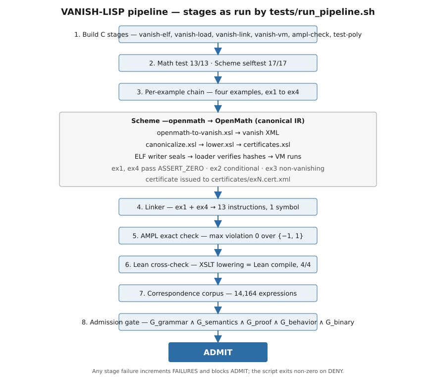
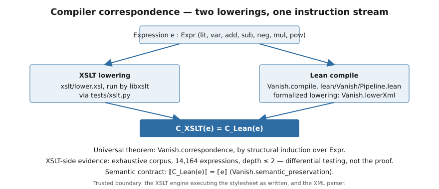
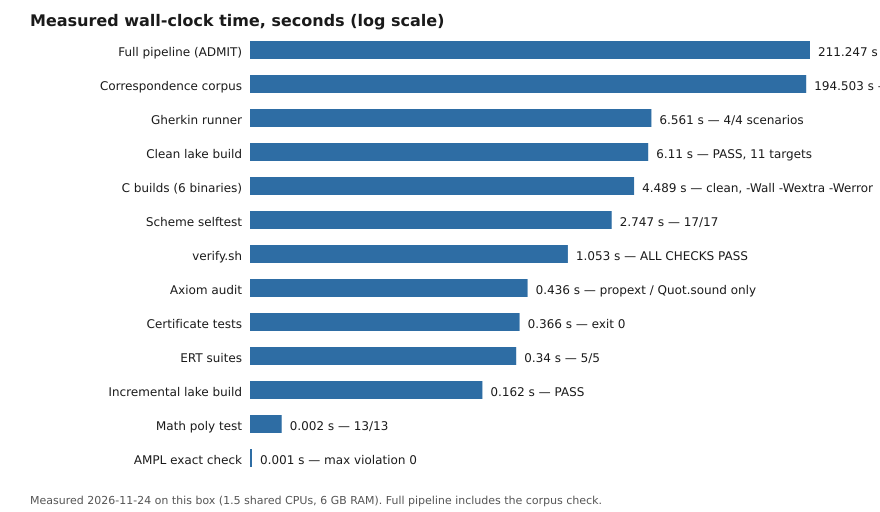
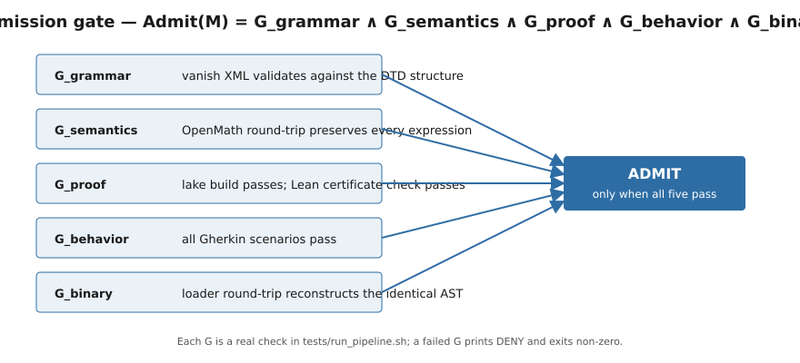

<!--
VANISH-LISP — Copyright (c) 2026 VANISH-LISP Contributors
This program is free software: you can redistribute it and/or modify
it under the terms of the GNU Affero General Public License as published
by the Free Software Foundation, either version 3 of the License, or
(at your option) any later version.

See the LICENSE file for the full text.
-->
# Licensed under AGPLv3. See LICENSE.

# VANISH-LISP — A Proof-Carrying, Constraint-Driven, Document-Oriented Lisp Dialect for Symbolic Vanishing Calculus

### Emacs Lisp · SGML · DSSSL · XSLT · OpenMath · AMPL · POP-11 · Lean 4 · ELF

[](https://github.com/AHMADALIPARR/vanish-lisp/actions/workflows/ci.yml)
[](https://lean-lang.org/)
[](LICENSE)

**VANISH-LISP Contributors · Research software · Version 0.1.0**

```
S-expression ──→ SGML document ──→ DSSSL reduction ──→ XSLT lowering
OpenMath ──→ vanish XML ──→ stack program ──→ ELF object ──→ VM
Lean 4 ──→ correspondence proof ──→ axiom audit
AMPL ──→ counterexample search ──→ exact witness ──→ Lean validation
Gherkin ──→ behavioral contracts ──→ admission gate
```

| 110 tracked files | 35 Lean theorems | 14,164 corpus expressions | 5/5 admission gates |
| --- | --- | --- | --- |
| 11,547 lines tracked | 0 sorry / 0 admit / 0 `by decide` | 4 Gherkin scenarios | ADMIT |

**Source basis:** local commit `07c3ff2` (Phase 1 correspondence), with the differential fix banked separately as `00afa4d` and the README rewrite at `a355912`. Counts and timings refer to the measured run on this box, 2026-11-24, not a fresh CI run. The CI workflow exists in `.github/workflows/ci.yml` and has never run: the repository has never been pushed.

## Contents

1. Overview
2. Architecture
3. Repository layout
4. The language: grammar, forms, and verdicts
5. Emacs Lisp: the interactive language
6. SGML: the structural grammar
7. DSSSL: the reduction rules
8. Scheme: the runnable mirror
9. XSLT: the declarative compiler
10. OpenMath: the canonical mathematical IR
11. Lean 4: semantics and universal compiler correspondence
12. ELF and the stack VM: the binary container
13. AMPL: counterexample search and the exact certificate bridge
14. POP-11: the symbolic engine
15. Gherkin: behavioral contracts
16. Certificates: issued witnesses
17. Tests: the check inventory
18. The vanishing calculator
19. Build and reproduce
20. Continuous integration
21. Benchmarks
22. Verification evidence
23. Trust boundaries
24. Axiom audit
25. Assurance matrix
26. Figure provenance
27. Provenance and licensing

## Overview

VANISH-LISP is a proof-carrying Lisp-family dialect for symbolic vanishing calculus. A vanishing problem enters as an S-expression and leaves as a sealed ELF binary carrying its own certificate, and the pipeline admits the artifact only when a Lean proof, a binary round-trip, and a behavioral contract all pass. The same expression travels through seven generations of language technology: Emacs Lisp reads it, SGML gives it a grammar, DSSSL reduces it, XSLT lowers it to a stack-machine program, OpenMath states it as canonical mathematics, Lean 4 proves the compiler correct, and ELF seals the result.

The verdict of a vanishing claim is three-valued:

$$\mathcal{V}_\Gamma(f) \in \{1, 0, \bot\}$$

`1` means the expression vanishes under the constraint set `Γ`, `0` means it does not, and `⊥` means the obligation stays unresolved. The pipeline admits an artifact only when all five gates pass:

$$\mathrm{Admit}(M) = G_{\mathrm{grammar}} \land G_{\mathrm{semantics}} \land G_{\mathrm{proof}} \land G_{\mathrm{behavior}} \land G_{\mathrm{binary}}$$

The central result is the agreement of two independently implemented compiler paths:

$$C_{\mathrm{XSLT}}(e) = C_{\mathrm{Lean}}(e)$$

combined with the semantic contract:

$$\llbracket C_{\mathrm{Lean}}(e) \rrbracket = \llbracket e \rrbracket$$

The first equality is a universal Lean theorem (`Vanish.correspondence`), proved by structural induction over the complete expression type. The second is `Vanish.semantic_preservation`. Together they are the foundation of a formally verified declarative compiler without LLVM: the stylesheet that lowers expressions and the Lean function that compiles them agree on every well-formed expression, and executing the compiled program yields exactly the value the expression denotes.

| Layer | Representation | Responsibility |
| --- | --- | --- |
| Emacs Lisp | S-expressions, macros, REPL | Interactive language and macro frontend |
| SGML | DTD grammar | Structural validity of the document |
| DSSSL | Scheme rules | Reduction and semantics |
| Scheme | Racket mirror | Runnable reduction, XML and OpenMath emission |
| XSLT | Stylesheets | Canonicalization, lowering, certificates |
| OpenMath | Content dictionaries and objects | Canonical mathematical IR |
| Lean 4 | Inductive types, theorems | Semantics, correspondence, certificate soundness |
| ELF | Sections and hashes | Sealed binary container |
| C VM | Stack machine | Execution and `ASSERT_ZERO` |
| AMPL | Optimization model | Counterexample search |
| POP-11 | Stack machine, pattern matching | Symbolic transformation and Gröbner certificates |
| Gherkin | Feature scenarios | Behavioral acceptance contracts |

## Architecture



The diagram shows the stages of `tests/run_pipeline.sh` in order. Each stage is a real check; any failure increments the failure count and blocks ADMIT. The per-example chain runs on four examples in `tests/examples/`: `ex1` `(vanish (- x x))`, `ex2` `(- (pow x 4) 1)`, `ex3` `(- x y)`, `ex4` `(* x 0)`.

The chain per example is:

```
tests/examples/exN.sexp
  -> scheme/vanish.rkt --openmath            (OpenMath, canonical IR)
  -> openmath/openmath-to-vanish.xsl         (vanish XML)
  -> xslt/canonicalize.xsl                  (canonical vanish XML)
  -> xslt/lower.xsl                         (program XML)
  -> xslt/certificates.xsl                  (certificate XML)
  -> elf/writer/vanish-elf                  (ELF object)
  -> elf/loader/vanish-load                 (verify + dump)
  -> vm/vanish-vm                           (execute)
```

The Scheme emitter also produces vanish XML directly, and the pipeline checks that the OpenMath-to-vanish-XML path produces byte-identical XML to the direct Scheme path. The Lean cross-check compares the XSLT lowering against the Lean compile for all four examples and requires an empty diff. The correspondence corpus check runs before the admission gate and compares the real XSLT lowering against the Lean compiler on 14,164 expressions.

## Repository layout

```
vanish-lisp/
├── .github/workflows/      ci.yml — GitHub Actions CI (verify.sh + full pipeline)
├── elisp/                  Emacs Lisp: reader, macros, REPL, vanish.el
├── ir/                     S-expression EBNF grammar and verification contract
├── sgml/                   vanish.dtd and grammar.sgml
├── dsssl/                  reduction.dsl and semantics.dsl
├── xslt/                   canonicalize.xsl, lower.xsl, certificates.xsl
├── scheme/                 Racket mirror of the DSSSL rules, S-exp to XML/OpenMath emitter
├── openmath/               vanish1.ocd, example objects, converters, OMDoc
├── ampl/                   vanish.mod and the exact C check
├── pop11/                  Stack machine, rewrite rules, Gröbner engine (staged, not run)
├── lean/                   Lean 4 Lake project: Vanish.* modules
├── elf/                    writer, loader, linker, ABI (opcodes, SHA-256, verify)
├── vm/                     C stack machine
├── math/                   Integer polynomial layer
├── gherkin/                vanishing.feature and the Racket runner
├── certificates/           Issued mathematical witnesses (four per pipeline run)
├── tests/                  ERT suites, pipeline runner, correspondence corpus, DTD/OpenMath checks
├── docs/figures/           SVG figures and the benchmark chart generator
├── vanishing-calculator/   Calculator kernels (PowerShell, Racket, Common Lisp, Poplog, C core)
├── Makefile                test-elisp, test-pop11, build-lean
├── verify.sh               Lean build, ERT suites, byte-compile
├── PIPELINE.md             Pipeline run instructions
└── STATUS.md               Measured status and benchmark log
```

The root is a Lake project (`lakefile.toml`, `lean-toolchain` pinned to `leanprover/lean4:v4.12.0`) and the actual system lives in the subdirectories. `vanishing-calculator/` is the calculator subsystem, kept as a subdirectory of the same repo.

## The language: grammar, forms, and verdicts

`ir/grammar.ebnf` states the language in EBNF. A program is a sequence of forms. The nine surface forms are:

| Form | Syntax | Meaning |
| --- | --- | --- |
| `vanish` | `(vanish expr)` | Prove the expression equals zero |
| `reduce` | `(reduce expr)` | Symbolic reduction |
| `normalize` | `(normalize expr)` | Canonical normal form |
| `under` | `(under (constraints) expr)` | Introduce equational and disequational assumptions |
| `derivative` | `(derivative symbol expr)` | Symbolic differentiation |
| `vanish-ideal` | `(vanish-ideal (generators ...) expr)` | Polynomial ideal membership |
| `residue` | `(residue (generators ...) expr)` | Remaining algebraic terms modulo generators |
| `witness` | `(witness (constraints) expr)` | Produce a counterexample or non-zero verdict |
| `seal` | `(seal expr)` | Emit a Lean 4 proof obligation |

An expression is an integer, a symbol, or a call to `+`, `-`, `*`, or `pow` with a non-negative integer exponent. `under` and `derivative` forms also appear inside expressions. A constraint is `(= expr expr)` or `(!= expr expr)`. A certificate carries a target expression, generators, quotients, a remainder, and a verdict of `1`, `0`, or `bot`.

`ir/contract.md` is the cross-language IR and verification contract. It separates symbolic discovery from formal verification across three layers: the surface language discovers candidate reductions and witnesses, the intermediate representations carry them without loss, and Lean 4 is the only layer that settles whether a claim holds.

The Lean syntax layer, `lean/Vanish/Syntax.lean`, defines the expression type the whole system agrees on:

```lean
inductive Expr : Type
  | lit : Int → Expr
  | var : String → Expr
  | add : Expr → Expr → Expr
  | sub : Expr → Expr → Expr
  | neg : Expr → Expr
  | mul : Expr → Expr → Expr
  | pow : Expr → Nat → Expr
```

`neg` has no template in the XSLT lowering and no element in the DTD. It is supported through the sub-from-zero encoding — `neg a` is `sub (lit 0) a` — used identically by the Scheme emitter, by Lean `compile`, and by Lean `encode`. The encoding is load-bearing: `neg a` and `sub (lit 0) a` share one XML tree, one instruction stream, and one value.

## Emacs Lisp: the interactive language

Emacs Lisp is the interactive language and macro frontend. Five files in `elisp/` provide it: `grammar.el` (validation predicates), `macros.el` (the nine surface macros), `reader.el` (S-expression reading and emission), `repl.el` (the interactive loop), and `vanish.el` (normalization, differentiation, and the verdict machinery).

The nine macros are the language the user types:

- `(vanish expr)` — prove equality to zero, returning the verdict $\mathcal{V}_\Gamma(f) \in \{1, 0, \bot\}$
- `(reduce expr)` — symbolic reduction
- `(normalize expr)` — canonical normal form
- `(under constraints expr)` — introduce equational and disequational assumptions
- `(derivative var expr)` — symbolic differentiation
- `(vanish-ideal (generators ...) expr)` — polynomial ideal membership
- `(residue (generators ...) expr)` — remaining algebraic terms modulo generators
- `(witness constraints expr)` — produce a counterexample or non-zero verdict
- `(seal expr)` — emit a Lean 4 proof obligation

The core functions are `vl-normalize`, `vl-normalize-product`, `vl-derivative`, `vl-substitute`, `vl-apply-constraints`, `vl-vanish-p`, and `vl-eval-form`. The normalizer drops factors of 1 and folds constants in n-argument products, so `(vanish (derivative x (pow x 2)))` returns `(* 2 x)`. The validators `vl-expr-p`, `vl-constraint-p`, and `vl-validate-expr` reject malformed input before it reaches the pipeline. The emitters `vl-sexp-to-pop11` and `vl-sexp-to-lean` translate one S-expression into the POP-11 engine's input and into Lean source, and `vl-emit-lean-theorem` writes a named proof obligation for a given expression and constraint set.

`vanish-repl` runs the interactive loop in the `*VANISH-LISP*` buffer. `vanish-format-verdict` renders a verdict, and `vanish-eval-expression` evaluates one form and prints the result. The customization variables `vl-pop11-executable` and `vl-lean-executable` name the external tools the REPL shells out to.

The Elisp test suites are ERT. `tests/reduction/test-reduction.el` carries the reduction suite (4 tests, including the n-ary product normalization regression test) and `tests/differential/test-differential.el` carries the differential suite (1 test: the derivative of $x^2$ vanishes to `(* 2 x)`). Both suites pass, and all five Elisp files byte-compile clean under `emacs --batch`.

## SGML: the structural grammar

The DTD in `sgml/vanish.dtd` is the structural grammar of the language:

```sgml
<!ELEMENT vanish - - (expr)>
<!ELEMENT expr - - (sub|add|mul|pow|symbol|integer)>
<!ELEMENT sub - - (expr,expr)>
<!ELEMENT add - - (expr,expr)>
<!ELEMENT mul - - (expr,expr)>
```

A `vanish` document holds exactly one `expr`. An `expr` is a `sub`, `add`, `mul`, `pow`, `symbol`, or `integer`. Each binary operator holds exactly two `expr` children. `sgml/grammar.sgml` instantiates the DTD as a document. The grammar is deliberately smaller than the surface language: it covers the expression core that the compiler lowers, and the `neg` form travels through the sub-from-zero encoding.

No SGML parser exists on this box, so `tests/check_dtd.exs` parses the DTD's ELEMENT declarations and validates each document against the declared content models. All four pipeline examples validate against the DTD structure, and a malformed `add` with a single child is rejected. The check is the `G_grammar` gate: the vanish XML for every example must validate before the pipeline admits anything.

## DSSSL: the reduction rules

The DSSSL stylesheets carry the reduction semantics as Scheme rules, standardized under ISO/IEC 10179:1996. `dsssl/reduction.dsl` defines the rewrite rules and `dsssl/semantics.dsl` defines the denotational mapping. The two supplied rules are the core of the calculus:

```scheme
(define (vanish-sub a b)
  (if (equal? a b) 0 (list 'sub a b)))

(define (vanish-mul a b)
  (cond
    ((equal? a 0) 0)
    ((equal? b 0) 0)
    (else (list 'mul a b))))
```

`vanish-sub` returns 0 when its arguments are equal and keeps the subtraction otherwise. `vanish-mul` returns 0 when either argument is 0. The same file adds the rest of the rewrite set in the same style — `vanish-add` (0 is the identity), `vanish-pow` (exponent 0 gives 1, exponent 1 gives the base), and the remaining rules covering the full rewrite set of `pop11/rewrite.p`.

`dsssl/semantics.dsl` defines `denote`, which maps every S-expression form to its meaning over the integers in an environment of `(symbol . integer)` pairs. It is the same meaning Lean's `Vanish.Semantics.eval` assigns: numbers denote themselves, symbols look up their binding, and each operator denotes the corresponding integer operation. The DSSSL layer says what every expression denotes; the Lean layer proves that the compiler preserves that denotation.

No DSSSL engine (no Jade or OpenJade) exists on this box, so `scheme/vanish.rkt` is the runnable Racket mirror of the rules. The DSSSL files are the specification of the reduction semantics; the Racket mirror is what executes it, and the Lean development is what proves it.

## Scheme: the runnable mirror

`scheme/vanish.rkt` is the Racket mirror of the DSSSL rules and the emitter that feeds the rest of the pipeline. It defines the reduction verbs `vanish-sub`, `vanish-mul`, `vanish-add`, `vanish-pow`, and `vanish-neg`; the normalizers `fold-constants`, `normalize-add`, `normalize-mul`, and `vanish-normalize`; the evaluator `denote` and the predicate `vanishes?`; and the emitters `sexp->xml` and `sexp->openmath`, which turn one S-expression into vanish XML and into OpenMath respectively. `canonical-op` maps surface operators to their canonical names, `xml-escape` handles the XML text encoding, and `read-sexp-file` reads one example file.

The program runs in four modes:

```
racket scheme/vanish.rkt --xml tests/examples/ex1.sexp out.xml
racket scheme/vanish.rkt --openmath tests/examples/ex1.sexp out.om
racket scheme/vanish.rkt --normalize tests/examples/ex1.sexp
racket scheme/vanish.rkt --selftest
```

The selftest runs 17 checks against the reduction rules, the normalizer, the evaluator, and the emitters, and passes 17/17. `scheme/batch-xml.rkt` emits XML for a whole batch of expressions in a single Racket process, so the correspondence corpus check uses the real Scheme emitter end to end instead of a reimplementation.

## XSLT: the declarative compiler

Three stylesheets in `xslt/` implement the compiler passes. `canonicalize.xsl` performs semantics-preserving structural canonicalization: an identity template copies the tree, and `integer` and `symbol` templates normalize the leaves. `lower.xsl` lowers a vanish XML tree to a stack-machine program. Its templates match `vanish|expr`, `sub`, `add`, `mul`, `pow`, `symbol`, and `integer`; each operator template recurses into its children and appends its operator, and the root template appends the trailing sequence `NORMALIZE, ASSERT_ZERO, VERIFY_PROOF, HALT`. `certificates.xsl` emits the certificate XML for one compiled program: the target AST, the lowered program, the Lean certificate reference, and the SHA-256 digests of both.

The lowering of `ex1`, `(vanish (- x x))`, is seven instructions:

```
PUSH_SYMBOL x, PUSH_SYMBOL x, SUB, NORMALIZE, ASSERT_ZERO, VERIFY_PROOF, HALT
```

Three more stylesheets in `openmath/` bridge the representations. `openmath-to-vanish.xsl` converts OpenMath to vanish XML with templates for `OMOBJ`, `OMA` (including the `vanish1` `vanishes` application and the `arith1` `minus`, `plus`, `times`, `power`, and `unary_minus` applications), `OMV`, `OMI`, and the unsupported constructs `OMF`, `OMBIND`, `OMBVAR`, `OMATTR`, and `OMR`. `vanish-to-openmath.xsl` converts the other way, and `content-mathml-to-openmath.xsl` converts Content MathML with templates for `math`, `apply` (`eq`, `minus`, `plus`, `times`, `power`, and the two-argument `minus`), `ci`, and `cn`.

All transforms run through `tests/xslt.exs`, which drives libxslt via `xsltproc`. The XSLT lowering equals the Lean compile on all four pipeline examples, and on all 14,164 corpus expressions.

## OpenMath: the canonical mathematical IR

OpenMath is the canonical mathematical IR. The custom content dictionary `openmath/vanish1.ocd` (status experimental, version 1, dated 2026-11-24, review date 2027-11-24) defines one symbol, `vanishes`, the assertion that an expression equals zero:

```xml
<CDDefinition>
  <Name> vanishes </Name>
  <Description> Asserts that an expression equals zero. </Description>
  <FMP>
    <OMOBJ>
      <OMA>
        <OMS cd="relation1" name="eq"/>
        <OMV name="e"/>
        <OMI>0</OMI>
      </OMA>
    </OMOBJ>
  </FMP>
</CDDefinition>
```

The formal mathematical property states the meaning in terms of the standard `relation1` equality: `vanishes(e)` holds exactly when `e = 0`. The dictionary's example applies it to `x - x`, the sub-self case.

The example objects cover the quartic $x^4 - 1 = 0$ in three forms — Presentation MathML, Content MathML, and OpenMath (`openmath/quartic-mathml.xml`, `openmath/quartic.om`) — and the sub-self case as OpenMath (`openmath/sub-self.om`). The three converters bridge the representations: `openmath-to-vanish.xsl`, `vanish-to-openmath.xsl`, and `content-mathml-to-openmath.xsl`. The round-trip is checked by the pipeline: vanish XML converted to OpenMath and back must be the identity on the expression, and the emitted OpenMath must be either identical to the Scheme OpenMath or the `vanishes()` wrapping of it, since the `<vanish>` root is itself the vanishing claim. `tests/check_om.exs` accepts both forms.

`openmath/omdoc/vanish.omdoc` states the theory as an OMDoc document: the `vanishes` assertion, the rewrite rules as axioms, and the soundness theorem statement referencing Lean. OpenMath describes meaning but does not prove correctness; the correspondence between the dictionaries, the POP-11 reductions, and the Lean semantics is implemented and verified by the pipeline, not assumed. The dictionary and the example objects were authored from the specification, not copied verbatim from a supplied text.

## Lean 4: semantics and universal compiler correspondence

The Lean project is a Lake package (`lakefile.toml`, `srcDir "lean"`, root `Vanish`, version 0.1.0) with 9 modules, 35 theorem declarations, and 21 definitions. It builds clean with zero errors and zero warnings under Lean 4.12.0.

| Module | Theorems | Definitions | Contents |
| --- | --- | --- | --- |
| `Vanish.lean` (root) | 3 | 0 | `vanish_sub`, `vanish_constraint`, `polynomial_vanish` — the worked vanishing facts |
| `Vanish.Syntax` | 0 | 0 | `Expr`, `Constraint`, `Verdict`, `Step`, `StepStar` — the inductive types |
| `Vanish.Semantics` | 0 | 4 | `eval`, `satisfies`, `satisfiesConstraint`, `SemanticallyVanishes` |
| `Vanish.Soundness` | 2 | 0 | `soundness_step`, `soundness_star` — reduction preserves evaluation |
| `Vanish.Termination` | 2 | 1 | `measure`, `measure_pos`, `termination_step` — reduction terminates |
| `Vanish.Ideals` | 2 | 2 | `InIdeal`, `sumProd`, `sumProd_vanishes`, `vanish_of_ideal_member` |
| `Vanish.Certificate` | 1 | 1 | `VanishingCert`, `ValidCert`, `cert_soundness` |
| `Vanish.Pipeline` | 8 | 5 | `Instr`, `compile`, `step`, `run`, `compile_correct`, and the certificate bridge |
| `Vanish.Correspondence` | 17 | 8 | `encode`, `decode`, `canon`, `lowerXml`, `boundedRun`, and the universal theorems |

The semantics is `eval`, the environment-indexed evaluator over `Expr`: literals evaluate to themselves, variables look up their binding, and each operator denotes the corresponding integer operation. `Vanish.Soundness` proves that one reduction step preserves evaluation, and that a reduction sequence does too. `Vanish.Termination` proves that reduction terminates, by a measure that decreases at every step. `Vanish.Ideals` proves that membership in the ideal generated by a set of generators makes an expression vanish: `vanish_of_ideal_member` and `sumProd_vanishes` connect the algebraic certificate to the semantic verdict. `Vanish.Certificate` defines the `VanishingCert` structure and `ValidCert` predicate and proves `cert_soundness`: a valid certificate establishes the vanishing claim.

`Vanish.Pipeline` defines the 11-instruction stack machine. `Instr` has one constructor per opcode, and `compile : Expr → List Instr` mirrors the XSLT lowering opcode for opcode. `step` executes one instruction against a stack, `run` executes a whole program, and `compile_correct` proves that executing `compile e` leaves `eval e` on the stack. `run_tail` and `run_append` are the composition lemmas the correspondence proofs build on. `program_vanishes` states the vanishing condition for a compiled program, `vanish_of_cert_program` connects a valid certificate to a vanishing program, and `CDVanishes` states the `vanish1` CD symbol `vanishes` as `eval e = 0` in every environment, with `cd_vanishes_iff_semantic` proving the equivalence to the semantic verdict.

`Vanish.Correspondence` is the universal compiler correspondence, proved by structural induction over the complete `Expr` type — `lit`, `var`, `add`, `sub`, `neg`, `mul`, `pow`, the whole type, matching the XSLT templates one to one. Its theorems are:

| Theorem | Statement |
| --- | --- |
| `decode_encode` | $\mathrm{decode}(\mathrm{encode}(e)) = \mathrm{some}(\mathrm{canon}(e))$ |
| `encode_decode` | every tree decoding to $e$ is the encoding of $e$ |
| `compile_canon` | `compile (canon e) = compile e` |
| `eval_canon` | `eval ρ (canon e) = eval ρ e` |
| `lowerXml_encode` | `lowerXml (encode e) = compile e` |
| `lowerProgram_encode` | the root template agrees with the full compiled program |
| `correspondence` / `correspondence_wf` | for every well-formed tree, `lowerXml t = compile e` |
| `compile_deterministic` / `lowerXml_deterministic` | the compiler and the lowering are total functions |
| `size_pos` | $1 \le \mathrm{size}(e)$ for every expression |
| `boundedRun_none_of_length` / `boundedRun_append` / `boundedRun_agree` | a compiled program runs identically under any stack-length cap of at least `s.length + size e` |
| `stack_safe` | `run ρ (compile e) s ≠ none` — a compiled program never underflows the stack |
| `stack_bound` | no intermediate stack exceeds `s.length + size e` |
| `semantic_preservation` | executing the compiled program yields `eval ρ e` |

One design point: `decode` returns the canonical form, not the literal input, because `neg a` and `sub (lit 0) a` share one XML tree, one instruction stream, and one value. The identification is invisible to the compiler and the semantics, and `compile_canon` and `eval_canon` prove exactly that. The size measure is 1 for a leaf, `size a + size b + 1` for a binary node, and `size a + 1` for a unary node.



The correspondence is differential-tested as well as proved. `tests/correspondence.exs` runs the real XSLT lowering on the real Scheme-emitted XML for every well-formed expression of depth at most 2 over variables `x`, `y` and literals `0`, `1` with exponents `0`, `1`, `2` — 14,148 expressions — plus 30 hand-picked edge cases (negative literals, exponent 4, deeper nesting, n-ary surface forms), 14,164 expressions in total. For each one it checks five things: the lowering run twice is byte-identical (determinism), the Scheme XML decodes to the canonical form, the lowering equals the Lean compile, the lowering equals the formalized `lowerXml`, and no trailing instruction is missing. All five checks pass on all 14,164 expressions. The Lean batch runs in chunks of 500 expressions per run because elaborating one giant `List Expr` literal is severely superlinear. The corpus check is differential testing, not the proof: the universal statement is `Vanish.correspondence` on the Lean side.

## ELF and the stack VM: the binary container

The ELF container carries the compiled program in six custom sections inside a standard ELF64 little-endian relocatable object (`ET_REL`, `EM_X86_64`), following the NOVA-ELF pattern: a standard container holding custom sections, with `Load(ELF(M)) = M` verified by the loader round-trip. `elf/abi/ABI.md` states the format, and `elf/abi/opcodes.h` defines the instruction set exactly once — the writer, loader, linker, and VM all include the same header, and the XSLT lowering and the Lean model use the same opcode names in the same order.

| Section | Contents |
| --- | --- |
| `.vanish.text` | Stack-machine instructions, 9 bytes each |
| `.vanish.ast` | The canonical vanish XML AST, exact bytes |
| `.vanish.proof` | The certificate XML, exact bytes |
| `.vanish.sym` | Symbol table, NUL-separated names in first-use order |
| `.vanish.hash` | SHA-256 digests, one `"<hex>  <section>"` line per section |
| `.note.vanish` | ABI version and metadata (ELF note, name `vanish`, type 1) |
| `.shstrtab` | Section-name string table |

Each instruction is 9 bytes: one opcode byte followed by an int64 little-endian operand. `PUSH_SYMBOL` carries a symbol-table index, `PUSH_INT` carries the integer value, and all other instructions carry zero.

| Opcode | Value | Operand |
| --- | --- | --- |
| `PUSH_SYMBOL` | 0x01 | symbol-table index |
| `PUSH_INT` | 0x02 | integer value |
| `DUP` | 0x03 | 0 |
| `ADD` | 0x04 | 0 |
| `SUB` | 0x05 | 0 |
| `MUL` | 0x06 | 0 |
| `POW` | 0x07 | 0 |
| `NORMALIZE` | 0x08 | 0 |
| `ASSERT_ZERO` | 0x09 | 0 |
| `VERIFY_PROOF` | 0x0A | 0 |
| `HALT` | 0x0B | 0 |

The writer (`elf/writer/vanish-elf.c`) recomputes both digests independently and refuses to write when they differ. The loader (`elf/loader/vanish-load.c`) verifies the hashes and reconstructs the AST; `--dump` prints the text, AST, and proof sections. The linker (`elf/linker/vanish-link.c`) combines two objects into one. The shared ABI library (`elf/abi/elfio.c`, `elf/abi/sha256.c`, `elf/abi/verify.c`) supplies the ELF I/O, the SHA-256 implementation, and the verification routines. All six C binaries build clean with `gcc -std=gnu11 -O2 -Wall -Wextra -Werror`.

The C stack machine (`vm/vanish-vm.c`) dispatches on all eleven opcodes. `PUSH_SYMBOL` and `PUSH_INT` push values, `DUP` duplicates the top of the stack, `ADD`, `SUB`, `MUL`, and `POW` combine the top two values, `NORMALIZE` runs the integer polynomial normal form from `math/poly.c`, `ASSERT_ZERO` checks the top of the stack and exits non-zero with a residual message when it is not zero, `VERIFY_PROOF` checks the certificate, and `HALT` ends the run. The integer polynomial layer in `math/` (`poly.h`, `poly.c`) supplies the normal-form arithmetic: `poly_new`, `poly_free`, `poly_copy`, `poly_const`, `poly_var`, `poly_add`, `poly_sub`, `poly_neg`, `poly_mul`, `poly_pow`, `poly_normalize`, `poly_is_zero`, `poly_equal`, `poly_is_const`, and `poly_to_string`, with `poly_var_index` and `poly_var_name` mapping variable names to indices. Its standalone test (`math/test_poly.c`) passes 13/13.

Per example, the VM outcome is: `ex1` and `ex4` pass `ASSERT_ZERO` (exit 0); `ex2` fails with residual $x^4 - 1$ (its vanishing is conditional on $x^2 - 1 = 0$, carried by the ideal certificate $x^4 - 1 = (x^2 + 1)(x^2 - 1)$); `ex3` fails with residual $x - y$ (non-vanishing). Both failures are the expected outcome and are checked as such. The linker combines `ex1` and `ex4` into 13 instructions with 1 symbol; the linked artifact loads, verifies, and runs with exit 0.

## AMPL: counterexample search and the exact certificate bridge

The AMPL model asks whether $f(x) = x^4 - 1$ vanishes everywhere subject to $x^2 - 1 = 0$, as a maximization over the feasible set:

$$\max_{x \in S} |f(x)|^2, \qquad S = \{x \in \mathbb{R} : x^2 - 1 = 0\}$$

`ampl/vanish.mod` states it directly:

```
var x;
var residual = x^4 - 1;
subject to manifold:
    x^2 - 1 = 0;
maximize violation:
    residual^2;
```

A certified global maximum of zero establishes vanishing over the feasible set. AMPL is not installed on this box, so `ampl/check.c` is the exact certified equivalent: it enumerates the feasible set $\{-1, 1\}$ in integer arithmetic and reports the maximum violation 0. A numerical solver result alone is not a proof; Lean remains the final mathematical authority, and the bridge converts the solver-discovered candidate into the exact witness — the feasible points with their residuals and the factorisation — that Lean validates. The witness for `ex2` is the ideal certificate $x^4 - 1 = (x^2 + 1)(x^2 - 1)$ with remainder 0.

## POP-11: the symbolic engine

POP-11 is the symbolic transformation engine. Six files in `pop11/` provide it, loaded in order by `pop11/vanish.p`:

| File | Contents |
| --- | --- |
| `stack.p` | Open value stack: `vl_stack`, `vl_stack_reset`, `vl_push` |
| `rewrite.p` | Pattern-matching term rewrite rules: `vl_rewrite_step` |
| `normalize.p` | Canonical multivariate polynomial normalizer (sparse terms, graded reverse lexicographic order): `vl_mono_mul` and the normal form |
| `polynomial.p` | Multivariate polynomial division and reduction: `vl_mono_divides` and the division step |
| `groebner.p` | S-polynomials, Buchberger reduction, and vanishing certificates: `vl_mono_lcm` and the Gröbner engine |
| `vanish.p` | Top-level reduction engine, loading the five siblings by bare filename |

`vl_rewrite_step` pattern-matches on the expression: a `sub` of equal arguments rewrites to 0, a `mul` with a zero factor rewrites to 0, and the remaining rules cover the full rewrite set the DSSSL file states in Scheme form. The normalizer represents a sparse polynomial as a list of `[coeff mono]` terms, where a monomial is an association list of `[var exp]` pairs sorted by variable name and terms are sorted in graded reverse lexicographic order. The Gröbner engine builds S-polynomials from monomial least common multiples and reduces them by Buchberger's method, producing the ideal certificates the pipeline seals.

POP-11 is staged, not run: no `pop11` binary exists on this box, so `make test-pop11` cannot execute here. The files are present and scanned, and the Gherkin runner drives the POP-11 reduction through the Scheme mirror of `pop11/rewrite.p`, so the behavioral contracts still exercise the rewrite rules. `tests/algebra/ideal-cases.p` holds the ideal test cases the engine runs when a POP-11 runtime is available.

## Gherkin: behavioral contracts

`gherkin/vanishing.feature` states four scenarios as acceptance contracts, each bound by `gherkin/runner.rkt` to a real pipeline stage:

| Scenario | Binding |
| --- | --- |
| Polynomial vanishing under constraints | POP-11 reduction, AMPL search, Lean certificate |
| Unresolved mathematical obligation | `x - y` stays unresolved; admission denied |
| Binary round-trip preservation | ELF seal, loader read-back, identical AST, matching hashes |
| Compiler correspondence and stack safety | `tests/correspondence.exs --one`, `tests/axioms.lean`, `stack_safe`, `stack_bound`, decode round-trip |

The first scenario is verbatim as supplied: given polynomial `x^4 - 1` and constraint `x^2 - 1 = 0`, when POP-11 reduces the expression, AMPL searches for a counterexample, and Lean validates the algebraic certificate, then the polynomial shall be classified as vanishing, the symbolic residual shall equal zero, and the ELF artifact shall contain a verified certificate. The steps of the second and third scenarios were written in the same style from their titles and are noted as such in the feature file. The fourth scenario runs the per-expression correspondence check on the scenario polynomial, checks the Lean correspondence theorems, and asserts that the XSLT lowering equals the Lean compile, that the lowering is deterministic, that the compiled program never underflows the stack, that the stack depth is bounded by the expression size, and that the XML decodes to the original expression. The runner carries `corr` and `axioms` context fields for the correspondence and axiom checks. All four scenarios pass.

## Certificates: issued witnesses

Each pipeline run issues one certificate XML per example into `certificates/`. A certificate carries the target AST, the lowered program, the Lean certificate reference, the witness, and the SHA-256 digests of the AST and the program. The `ex1` certificate shows the shape:

```xml
<certificate>
  <target><vanish><expr><sub><expr><symbol>x</symbol></expr>
  <expr><symbol>x</symbol></expr></sub></expr></vanish></target>
  <program>
    <instruction opcode="PUSH_SYMBOL">x</instruction>
    <instruction opcode="PUSH_SYMBOL">x</instruction>
    <instruction opcode="SUB"/>
    <instruction opcode="NORMALIZE"/>
    <instruction opcode="ASSERT_ZERO"/>
    <instruction opcode="VERIFY_PROOF"/>
    <instruction opcode="HALT"/>
  </program>
  <lean><module>Vanish.Certificate</module><theorem>cert_soundness</theorem></lean>
  <witness><generators/><quotients/><remainder>0</remainder></witness>
  <hashes>
    <hash section=".vanish.ast" algorithm="sha256">696ddd60f1a5e26260e2ef0fc0f3a878e0722cece7875e57d907b210ffd23f74</hash>
    <hash section=".vanish.text" algorithm="sha256">18ece24fa183370080103ddb3491086b1e2184151eddfdaf8275a2f6bb25c2fa</hash>
  </hashes>
</certificate>
```

The witness records the generators, the quotients, and the remainder. For `ex2` the generators carry `x^2 - 1` and the quotients carry `x^2 + 1`, the factorisation that witnesses the conditional vanishing. For `ex3` the remainder records `x - y`, the unresolved residual. The hashes bind the certificate to the exact bytes of the AST and the program it certifies; the ELF writer stores the certificate in `.vanish.proof` and the loader verifies the digests before the VM runs anything.

## Tests: the check inventory

`tests/` holds every check the pipeline and the CI run, plus the harnesses that drive them:

| Check | File | What it runs |
| --- | --- | --- |
| Reduction suite | `tests/reduction/test-reduction.el` | 4 ERT tests on the Elisp normalizer and reducer |
| Differential suite | `tests/differential/test-differential.el` | 1 ERT test: the derivative of $x^2$ normalizes to `(* 2 x)` |
| Axiom audit | `tests/axioms.lean` | `#print axioms` on the 13 audited theorems |
| Certificate tests | `tests/certificates/CertificateTests.lean` | Lean checks on the certificate machinery |
| Lean cross-check | `tests/lean-cross-check.lean` | Prints the Lean compile for the four examples (30 lines) |
| Correspondence corpus | `tests/correspondence.exs`, `tests/correspondence.sh` | 14,164 expressions, five checks each |
| DTD check | `tests/check_dtd.exs` | Validates vanish XML against the DTD's declared content models |
| OpenMath check | `tests/check_om.exs` | Accepts the identical object or the `vanishes()` wrapping |
| XSLT driver | `tests/xslt.exs` | Runs every stylesheet through xsltproc/libxslt |
| Program text | `tests/program_to_text.exs` | Renders a program XML as instruction text for the diff |
| Pipeline runner | `tests/run_pipeline.sh` | The full chain plus the admission gate |
| Ideal cases | `tests/algebra/ideal-cases.p` | POP-11 ideal test cases, staged |
| Examples | `tests/examples/ex1.sexp` … `ex4.sexp` | The four pipeline examples |

`./verify.sh` runs the fast checks: `lake build`, the two ERT suites, and the Elisp byte-compile check. It prints `ALL CHECKS PASS` and exits 0. `bash tests/run_pipeline.sh` runs the full chain and prints `ADMIT` or `DENY`; it exits non-zero on `DENY`. Intermediate artifacts and binaries land in `tests/.pipeline-work/` (gitignored); the issued certificate XML for each example lands in `certificates/`.

## The vanishing calculator

`vanishing-calculator/` is the calculator subsystem, kept as a subdirectory of the same repo. It is a self-modifying calculator in five kernels plus the Org Babel Lean 4 bridge. Run once visible, it prints Fibonacci(10), Primes(30), and Factorial(5), then hides its engine as a base64 payload. Run again hidden, it restores the engine. Run again, it calculates and hides again.

| Kernel | File | Runtime |
| --- | --- | --- |
| PowerShell | `vanishing_calculator.ps1` | PowerShell 7.4.6 |
| Racket | `vanishing_calculator.rkt` | Racket 8.15 |
| Common Lisp | `vanishing_calculator.lisp` | SBCL 2.2.9 |
| Poplog | `vanishing_calculator.p` | Poplog / Pop-11, staged, not run here |
| C core | `vanishing_calculator.c` | gcc, arena Lisp with `vanish!`, `fib(10)` then vanish |

`ob-lean4.el` is the Org Babel support for Lean 4 (runs blocks through `lean --json`), verbatim upstream from the `ob-lean` project, with `ob-lean4-test.el` as its end-to-end test. `verify.py` is the round-trip verifier: run 1, 2, and 3 per runnable kernel, plus the C core and `ob-lean4.el` checks — 66 checks, 0 failures. The demo vectors are Fibonacci(10) `[0,1,1,2,3,5,8,13,21,34]`, Primes(30) `[2,3,5,7,11,13,17,19,23,29]`, and Factorial(5) `120`. Every run rewrites its own file, so each kernel runs on a copy first.

## Build and reproduce

### Toolchain

| Component | Requirement or configuration |
| --- | --- |
| Lean | `leanprover/lean4:v4.12.0` via elan (`~/.elan/bin`) |
| Lake | 5.0.0, from the pinned Lean toolchain |
| gcc | 13.3.0, `-std=gnu11 -O2 -Wall -Wextra -Werror` |
| Racket | 8.15, `~/workspace/.tools/racket/bin/racket` |
| Emacs | 29.3, for the ERT suites and byte-compile |
| Elixir | 1.20.5 / OTP 29, with `xsltproc` (libxslt) for the XSLT stages |

```
git clone <repo>
cd vanish-lisp
lake build
```

### Individual gates

```
./verify.sh                  # Lean build, ERT suites, byte-compile
bash tests/run_pipeline.sh   # Full chain plus the admission gate; prints ADMIT or DENY
bash tests/correspondence.sh # Correspondence corpus check on its own
make test-elisp              # Reduction and differential ERT suites
lake env lean tests/axioms.lean  # Axiom audit
racket gherkin/runner.rkt --root . --work tests/.pipeline-work gherkin/vanishing.feature
```

Each stage also runs on its own. The Scheme emitter, the XSLT driver, and the C stage build commands are listed in full in PIPELINE.md. The pipeline writes its intermediate artifacts and binaries to `tests/.pipeline-work/` (gitignored) and the issued certificates to `certificates/`.

## Continuous integration

`.github/workflows/ci.yml` runs the repository's real checks on every push and pull request. The workflow installs the toolchain a fresh runner needs — elan with the pinned Lean 4.12.0 toolchain, Racket and Emacs from apt, and Elixir — then runs `./verify.sh` followed by the full `bash tests/run_pipeline.sh`. The pipeline script expects Racket at `~/workspace/.tools/racket/bin/racket`, so the workflow creates that path and symlinks the installed Racket binary there; no repository script is modified for CI.

The CI badge at the top of this README is wired to that workflow. It has never run and shows no result yet: the repository has never been pushed, so no CI run exists. The badge lights up on the first push. The workflow file is the real gate — it runs the same two commands a local checkout runs, with nothing skipped.

## Benchmarks

All timings are measured wall-clock seconds on this box (1.5 shared CPUs, 6 GB RAM), 2026-11-24. The raw commands are recorded in STATUS.md. The full pipeline run includes the corpus check, which dominates it.

| Gate | Wall time | Result |
| --- | --- | --- |
| Full pipeline | 211.247 s | ADMIT, 5/5 gates |
| Correspondence corpus | 194.503 s | PASS, 14,164 expressions |
| Gherkin runner | 6.561 s | 4/4 scenarios |
| Clean lake build | 6.110 s | PASS, 11 targets |
| C builds (6 binaries) | 4.489 s | clean, `-Wall -Wextra -Werror` |
| Scheme selftest | 2.747 s | 17/17 |
| verify.sh | 1.053 s | ALL CHECKS PASS |
| Axiom audit | 0.436 s | propext / Quot.sound only |
| Certificate tests | 0.366 s | exit 0 |
| ERT suites | 0.340 s | 5/5 |
| Incremental lake build | 0.162 s | PASS |
| Math poly test | 0.002 s | 13/13 |
| AMPL exact check | 0.001 s | max violation 0 |



The corpus check is slow because the Lean batch elaborates one `List Expr` literal per chunk of 500 expressions, and that elaboration is severely superlinear (1,000 fast, 2,000 slow, 4,000 does not finish in 280 s). The chart uses a log scale because the timings span five orders of magnitude.

## Verification evidence

| Subsystem | Recorded result | Evidence |
| --- | --- | --- |
| Lean build | PASS, 11 targets | `lake build`, exit 0 |
| ERT reduction | 4/4 | `make test-elisp` |
| ERT differential | 1/1 | `make test-elisp` |
| Byte-compile | PASS, 5 files | `verify.sh` |
| Scheme selftest | 17/17 | `racket scheme/vanish.rkt --selftest` |
| Math poly test | 13/13 | `test-poly` |
| XSLT–Lean cross-check | 4/4 examples | `tests/lean-cross-check.lean`, diff empty |
| Correspondence corpus | 14,164 expressions, 5 checks green | `tests/correspondence.exs` |
| AMPL exact check | max violation 0 | `ampl/check.c` |
| Gherkin | 4/4 scenarios | `gherkin/runner.rkt` |
| Admission gate | ADMIT, 5/5 gates | `bash tests/run_pipeline.sh`, exit 0 |

## Trust boundaries



| Evidence class | Meaning | Boundary |
| --- | --- | --- |
| Kernel proof | A Lean proposition is accepted | Depends on its hypotheses and transitive axioms |
| Finite exact computation | A specified concrete computation is established | Does not generalize automatically to all inputs |
| Corpus agreement | The real stylesheet and the Lean compile agree on 14,164 expressions | Does not prove all-input XSLT equivalence; the universal statement is `Vanish.correspondence` on the Lean side |
| Numeric comparison | Recorded outputs satisfy a comparison predicate | Does not prove all-input equivalence |
| Recorded log | Historical driver outcome | Must be regenerated for current-revision assurance |

The Lean model is not the stylesheet. The rule-by-rule correspondence table in `lean/Vanish/Correspondence.lean` and in PIPELINE.md is the explicit connection between the formalized transformation semantics and the actual stylesheet, template by template. What remains trusted, and is not proved in Lean, is the XSLT 1.0 engine executing `xslt/lower.xsl` as written (here libxslt, via `tests/xslt.exs`) and the XML parser that reads the vanish XML. A second boundary: Lean `Int` is unbounded while the C ELF encoding carries int64 operands, so the binary correspondence holds for literals inside the int64 range; the corpus uses small literals. POP-11 is staged, not run: no `pop11` binary exists on this box, and the Gherkin runner drives the POP-11 reduction through the Scheme mirror of `pop11/rewrite.p`.

The tool substitutions on this box are stated plainly: XSLT runs through libxslt via the native `xsltproc` binary; no SGML parser, so the DTD check parses the DTD's ELEMENT declarations and enforces them directly; no DSSSL engine, so the Racket mirror runs the rules; no AMPL, so the exact C check enumerates the feasible set. Each substitution names the same engine or the exact equivalent, and none of them changes what the check establishes.

## Axiom audit

`lake env lean tests/axioms.lean` reports the axiom dependencies of the thirteen audited theorems. There are no custom axioms and no `sorryAx`. The audit was re-run for this revision and prints exactly these dependencies:

| Dependency | Theorems |
| --- | --- |
| `propext` and `Quot.sound` (8) | `correspondence`, `correspondence_wf`, `encode_decode`, `boundedRun_agree`, `stack_safe`, `stack_bound`, `semantic_preservation`, `compile_correct` |
| `propext` only (3) | `decode_encode`, `lowerXml_encode`, `lowerProgram_encode` |
| No axioms (2) | `compile_deterministic`, `lowerXml_deterministic` |

`compile_deterministic` and `lowerXml_deterministic` depend on no axioms at all. Every other audited theorem depends only on the standard Lean axioms `propext` and `Quot.sound`. A theorem with an empty axiom set still depends on the correctness of the Lean kernel and on the intended interpretation of its statement.

## Assurance matrix

| Area | Established in this revision | Stronger obligation |
| --- | --- | --- |
| Compiler correspondence | Universal Lean theorem over the complete `Expr` type; corpus agreement to depth 2 | Universal proof about the XSLT engine's execution |
| Stack safety | `stack_safe` and `stack_bound` for every compiled program | Machine-checked bound on the C VM's stack |
| Semantic preservation | `semantic_preservation` for every expression | End-to-end preservation through the ELF encoding |
| Binary round-trip | Loader reconstructs the identical AST; hashes match; tamper rejection is not yet tested | Negative tamper test in the pipeline |
| OpenMath conformance | Converters and round-trip checks pass | Validation against the OpenMath and MathML schemas |
| AMPL bridge | Exact witness from the feasible set, validated by Lean | General solver-to-witness translation |
| POP-11 | Staged source, Scheme mirror tested 17/17 | A POP-11 runtime on this box |
| xsltproc | Native `xsltproc` binary (libxslt) | — |
| CI | Workflow file runs the real checks on push and pull request | A first push, so the badge shows a real run |

The stronger obligations are research directions, not empty implementation slots. They preserve the existing mathematics and make the next proof boundary explicit.

## Figure provenance

| Figure | Source basis |
| --- | --- |
| Pipeline diagram | The stages of `tests/run_pipeline.sh`, in order |
| Correspondence diagram | `Vanish.correspondence` and the XSLT–Lean lowering agreement |
| Admission gate diagram | The five gates of the admission gate in `tests/run_pipeline.sh` |
| Benchmark chart | Measured wall-clock times in `docs/figures/benchmarks.tsv`, rendered by `docs/figures/gen-benchmarks.py` |

All figures are SVG in `docs/figures/`. The benchmark chart is generated from measured data; the other three are structural diagrams drawn from the pipeline stages, the correspondence theorem, and the admission gate as they run.

## Provenance and licensing

The source was supplied as `vanish-lisp.zip` (29 files, sha256 `53c5393dc70edf04969c89959fc7d1fab77c0451599f67352d1c120b60f8197a`), verified byte-for-byte against `MANIFEST.sha256`. The local history is `d87e77d` (combined repo), `6f573d6` (pipeline), `d722a6d` (title), `00afa4d` (differential fix), `07c3ff2` (Phase 1 correspondence), `a355912` (README rewrite with measured benchmarks). Nothing is pushed; no destination or token was named. The `vanishing-calculator/` subdirectory holds the calculator kernels copied from the pirtm-hcalc repo; its own `verify.py` passes 66 checks, 0 failures.

The repository is licensed under the GNU Affero General Public License v3, Copyright (c) 2026 VANISH-LISP Contributors. No personal name appears in it.

---

**VANISH-LISP — A Proof-Carrying, Constraint-Driven, Document-Oriented Lisp Dialect for Symbolic Vanishing Calculus.**
